<div align="center">


# Nightglide CLI v1.0.0

> **Build beyond the horizon. / 漫翔苍穹，构筑所想。**

[](CHANGELOG.md)
[](docs/OMP_BASELINE.md)
[](#核心特性--features-overview)
[](#中英双语设置与分层菜单)
[-10b981)](docs/SECURITY.md)
[](docs/LICENSE_POLICY.md)

</div>

**Nightglide CLI** 是基于 [**Oh My Pi (OMP) v18.20.2**](https://github.com/can1357/oh-my-pi) 构建的终端 AI 编程助手。它在完整保留 OMP 引擎能力、工具链、扩展与 `~/.omp` 生态兼容性的同时，带来 **Glide 全屏工作台**、**7 套手工主题与双侧像素场景**、**5 位可选像素伙伴**、**中英双语（`zh`/`en`）图形界面**、**四档本地/云端路由**，以及默认 **`write` 高风险询问** 的安全基线。

Built atop **Oh My Pi (`v18.20.2`)**, Nightglide CLI delivers a self-managed fullscreen **Glide TUI**, **7 handcrafted themes**, **5 selectable 10×5 pixel companions**, **bilingual (`zh`/`en`) UX**, **4-mode model routing**, and **`write` (ask-when-risky) approval safety by default**—while staying 100% compatible with `~/.omp` and leaving any existing `omp` binary untouched.

---

## 目录 / Table of Contents

- [界面预览 / Showcase Gallery](#界面预览--showcase-gallery)
- [核心特性 / Features Overview](#核心特性--features-overview)
- [安装指南 / Installation (`v1.0.0`)](#安装指南--installation-v100)
- [IDE 与终端推荐 / Recommended IDEs, Terminals & Fonts](#ide-与终端推荐--recommended-ides-terminals--fonts)
- [快速上手、快捷键与文档 / Quick Start, Shortcuts & Docs](#快速上手快捷键与文档--quick-start-shortcuts--docs)
- [安全模型与已知边界 / Security Model & Known Boundaries](#安全模型与已知边界--security-model--known-boundaries)
- [许可与致谢 / License & Attribution](#许可与致谢--license--attribution)

---

## 界面预览 / Showcase Gallery

<p align="center">
  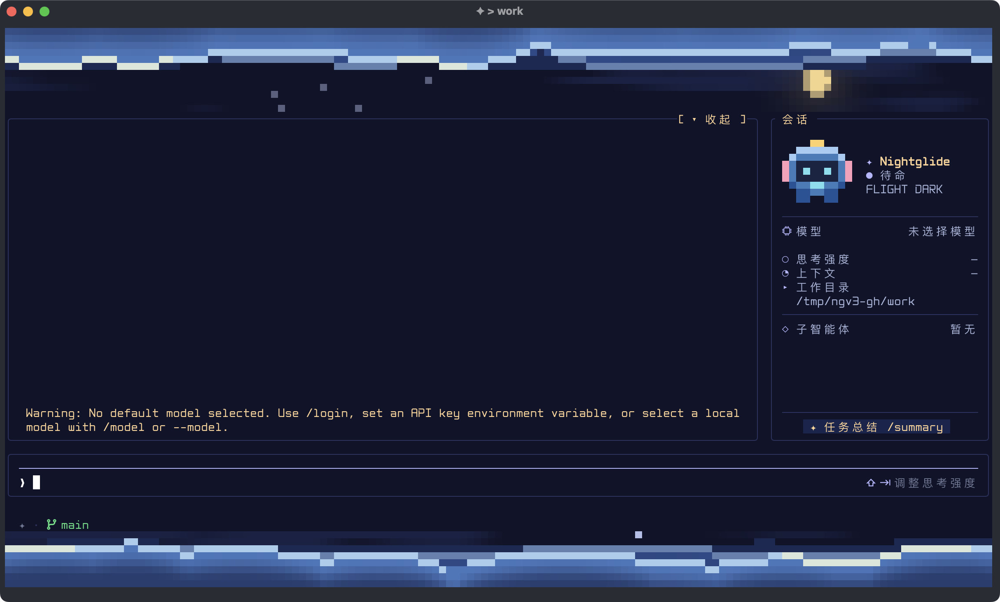
</p>
<p align="center"><em>默认暗色主题 <code>nightglide-flight</code>（夜航模式）：顶底双侧视差云海 + <code>Ctrl+N</code> 展开侧边栏与 10×5 像素伙伴</em></p>

| 主题与工作台场景 | 预览 / Preview |
|---|---|
| **Flight（默认收起侧栏）**<br>默认收起右侧栏以专注对话；顶部 `[ ▸ 详情 ^N ]` 或 `Ctrl+N` 随时展开 | 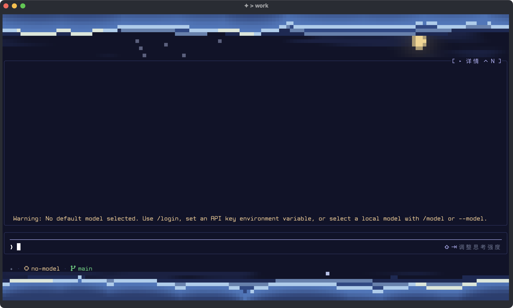 |
| **Iris（虹彩柔云浅色）**<br>柔和粉彩光谱云海与日晕高光（`nightglide-iris`） | 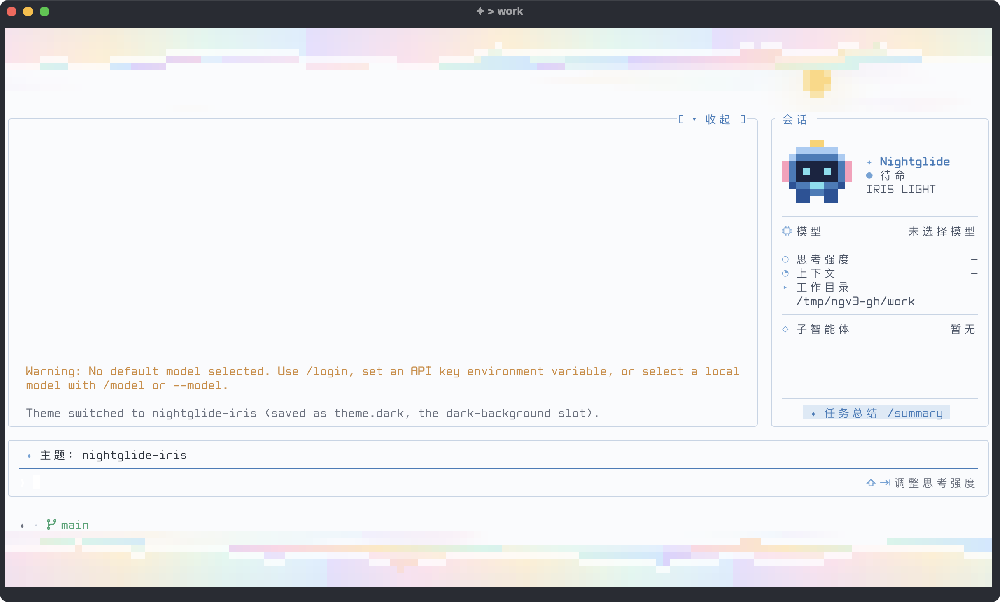 |
| **Daybreak（温润日光深潜）**<br>象牙暖底 `#fffaf2` 与浅海光柱水草（`nightglide-daybreak`） | 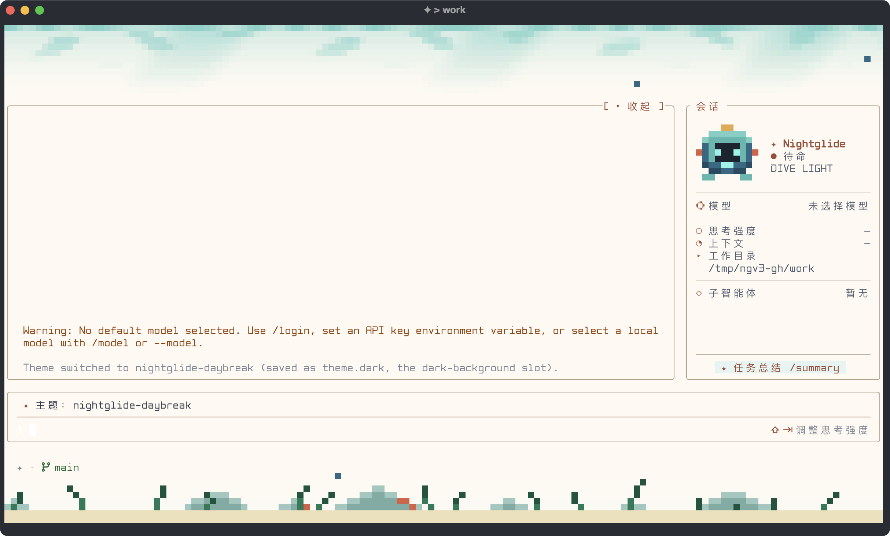 |
| **Abyss Trench（深渊荧光）**<br>高对比深渊海沟与青绿冷光（`nightglide-abyss-trench`） | 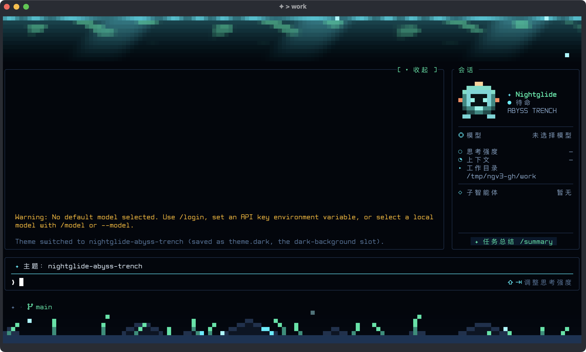 |
| **Cloudlight + 星云猫耳伙伴**<br>晴空流云亮色主题搭配 `cat` 像素伙伴（`nightglide-cloudlight`） | 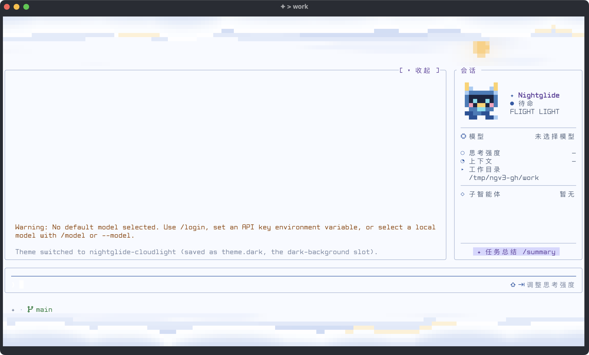 |
| **Aurora（极光帘幕）**<br>绿紫极光帘幕与山脊剪影（`nightglide-aurora`） | 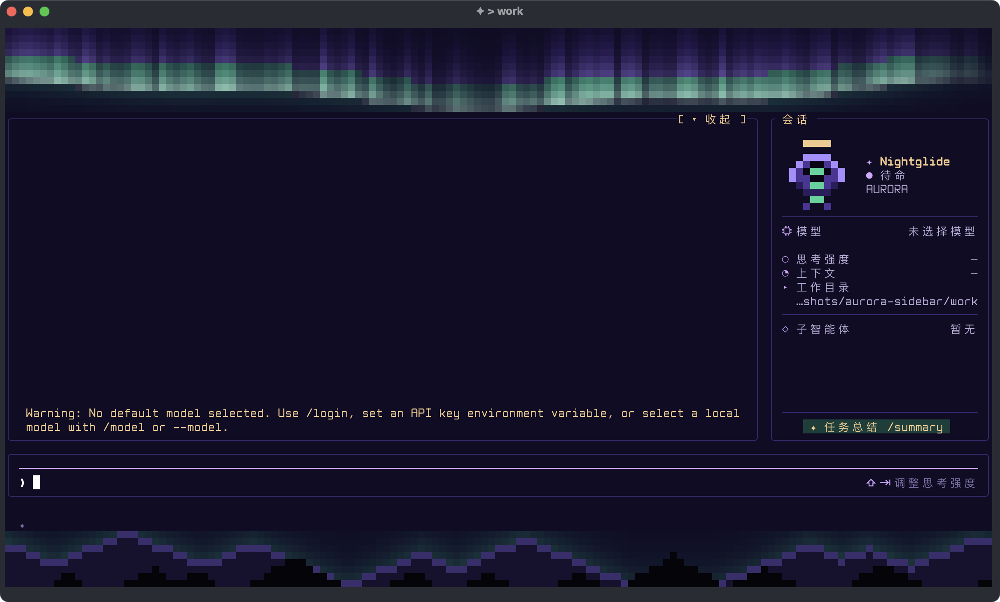 |

<details>
<summary><strong>更多界面截图：首次启动向导、图形设置页、/summary 弹窗与 80×24 窄屏适配 / More UI Views</strong></summary>

| 功能界面 / Surface | 预览 / Preview |
|---|---|
| **首次启动画面与向导 (`/setup`)**<br>46×5 实心方块 `NIGHTGLIDE` 字标与星海波纹入场 | 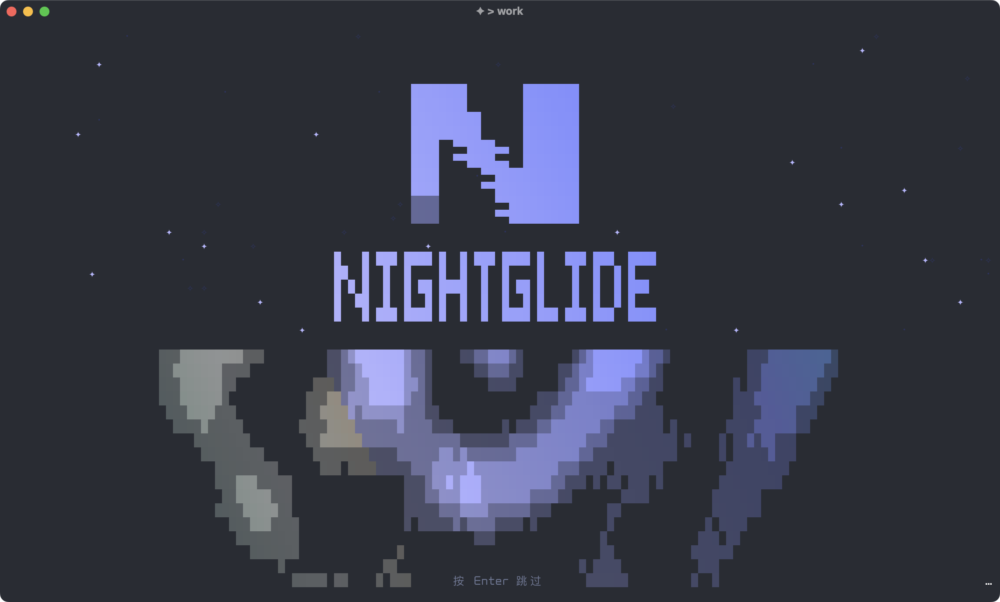 |
| **图形化设置页 (`/settings`)**<br>左侧分类栏 + 右侧主题卡片、动效开关与像素伙伴实时预览 | 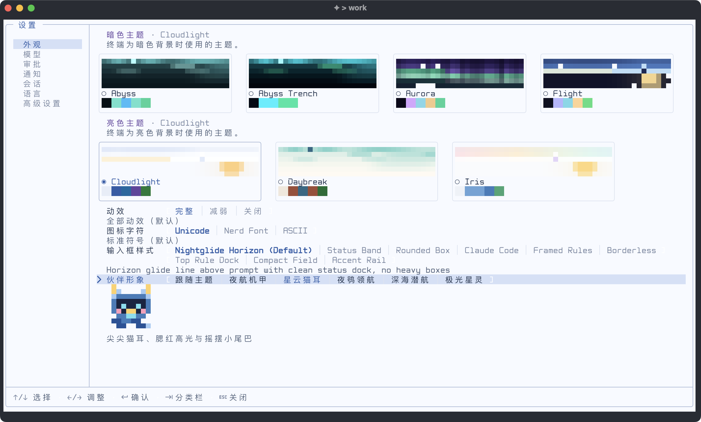 |
| **任务总结弹窗 (`/summary`)**<br>离线本地事实汇总（轮次/工具/文件/子智能体）+ 按需 AI 总结 | 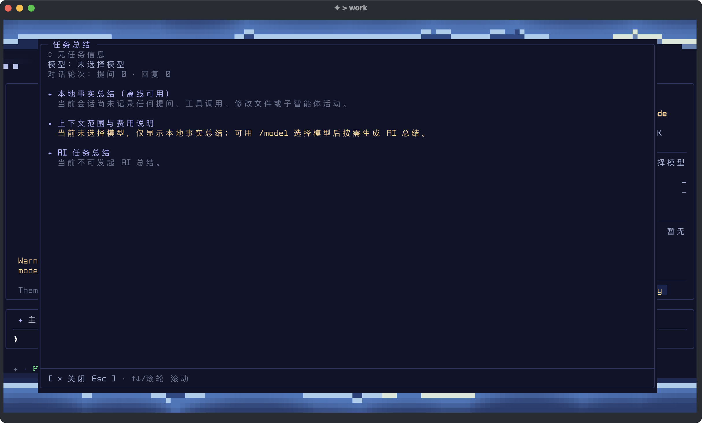 |
| **80×24 窄屏自适应**<br>自动收起侧栏与场景带并将模型状态回收到状态栏，核心编辑始终可用 | 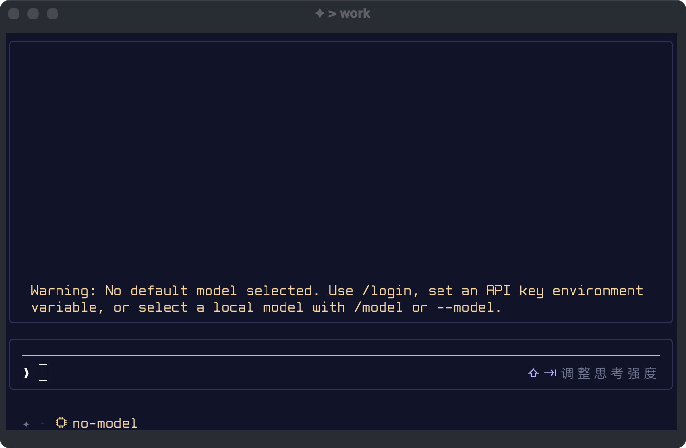 |
| **Web 统计面板（Flight Dark · 中文）**<br>`nightglide stats` 本地统计仪表盘：几何 `N` 徽标、Flight Dark 配色与实时 `中 / EN` 切换 | 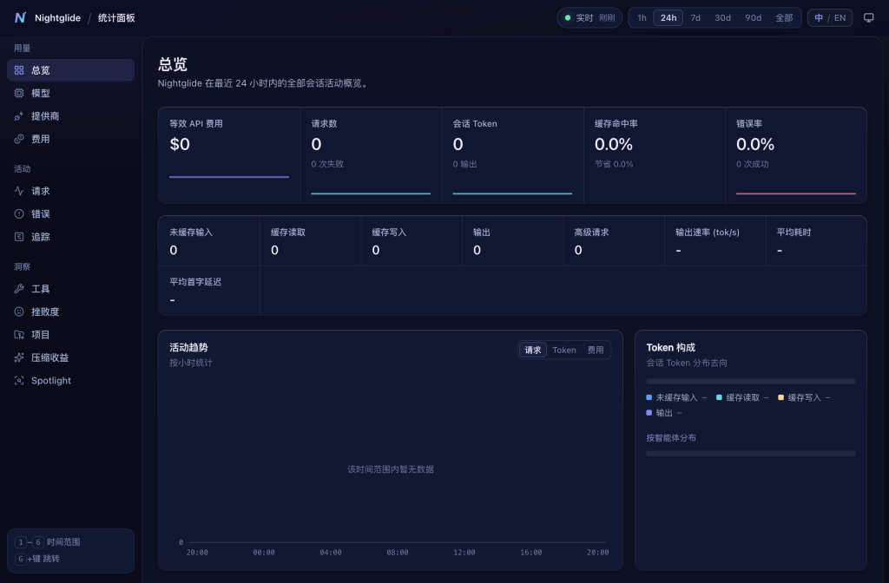 |
| **Web 统计面板（Cloudlight · EN）**<br>一键切换 Cloudlight 浅色主题与中英双语，支持会话费用、追踪、工具与压缩收益分析 | 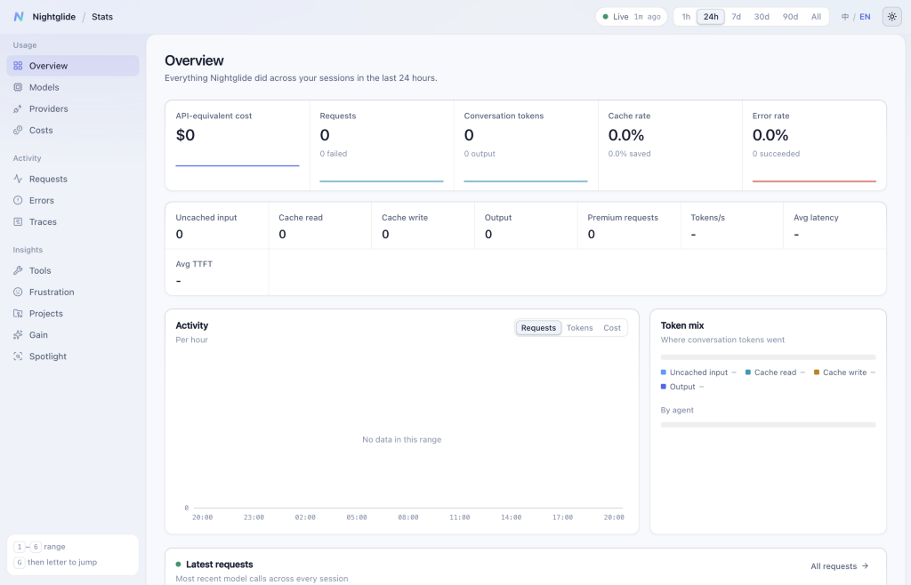 |

</details>

---

## 核心特性 / Features Overview

### 1. Glide 全屏工作台 (Glide Fullscreen TUI)
- **自管 alt-screen 整窗布局**：通过 `TUI.setScreenProvider` 接管全屏，顶部与底部绘制动态像素场景带，中部为主对话面板与默认收起的信息侧边栏，底部为固定输入框卡片与状态栏（经典 inline 入口已移除）。
- **稳态回看与锚定**：支持鼠标滚轮、`PgUp`/`PgDn` 回看长输出；回看期间自动锚定顶部 3 行，防止流式输出把视图拖回底部；按 `End` 或点击顶部 `↑ 回看中 · End 或点此回到底部` 标签立即回到实时尾部。
- **G3 内容卡片与双语审批框**：统一用户消息卡、`✦ Nightglide` 回复头、工具/Diff 卡片与中英双语审批框（修复输入框焦点下 `[y]`/`[s]`/`[n]` 误写入草稿的问题，支持 `Ctrl+Q` / `Ctrl+Enter` 安全批准）。
- **可折叠信息侧边栏 (`Ctrl+N`)**：默认收起；点击顶部 `[ ▸ 详情 ^N ]` 或按 `Ctrl+N` 展开后显示：
  - 像素伙伴 + 实时状态（待命 / 思考中 / 工具中 / 已完成）
  - 当前模型、提供商、`路由模式` 与重试回退提示（`↩ 回退 …`）
  - 思考强度条（按实际生效值渲染；不支持思考的模型显示「此模型不支持」或 `—`）
  - 上下文用量（未知窗口时显示 `—`）与尾部优先保留的 `工作目录`
  - 可点击展开/收起的子智能体列表与底部 `✦ 任务总结 /summary` 胶囊按钮
  - 终端宽度 `< 100` 列时自动隐藏侧边栏，并将模型段动态交还底部状态栏显示。

### 2. 7 套手工主题与双侧场景 (7 Handcrafted Themes)

Nightglide 移除上游默认主题包，精简并重制了 **7 套主题**（**3 亮色 + 3 暗色 + 1 极光**），由 `resolveFramePalette` 直接基于主题 JSON 推导外框与导出配色，并支持 `/theme <名称>`（可用短名或别名）立即切换与持久化：

| 类别 | 主题 ID | `/theme` 短名 | 场景家族 | 视觉特征 / 适用环境 |
|---|---|---|---|---|
| **Dark (暗色)** | `nightglide-flight` | `flight` *(默认暗色 / `dark`)* | `flight` | 深夜星海、前后双层视差云海与金色细光带 |
| **Dark (暗色)** | `nightglide-abyss` | `abyss` | `dive` | 深海蓝绿水体、水面斜光柱、摇曳海草与气泡微粒 |
| **Dark (暗色)** | `nightglide-abyss-trench` | `abyss-trench` / `trench` | `dive` | 极深海沟高对比青绿荧光底色与微光浮游 |
| **Light (亮色)** | `nightglide-cloudlight` | `cloudlight` *(默认亮色 / `light`)* | `flight` | 晴空亮蓝白底，顶底双侧柔和流云与暖金日光 |
| **Light (亮色)** | `nightglide-daybreak` | `daybreak` | `dive` | 象牙暖底（`#fffaf2`）与清透浅海光柱、珊瑚点缀 |
| **Light (亮色)** | `nightglide-iris` | `iris` | `flight` | 浅色虹彩卷云，紫/粉/薄荷/金多色光谱高光波纹 |
| **Aurora (极光)** | `nightglide-aurora` | `aurora` | `aurora` | 绿紫渐变极光帘幕、启动扫掠动效与暗色山脊剪影 |

> **兼容与自定义**：旧配置中的 `dark` / `light` 自动映射到 `nightglide-flight` / `nightglide-cloudlight`；用户自定义主题（`~/.omp/agent/themes/*.json`）继续可用，并会自动合成匹配的外框与场景调色板。场景速度与细节密度跟随**实际生效的思考强度**变化；传入 `--motion none` 或在 `/settings` 关闭动效可锁定静态帧。

### 3. 5 位可选像素伙伴 (5 Pixel Companions)

侧边栏顶部提供 **10×5 半块（`10×10` 像素）精灵伙伴**，仅根据真实会话状态（`idle` / `thinking` / `tools` / `done`）响应与微动，绝不伪造推理进度；在 `/settings` →「外观」可实时预览并自由搭配任意主题：

| 样式值 (`nightglide.robotStyle`) | 中文名称 | English Name | 造型特色 |
|---|---|---|---|
| `auto` *(默认)* | 跟随主题 | Match theme | Flight 主题匹配 `glider`，Dive 匹配 `diver`，Aurora 匹配 `prism` |
| `glider` | 夜航机甲 | Sky Glider | 圆润流线头盔配流光侧翼 |
| `cat` | 星云猫耳 | Nebula Cat | 尖尖猫耳、腮红高光与摇摆小尾巴 |
| `owl` | 夜鸮领航 | Night Owl | 羽毛耳簇、圆亮夜视大眼与折翼 |
| `diver` | 深海潜航 | Deep Diver | 圆形舷窗头盔与灵动双鳍 |
| `prism` | 极光星灵 | Aurora Sprite | 悬浮光环与棱晶星灵核心 |

在 `cellPixels=1`（Terminal.app）、`NO_COLOR` 单色、ASCII 符号集以及高度受限终端下，伙伴会自动降级为清晰字符块或单行徽章（如 `[✦◠✦]`）。

### 4. `/summary` 任务总结（离线事实 + 按需 AI）
- 通过命令 `/summary` 或点击侧边栏底部 `✦ 任务总结 /summary` 按钮打开 `TaskSummaryOverlayComponent`。
- **默认零模型调用、零费用**：优先离线汇总真实对话轮次、最近提问/回复摘要、执行中与历史工具调用次数/错误数、涉及修改的文件与子智能体状态（自动过滤凭据模式）。
- **显式触发与费用透明**：清晰标出将发送给当前模型的脱敏消息条数与字符估算；仅当用户主动按 `Enter` / `g` 或点击 `[ ✦ 生成 AI 总结 ]` 时发起一次性只读请求，支持 `Esc` 中断，且**绝不改写原会话历史**。

### 5. 四档模型路由 (`manual` / `local` / `balanced` / `performance`)

通过设置向导（`/setup`）或 `/settings` →「模型」配置 `nightglide.routingMode` 与可选固定本地选择器 `nightglide.localModel`（会话新建时生效，覆盖 10 个聊天角色与子智能体 `@role`）：

| 路由模式 | 行为说明 | 本地模型不可用时 |
|---|---|---|
| `manual` *(默认)* | 保持你配置的模型与各角色设置不变 | 按原配置运行 |
| `local` | 将会话与子智能体聊天角色全部绑定到本地端点（如 `omlx`、`ollama`、`lm-studio`、`vllm`、`llama.cpp` 或回环地址），回退链仅限本地模型，拒绝子智能体按次指定云端模型 | 启动时尝试刷新一次本地服务；仍无可用本地模型则快速失败拒启 |
| `balanced` | `default`/`slow`/`plan`/`commit` 保留强模型并前置本地回退；`smol`/`task`/`memory`/`tiny`/`widget` 优先走本地 | 降级为原配置，不注入回退链 |
| `performance` | 小角色与子智能体（`smol`/`task`/`advisor`/`memory`/`tiny`/`widget`）指向最强默认模型并附带本地回退 | 仍使用最强模型，链中省略本地项 |

> 边界提示：`vision`、`image`、`web`、`speech`、`dictation`、`judge` 等 **kind 角色**以及扩展自身逻辑不受聊天路由模式覆写，详见 [docs/SECURITY.md](docs/SECURITY.md)。

### 6. 中英双语设置与分层菜单

- **双语切换 (`nightglide.language`)**：支持 `zh`（中文，默认）、`en`（English）、`auto`（读取 `LC_ALL`/`LC_MESSAGES`/`LANG`），在 `/settings` →「语言」切换后无需重启即时刷新。注：内嵌的上游 OMP「高级设置」条目正文保持英文。
- **图形化设置页 (`/settings`)**：宽屏（`≥100` 列）左侧分类栏 + 右侧卡片/分段/等级条控件 + 底部双语按键提示；窄屏自动切为单栏导航。覆盖 **外观 / 模型 / 审批 / 通知 / 会话 / 语言 / 高级设置** 7 大分类。
- **三层命令体系 (`/` 与 `/more`)**：93 个内置命令分为常用（20 个，直接输入 `/` 列出）、标准（21 个，输入名称搜到）与高级（52 个，默认收起在 `/more` 首行「＋ 显示高级命令」开关后，直接输入完整名称或别名仍可运行）。扩展、技能与模板命令不受隐藏影响。
- **提供商与模型流程 (`/provider` · `/login` · `/model`)**：
  - `/login` 与 `/setup` 精简为 OAuth/设备码等账号登录项，并在首行提供「＋ 添加自定义提供商」。
  - `/provider` 支持按名称 + Base URL + 接口类型（OpenAI 兼容 `/v1/chat/completions` 或 Anthropic 兼容 `/v1/messages`）+ API Key（输入遮掩）添加、编辑、删除自定义端点；配置写入 `~/.omp/agent/models.yml`（首次改写自动保留 `models.yml.bak`），Key 存入 `~/.omp/agent/agent.db`（自带 `models` 列表的条目按 OMP 规范保留内联 Key），保存后自动请求 `/models` 发现模型。
  - `/model` 仅显示当前可用提供商。

---

## 安装指南 / Installation (`v1.0.0`)

Nightglide CLI 沿用与兼容已有的 `~/.omp` 配置、凭据库与会话目录，**绝不覆盖或修改机器上已有的 `omp` 命令**。

### 方式一：macOS / Linux via Homebrew

```bash
brew tap Aoody743/nightglide
brew install nightglide
```

或使用单行命令直接安装：

```bash
brew install Aoody743/nightglide/nightglide
```

### 方式二：Debian / Ubuntu via APT

**选项 A — 通过 GitHub Pages APT 仓库安装：**

```bash
echo "deb [trusted=yes] https://aoody743.github.io/nightglide-cli/apt stable main" | sudo tee /etc/apt/sources.list.d/nightglide.list
sudo apt update && sudo apt install nightglide
```

**选项 B — 直接安装 GitHub Releases 的 `.deb` 包：**

```bash
# x86_64 (amd64)
sudo apt install ./nightglide_1.0.0_amd64.deb

# ARM64 (arm64)
sudo apt install ./nightglide_1.0.0_arm64.deb
```

### 方式三：Prebuilt Binaries (GitHub Releases)

从 GitHub Releases 下载对应系统与架构的 `v1.0.0` 独立预编译压缩包，校验哈希并解压至 `PATH` 目录（如 `~/.local/bin` 或 `/usr/local/bin`）：

```bash
tar -xzf nightglide-v1.0.0-<os>-<arch>.tar.gz
install -m 0755 nightglide ~/.local/bin/nightglide
nightglide --version   # nightglide/1.0.0
```

### 方式四：源码模式启动器 (`./nightglide` / `scripts/install.sh`)

适合开发者或需要紧跟 `codex/nightglide` 分支源码的用户（需 Bun `>= 1.4.4` 与 Rust 工具链构建原生插件 `pi_natives`）：

```bash
git clone https://github.com/Aoody743/nightglide-cli.git "Nightglide CLI"
cd "Nightglide CLI"
git submodule update --init vendor/omp

cd vendor/omp
bun install
bun run build:native

# 返回主仓库根目录运行或安装 launcher 到 ~/.local/bin/nightglide
cd ..
./nightglide --version           # nightglide/1.0.0
bash scripts/install.sh          # 安装到 ~/.local/bin/nightglide（不触碰全局 omp）
```

> 详细构建参数、环境变量与排障说明见 [docs/INSTALL.md](docs/INSTALL.md)。源码启动器自带工作目录恢复（`OMP_LAUNCH_CWD`）、外来 `bunfig.toml` 隔离与回环地址 `NO_PROXY` 保护（防止系统代理劫持 `127.0.0.1` 本地模型）。

---

## IDE 与终端推荐 / Recommended IDEs, Terminals & Fonts

Nightglide 顶部与底部场景、像素伙伴和边框大量使用 **24-bit Truecolor** 与半格方块字符（`▀`）。终端模拟器和字体的选择直接决定场景的精细度与边缘平滑度。

### 1. 顶级真彩半块终端 (Top-Tier Truecolor Half-Block Terminals)

下列终端支持 **24-bit Truecolor** 且对 `▀`（Unicode Upper Half Block）自绘或无缝对齐，可在 `cellPixels=2` 模式下呈现最细腻的云海、光柱与极光渐变：

| 终端 | 平台 | 像素渲染特点 | 推荐配置要点 |
|---|---|---|---|
| **Ghostty** *(强烈推荐)* | macOS / Linux | 自绘方块字符 + 原生 Truecolor + GPU 加速，半块零缝隙 | `brew install --cask ghostty`，配置见下方示例 |
| **iTerm2** | macOS | 自绘块级字符 + Truecolor，支持丰富鼠标与快捷键 | Settings › Profiles › Text › Font 选推荐等宽字体；开启 Unlimited Scrollback 与 Report Mouse |
| **WezTerm** | macOS / Linux / Windows | Rust + GPU 渲染，原生半块与 Nerd Font 回退极佳 | 启用 `front_end = "WebGpu"` 或默认 OpenGL；设置 14pt 等宽字体 |
| **Kitty** | macOS / Linux | GPU 加速、自带方块矢量绘制与完整 Kitty 键盘协议 | `font_size 14`、`modify_font cell_height 100%` 保持垂直像素紧密 |
| **Alacritty** | macOS / Linux / Windows | 轻量 GPU 渲染 + Truecolor，方块字符绘制规整 | 设置 `[font] size = 14` 与 Truecolor `TERM=xterm-256color` |

**Ghostty 推荐配置 (`~/.config/ghostty/config`)：**

```ini
font-family = "NeoX Mono 1.4"
# 若未安装 NeoX Mono，可使用开源替代：
# font-family = "JetBrains Mono"
font-size = 14
window-width = 140
window-height = 40
```

### 2. AI 与代码 IDE 集成推荐 (AI & Code IDEs)

Nightglide 既可在独立终端中与 IDE 并排使用，也可直接在以下主流 IDE 的内置终端中运行：

| IDE | 配合方式与推荐终端设置 |
|---|---|
| **VS Code** | 打开内置终端（`Ctrl+\``）或右键分屏并排。建议设置 `"terminal.integrated.gpuAcceleration": "on"`、`"terminal.integrated.minimumContrastRatio": 1`（避免自动篡改暗/亮主题对比度），并确认 `COLORTERM=truecolor`。 |
| **Cursor** | 继承 Chromium/VS Code 终端引擎，适合左侧编辑/Agent、右侧分栏长驻 `nightglide` 做 `/plan`、`/summary` 或本地 `omlx` 路由任务。建议禁用最小对比度改色以保真主题色板。 |
| **Antigravity** | 可在内置终端或并排任务面板中与 Nightglide 协同；建议保持 24-bit Truecolor 与 ≥100 列宽度，以便随时 `Ctrl+N` 展开侧边栏与像素伙伴。 |
| **Zed** | Zed 内置 GPU 渲染终端对 Truecolor 与 `▀` 半块支持良好；建议在 Zed `settings.json` 中设置 `"terminal": { "font_family": "JetBrains Mono", "font_size": 14 }`（或 `NeoX Mono 1.4`）。 |

### 3. 字体建议与 macOS Terminal.app 说明

- **推荐字体**：
  - **NeoX Mono**（`NeoX Mono 1.4`）：本项目实机视觉调优参考字体（版权保留所有权利，仓库不附带字体文件，需自行安装；单字重 Regular，粗体由终端合成）。
  - **开源替代字体**：[**JetBrains Mono**](https://www.jetbrains.com/lp/mono/)（Apache 2.0）、[**Fira Code**](https://github.com/tonsky/FiraCode)（SIL OFL 1.1），以及任意 **Nerd Fonts** 补丁字体（若在 `/settings` 开启 `nerd` 图标字符集）。
- **macOS 系统自带 Terminal.app**：
  - Terminal.app 仅支持 256 色，且字体内置 `▀` 在部分字体下存在行间缝隙。Nightglide 会自动检测 `TERM_PROGRAM=Apple_Terminal` 并切换为 `cellPixels=1`（整格背景色）与专门调校的 `scene256` 网格调色板，画面干净无断层。
  - 运行仓库脚本 `scripts/terminal-profile.sh`（或 `--default`）可一键创建/更新名为 `"Nightglide"` 的 140×40、NeoX Mono 14pt 描述文件。
  - 需要覆盖自动检测时可设置环境变量：`NIGHTGLIDE_SCENE_PIXELS=2`（强制半格）或 `NIGHTGLIDE_SCENE_PIXELS=1`（强制整格）。
  - **鼠标选中复制提示**：Glide 默认开启终端鼠标滚轮捕获；在 Terminal.app 等终端中如需用鼠标原生划词，按住 **Option (`⌥`) 拖动**，或直接使用内置命令 `/copy`。

---

## 快速上手、快捷键与文档 / Quick Start, Shortcuts & Docs

### 首次运行 / Quick Start

```bash
# 1. 在任意项目目录启动 Nightglide（首次启动运行引导向导）
nightglide

# 2. 常用启动参数与子命令
nightglide --version                  # 输出 nightglide/1.0.0
nightglide stats                      # 打开 Nightglide Stats 本地 Web 统计面板（Flight / Cloudlight 双主题 + 中/EN 切换）
nightglide --motion none              # 关闭动效（静态画面，功能完全不变）
nightglide --approval-mode always-ask # 临时切为全部询问模式
nightglide -p "解释这个仓库结构"       # 非交互 print 模式（高风险工具自动拒绝，需全自动请显式传 --auto-approve）
nightglide --profile work             # 使用隔离配置档案
```

### 常用快捷键 / Keybindings

| 快捷键 | 作用 / Action |
|---|---|
| `Ctrl+N` | 展开 / 收起右侧信息侧边栏（也可点击顶部 `[ ▸ 详情 ^N ]` / `[ ▾ 收起 ]`） |
| `Shift+Tab` | 循环切换当前模型支持的思考强度 |
| `Ctrl+T` | 开关思考显示模式 |
| `Ctrl+P` / `Shift+Ctrl+P` | 切换下一个 / 上一个模型 |
| `PgUp` / `PgDn` / 鼠标滚轮 | 在 Glide 对话面板内回看历史输出 |
| `End` / 点击 `↑ 回看中` | 回到底部并恢复跟随最新输出 |
| `Ctrl+O` | 展开/折叠工具调用详情（及错误横幅详情） |
| `Ctrl+Q` / `Ctrl+Enter` | 在审批对话框中安全批准待确认的工具调用 |
| `Esc` / `Ctrl+C` | 中断当前生成或关闭当前浮层；`Ctrl+D` 退出 |

### 核心内置斜杠命令 / Core Slash Commands

| 命令 | 说明 |
|---|---|
| `/setup` | 重新打开首次引导向导（OAuth 登录、自定义提供商、路由、字形、主题） |
| `/theme [名称]` | 查看或立即切换主题（如 `/theme iris`、`/theme abyss-trench`） |
| `/settings` | 打开 Glide 图形化设置页（外观、模型、审批、通知、会话、语言、高级设置） |
| `/summary` | 打开任务总结弹窗（先离线汇总本地事实，再按需显式调用 AI 总结） |
| `/more` | 按分组浏览常用/标准命令与扩展，首行开关可展开 52 个高级命令 |
| `/provider` | 添加、编辑、删除自定义 Base URL 提供商（OpenAI / Anthropic 兼容） |
| `/login` | 登录 OAuth/设备码提供商，或进入添加自定义提供商流程 |
| `/model` | 从当前可用提供商中切换模型 |
| `/export` | 导出当前会话为带 Nightglide Flight Dark / Cloudlight 主题配色的独立 HTML |
| `/copy` | 复制回复内容或代码块 |
| `/exit` | 优雅退出并恢复终端（同时将对话写回终端原生 scrollback） |

### 文档导航 / Documentation Map

| 文档 | 内容 |
|---|---|
| [docs/INSTALL.md](docs/INSTALL.md) | Homebrew、APT、预编译包与源码构建安装、终端字体配置、冒烟验证 |
| [CHANGELOG.md](CHANGELOG.md) | `v1.0.0 (2026-11-27)` 完整变更日志 |
| [docs/SECURITY.md](docs/SECURITY.md) | 审批默认策略、`~/.omp` 保护、路由范围与安全事实边界 |
| [docs/CURRENT_STATE.md](docs/CURRENT_STATE.md) | 当前实现快照、验证边界与待决项 |
| [docs/PRODUCT_DIRECTION.md](docs/PRODUCT_DIRECTION.md) | 产品边界、主题/动效/界面与交互设计规范 |
| [docs/DEVELOPMENT_PLAN.md](docs/DEVELOPMENT_PLAN.md) | 阶段任务记录（S1–S5、G1–G6、P3–P4） |
| [docs/OMP_BASELINE.md](docs/OMP_BASELINE.md) | `vendor/omp` 基线版本与分叉结构说明 |
| [docs/UPSTREAM_SYNC.md](docs/UPSTREAM_SYNC.md) | `codex/nightglide` 同步上游 `can1357/oh-my-pi` 的完整工作流与回归门禁 |
| [docs/LICENSE_POLICY.md](docs/LICENSE_POLICY.md) | MIT 许可、依赖准入规范、字体与商标边界 |
| [docs/P4_RELEASE_CHECKLIST.md](docs/P4_RELEASE_CHECKLIST.md) | v1.0.0 发布打包前检查与跨平台验收清单 |

---

## 安全模型与已知边界 / Security Model & Known Boundaries

Nightglide 的安全与权限机制基于 OMP 原生引擎并做出关键默认收紧，完整技术细节请查阅 [docs/SECURITY.md](docs/SECURITY.md) 与 [docs/P4_RELEASE_CHECKLIST.md](docs/P4_RELEASE_CHECKLIST.md)：

1. **默认 `write`（高风险询问）策略**：读取与工作区文件写入默认放行；命令执行（`bash`、`eval`）、子智能体（`task`）与危险命令在交互模式下弹框询问，在无界面（`-p`/RPC/ACP）模式下默认拒绝（需全自动运行须显式传入 `--auto-approve` 或 `--approval-mode yolo`）。
2. **`~/.omp` 配置提权防护**：`tools.restrictedFolders` 默认包含 `["~/.omp"]`，任何档位下读写该目录均每次询问且不可记住；项目目录中的 `.omp/config.yml` **只能收紧、不能放宽**全局审批档位或受限目录列表。
3. **如实边界（非系统沙箱）**：规则审批不替代 OS 级沙箱；`yolo` 模式下危险命令不会询问；批准一次 `task` 即授权该子智能体以 `yolo` 运行（用户逐工具 `deny` 仍有效）；`local` 路由仅约束会话与子智能体聊天模型，不涵盖 `web`/`image`/`speech`/`dictation`/`vision` 等 kind 角色；配置与凭据沿用 `~/.omp`，不与已有 OMP 环境做数据隔离。
4. **持续验证项**：截至 `v1.0.0` 发布，静态检查、类型检查、启动器门禁、`packages/tui` 与 Nightglide 相关测试集以及 Ghostty / Terminal.app 静态视觉核验已通过；超长会话压测、`tmux` 内运行与中文输入法候选框位置及持续动效视频录屏见 [docs/CURRENT_STATE.md](docs/CURRENT_STATE.md) 与 [docs/P4_RELEASE_CHECKLIST.md](docs/P4_RELEASE_CHECKLIST.md) 中的追踪记录。

---

## 许可与致谢 / License & Attribution

- 本项目以 **MIT License** 开源发布，详见 [LICENSE](LICENSE) 与 [docs/LICENSE_POLICY.md](docs/LICENSE_POLICY.md)。
- **上游归属致谢**：Nightglide CLI 基于 [**can1357/oh-my-pi**](https://github.com/can1357/oh-my-pi) (`v18.20.2`) 衍生构建，感谢上游作者与版权持有者 **Mario Zechner**、**Can Bölük**、**Stencil Labs, Inc.** 以及所有开源贡献者。
- 完整的第三方组件版权与许可证声明请见 [THIRD-PARTY-NOTICES.txt](THIRD-PARTY-NOTICES.txt)。
