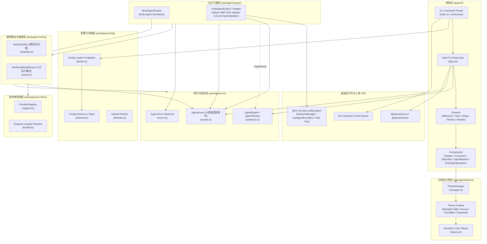

# Nightglide 系统架构设计文档 (ARCHITECTURE)


> **历史原型记录。** 本文描述已退役的 OpenTUI 原型架构，其中的技术方案、完成度与结论不适用于 OMP 原生新主线；现状以 [新路线图](ROADMAP.md) 与 [验收记录](STAGE_2_3_VERIFICATION.md) 为准。本文仅作设计思想与历史参考。
> **"Build beyond the horizon." / "漫翔苍穹，构筑所想。"**

本文档详细阐述 Nightglide 的系统总体架构、模块分层边界、与上游 Oh My Pi (OMP) SDK 的轻量适配架构、多提供商注册表、工作负载感知模型路由（Workload-Aware Model Router）、本地与云端智能体协同流转模型（Local + Cloud Collaboration）、会话生命周期管理以及与原生 OMP 的清晰职责划分。

Nightglide 本质上是构建在原生 OMP SDK 之上的**轻量 SDK 适配器 (Thin SDK Adapter)、终端表现层 (TUI) 与多提供商工作负载路由器 (Multi-Provider Workload Router)**。原生 OMP 负责工具执行、工具审批与智能体调度；Nightglide 负责优雅呈现、苍穹主题、提供商管理与隐私优先的模型路由。

---

## 1. 架构目标与核心原则

1. **强隔离与防污染 (Strict Isolation):**
   - Nightglide 拥有完全独立的配置体系与会话管理，绝不隐式继承用户全局未授权的 ambient extensions、MCP servers 或宿主历史凭证。
   - 上游 SDK 的内部类型与实现细节严格封装在 `packages/engine` 内部，绝不泄漏至 UI 表现层。
2. **多提供商中立与多模型协同 (Multi-Provider & Cross-Model Collaboration):**
   - 彻底打破单供应商绑定。通过 `@nightglide/providers` 支持本地端侧模型（oMLX, Ollama, LM Studio）与云端大模型（OpenAI, Anthropic, DeepSeek）并存。
   - 依托 `@nightglide/routing` 实现工作负载自适应路由（LOCAL, BALANCED, PERFORMANCE, MANUAL），协调轻量端侧模型与强推理云端模型高效接力。
3. **网络位置绝对判定与本地优先隐私路由 (Endpoint Locality & Privacy-First Routing):**
   - 严禁轻信 Provider 名称；网络 Locality 严格依据解析后的网络端点地址（回环地址为 `local`，其余强制为 `remote`）。
   - 在 `LOCAL` 模式下，路由层从源头保证仅分派物理本地模型，且回退候选链绝不包含云端端点，确保敏感数据不出机。
4. **抽象与确定性 (Deterministic Engine Abstraction):**
   - 表现层（TUI）仅依赖统一的抽象接口 `AgentEngine` 与 `AgentSession`。
   - 系统内置确定性 `MockAgentEngine`，使 UI 演示、快速验证与自动化单元测试无需依赖任何外部 AI 模型即可 100% 稳定运行。
5. **响应式与类型安全事件流 (Type-safe Event Streaming):**
   - 采用标准 TypeScript Discriminated Union 规范事件流（`AgentEvent`），涵盖单模型生成、工具调用、路由决策透明解释（`routing_decision`）以及子智能体生命周期监视（`subagent_start`, `subagent_delta`, `subagent_end`）。

---

## 2. 总体分层拓扑架构



---

## 3. 核心包职责与模块边界

| 模块包路径 | 职责定位 | 核心依赖 | 严禁行为 |
| :--- | :--- | :--- | :--- |
| `packages/core` | 纯类型契约与错误层。定义 `AgentEngine`, `AgentSession`, `AgentEvent`, `RoutingDecision`, `ModelDescriptor`, `NightglideError` 等。 | 无内部或第三方重依赖。 | 严禁依赖任何具体运行时实现或上游 SDK。 |
| `packages/providers` | 多提供商注册表、物理网络位置判定与健康探测。 | `packages/core`, `packages/config` | 严禁日志输出未脱敏 API Key；严禁轻信 Display Name 判定 Locality。 |
| `packages/routing` | 工作负载感知任务分类与智能模型路由矩阵。包含 8 类任务识别与 4 类路由模式。 | `packages/core`, `packages/config`, `packages/providers` | 严禁在 LOCAL 模式下产生任何云端候选；严禁越权静默回退。 |
| `packages/themes` | 苍穹设计系统的色彩与主题 Token，提供运行时主题切换与订阅管理器。 | 仅依赖标准数据结构。 | 严禁硬编码颜色值至业务逻辑组件中。 |
| `packages/config` | 跨平台配置目录管理、JSON Schema 校验、多提供商配置与路由模式持久化。 | `packages/core` | 严禁将明文凭据强制写入常规配置文件。 |
| `packages/engine` | 引擎适配器实现层。作为原生 OMP SDK 的轻量封装适配器，标准化转换 `subagentEventBus` 事件流，并驱动确定性模拟引擎。 | `@nightglide/*`, `@oh-my-pi/pi-coding-agent` | 严禁向外部导出任何 OMP SDK 的私有内部类；严禁构建脆弱的自定义越权拦截层。 |
| `apps/cli` | 终端应用入口点、CLI 子命令（`providers`, `models`, `doctor`, `demo`）与 OpenTUI React 界面视图。 | `@nightglide/*`, `@opentui/*`, `react` | 严禁直接与底层文件系统或未封装的 OMP 实例通信。 |

---

## 3.1 模块权责边界矩阵 (Responsibility Matrix: OMP vs Nightglide)

Nightglide 坚持“薄适配器”架构哲学，不重复实现底层引擎逻辑，不构建多余的自定义拦截防火墙，清晰界定系统权责：

| 职责范畴 (Domain) | 原生 OMP 拥有并驱动 (OMP SDK Owns) | Nightglide 拥有并呈现 (Nightglide Owns) |
| :--- | :--- | :--- |
| **工具体系 (Tools)** | • 工具执行与运行时沙箱 (Tool Execution)<br>• 工具可用性与发现 (Tool Availability)<br>• 原生工具审批机制 (Native Tool Approval)<br>• 原生编码工具链 (`write`, `edit`, `bash`, `read`, 等) | • 工具执行状态与审批人机交互呈现 (TUI Presentation)<br>• 工具调用卡片渲染与参数透明化展示 |
| **智能体与委派 (Agents & Delegation)** | • 智能体定义与元数据解析 (Agent Definitions)<br>• 子智能体运行时派发与执行 (Child Agent Execution)<br>• 原生 Task 委派机制 (`task` tool)<br>• 原生 Reviewer 审查与执行 (`reviewer`)<br>• 原生 Plan 规划与执行 (`plan`) | • 任务意图识别与分类 (Task Classification)<br>• 智能体角色到模型的动态分配 (Role-to-Model Assignment)<br>• 多智能体实时监视看板 (`AgentMonitor`) |
| **模型与路由 (Model & Routing)** | • 底层 LLM 会话通信与流式处理<br>• 模型调用重试与传输协议封装 | • 多提供商注册表与连通性探针 (`ProviderRegistry`)<br>• 端点物理 Locality 判定 (Loopback vs Remote)<br>• 4 大路由运行模式 (`LOCAL`, `BALANCED`, `PERFORMANCE`, `MANUAL`)<br>• 路由决策透明解释 (`RoutingExplanation`) |
| **生命周期与呈现 (Lifecycle & UX)** | • 会话生命周期底层执行与会话取消 (`abort`)<br>• LSP 与底层子进程管理与资源释放 (`dispose`) | • OpenTUI 声明式终端界面与视口适配<br>• 苍穹系列语义主题设计系统 (`Midnight Flight`, `Aurora`, 等)<br>• 环境体检与错误诊断报告 (`doctor`) |

---

## 4. 本地与云端协同流转模型 (Local + Cloud Collaboration)

在 BALANCED 模式下，系统能够协同本地端侧模型与云端强模型，实现兼顾隐私安全、零成本探索与高阶推理方案的无缝闭环：

```mermaid
sequenceDiagram
    autonumber
    actor User as 用户 (Terminal)
    participant UI as OpenTUI React View
    participant Director as Nightglide Task Director (Routing)
    participant Explorer as Local Explorer (omlx/qwen2.5-coder)
    participant Planner as Cloud Planner (openai/gpt-4o)
    participant Synthesizer as Main Synthesizer

    User->>UI: 提交任务 ("分析代码库并制定安全重构方案")
    UI->>Director: routeTask(prompt, { mode: "BALANCED" })
    Director-->>UI: emit { type: "routing_decision", decision: ... }
    
    rect rgb(20, 35, 45)
    note right of Director: 阶段一：本地安全探索 (零云端网络外发)
    Director->>Explorer: 派发 explore 子任务 (只读扫描)
    Explorer-->>UI: emit { type: "subagent_start", role: "explore", locality: "local" }
    Explorer->>Explorer: 扫描本地项目关键符号与模块依赖
    Explorer-->>UI: emit { type: "subagent_delta", delta: "找到 12 个核心文件..." }
    Explorer-->>Director: 返回提炼后的结构纲要报告
    Explorer-->>UI: emit { type: "subagent_end", result: "摘要已生成" }
    end

    rect rgb(35, 20, 45)
    note right of Director: 阶段二：云端架构规划 (仅发送最小必要上下文)
    Director->>Planner: 派发 plan 子任务 (携带摘要，云端已授权)
    Planner-->>UI: emit { type: "subagent_start", role: "plan", locality: "remote" }
    Planner->>Planner: 运用强推理能力生成分阶段架构演进路线
    Planner-->>UI: emit { type: "subagent_delta", delta: "阶段1: 接口解耦..." }
    Planner-->>Director: 返回规划蓝图
    Planner-->>UI: emit { type: "subagent_end", result: "蓝图生成完成" }
    end

    Director->>Synthesizer: 汇聚多智能体成果并交付
    Synthesizer-->>UI: emit { type: "text_delta", delta: "### 协作执行完成..." }
    Synthesizer-->>UI: emit { type: "done", summary: "多模型协作完成" }
    UI->>User: 渲染完整流式规划蓝图与 AgentMonitor 实时卡片
```



---

## 5. 原生 Subagent 事件捕获与归一化

OMP SDK 在执行原生子智能体时，通过根事件总线 `subagentEventBus` 发送广播。Nightglide 适配器监听 `task:subagent:event` 信道，将其无损转换为 Nightglide 标准事件：

```typescript
// OmpAgentSession 核心归一化逻辑
this.subagentEventBus.on("task:subagent:event", (payload: SubagentEventPayload) => {
  const { id, event } = payload;
  switch (event.type) {
    case "turn_start":
    case "agent_start":
      this.emit({
        type: "subagent_start",
        subagentId: id,
        role: subagent.role,
        model: subagent.model,
        locality: subagent.locality,
        task: subagent.task,
      });
      break;

    case "message_update":
      if (event.assistantMessageEvent?.type === "text_delta") {
        this.emit({
          type: "subagent_delta",
          subagentId: id,
          delta: event.assistantMessageEvent.delta,
        });
      }
      break;

    case "turn_end":
    case "agent_end":
      this.emit({
        type: "subagent_end",
        subagentId: id,
        result: "Subagent completed.",
        totalTokens: event.usage?.totalTokens,
      });
      break;
  }
});
```
