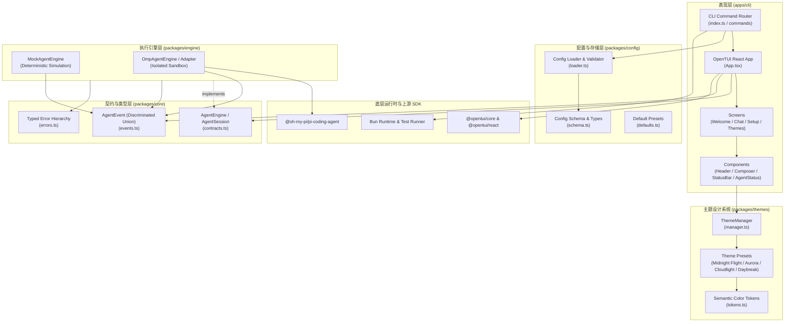
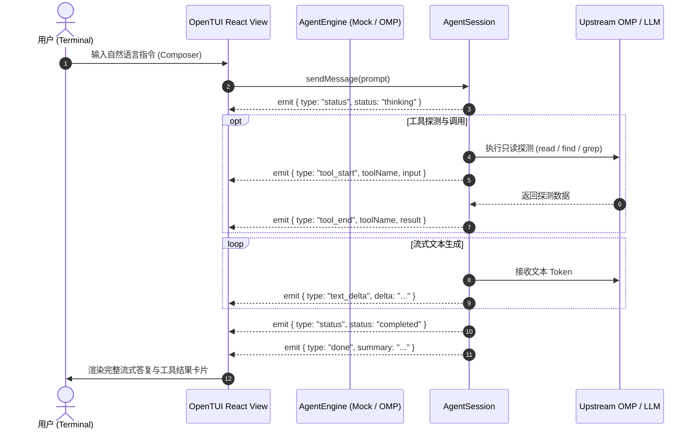
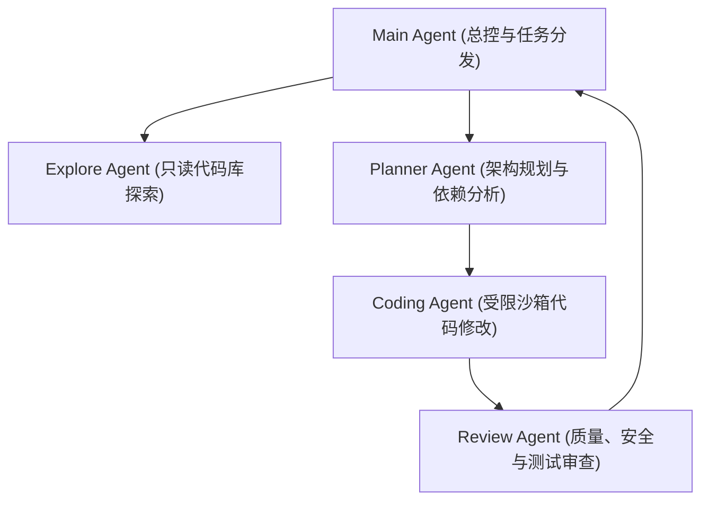

# Nightglide 系统架构设计文档 (ARCHITECTURE)

> **"Build beyond the horizon." / "漫翔苍穹，构筑所想。"**

本文档详细阐述 Nightglide 的系统总体架构、模块分层边界、数据与事件流转模型、会话生命周期管理以及对上游 Oh My Pi (OMP) SDK 的防污染隔离设计。

---

## 1. 架构目标与核心原则

1. **强隔离与防污染 (Strict Isolation):**
   - Nightglide 拥有完全独立的配置体系与会话管理，绝不隐式继承用户全局未授权的 ambient extensions、MCP servers 或宿主历史凭证。
   - 上游 SDK 的内部类型与实现细节严格封装在 `packages/engine` 内部，绝不泄漏至 UI 表现层。
2. **抽象与确定性 (Deterministic Engine Abstraction):**
   - 表现层（TUI）仅依赖统一的抽象接口 `AgentEngine` 与 `AgentSession`。
   - 系统内置确定性 `MockAgentEngine`，使 UI 演示、快速验证与自动化单元测试无需依赖任何外部 AI 模型即可 100% 稳定运行。
3. **响应式与类型安全事件流 (Type-safe Event Streaming):**
   - 采用标准 TypeScript Discriminated Union 规范事件流（`AgentEvent`），包括增量文本 (`text_delta`)、工具调用生命周期 (`tool_start`, `tool_end`)、代理状态 (`status`) 与终止结算 (`done`)。
4. **极致美学与终端鲁棒性 (Terminal Aesthetics & Robustness):**
   - 深度集成 OpenTUI 原生与 React 声明式渲染器，提供基于语义 Token 的多套苍穹主题，保证在 `80x24` 至高分宽屏终端中平滑缩放、不花屏、无内存泄漏。

---

## 2. 总体分层拓扑架构



---

## 3. 核心包职责与模块边界

| 模块包路径 | 职责定位 | 核心依赖 | 严禁行为 |
| :--- | :--- | :--- | :--- |
| `packages/core` | 纯类型契约与错误层。定义 `AgentEngine`, `AgentSession`, `AgentEvent`, `NightglideError` 等。 | 无内部或第三方重依赖。 | 严禁依赖任何具体运行时实现或上游 SDK。 |
| `packages/themes` | 苍穹设计系统的色彩与主题 Token，提供运行时主题切换与订阅管理器。 | 仅依赖标准数据结构。 | 严禁硬编码颜色值至业务逻辑组件中。 |
| `packages/config` | 跨平台配置目录管理、JSON Schema 校验、默认配置生成与安全存取。 | `packages/core` | 严禁明文打印或导出 API Key 及凭据。 |
| `packages/engine` | 引擎适配器实现层。包含确定性 `MockAgentEngine` 与真实上游 `@oh-my-pi/pi-coding-agent` 隔离适配器。 | `packages/core`, `@oh-my-pi/pi-coding-agent` | 严禁向外部导出任何 OMP SDK 的私有内部类。 |
| `apps/cli` | 终端应用入口点、CLI 子命令路由与 OpenTUI React 界面视图。 | `@nightglide/*`, `@opentui/*`, `react` | 严禁直接与底层文件系统或未封装的 OMP 实例通信。 |

---

## 4. 事件驱动与会话生命周期

### 4.1 会话建立与消息流转 (Sequence Diagram)



### 4.2 统一事件模型定义 (`AgentEvent`)

```typescript
export type AgentEvent =
  | { readonly type: "text_delta"; readonly delta: string }
  | {
      readonly type: "tool_start";
      readonly toolName: string;
      readonly toolCallId: string;
      readonly input: Record<string, unknown>;
    }
  | {
      readonly type: "tool_end";
      readonly toolName: string;
      readonly toolCallId: string;
      readonly result?: unknown;
      readonly error?: string;
    }
  | {
      readonly type: "status";
      readonly status: AgentStatus;
      readonly message?: string;
    }
  | {
      readonly type: "error";
      readonly error: string;
      readonly code?: string;
      readonly recoverable?: boolean;
    }
  | {
      readonly type: "done";
      readonly summary?: string;
      readonly totalTokens?: number;
    };
```

---

## 5. OMP 上游隔离与安全架构

为了确保宿主环境与 Nightglide 之间的单向安全边界，`OmpAgentEngine` 实施以下技术隔离：

1. **进程与全局状态解耦 (`Settings.isolated`):**
   - 绝不使用 OMP 的全局设置单例，使用 `Settings.isolated()` 构建单次会话设置视图。
2. **内存会话管理器 (`SessionManager.inMemory`):**
   - 会话记录留存在内存生命周期中，严禁在未经用户许可的情况下向宿主历史写入未知 JSONL。
3. **禁用环境与 MCP 发现:**
   - 显式传递 `disableExtensionDiscovery: true` 与 `enableMCP: false`，杜绝未授权进程执行或网络探针注入。
4. **工具严格白名单:**
   - 传递 `restrictToolNames: true` 与只读工具集 `["read", "find", "grep"]`。
5. **资源生命周期清理:**
   - 当终端会话结束或收到退出信号时，强制调用 `session.dispose()`，确保清理底层事件监听与流句柄。

---

## 6. 未来多 Agent 协同演进架构 (M3 Preview)

在 M3 阶段，系统将在 `AgentEngine` 之下引入编排器（Multi-Agent Orchestrator），演进为如下拓扑结构：



- **Main Agent:** 负责与用户交互，分解需求并维护会话总线。
- **Explore Agent:** 纯只读工作空间检索，建立符号表与依赖拓扑。
- **Planner Agent:** 生成细粒度执行计划与 Diff 预览。
- **Coding Agent:** 仅在经过用户确认后，在隔离的工作树（Git Worktree）中执行变更。
- **Review Agent:** 自动触发单元测试与代码安全静态检查。
