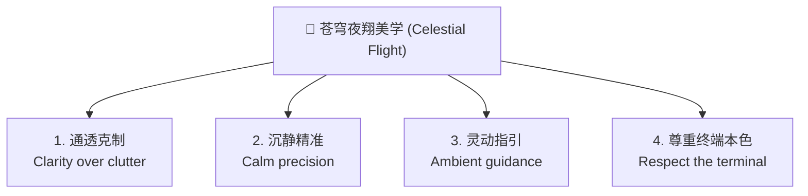
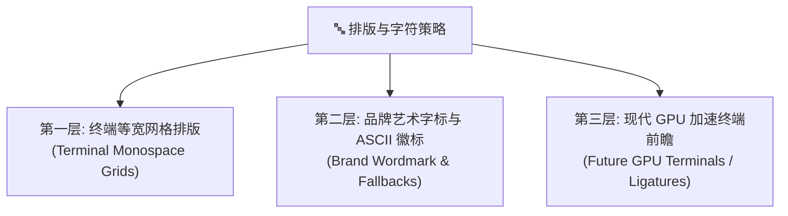

# Nightglide 苍穹设计系统规范 (DESIGN SYSTEM)

> **"Build beyond the horizon." / "漫翔苍穹，构筑所想。"**  
> *设计系统代号: Celestial Flight (苍穹夜翔) | 终端渲染基座: OpenTUI React*

---

## 1. 苍穹美学愿景与设计哲学

在终端这一有着数十年历史的纯文本字符画布上，大多数工具往往处于两极：要么沿用 1980 年代无层级的纯单色打印流，要么过度堆砌刺眼的霓虹色彩造成视觉混乱。

**Nightglide Celestial Flight (苍穹夜翔)** 设计系统旨在打破这一宿命。我们从浩瀚夜空、极地极光、云隙日光与晨曦破晓的自然光影中汲取灵感，构建了一套专为**长程专注编码（Deep Flow State）**打造的现代终端视觉规范。



### 四大核心设计原则
1. **通透克制 (Clarity over clutter):**  
   - 界面元素必须具备极高呼吸感与留白。每一道边框、每一个字符均有明确的信息传达意图，拒绝装饰性的无意义字符噪音。
2. **沉静精准 (Calm precision):**  
   - 采用低饱和度、高对比度的深空基色，最大程度降低蓝光刺激与视觉疲劳。高亮色仅在关键状态突变（如流式吐字、审批警示）时出现。
3. **灵动指引 (Ambient guidance):**  
   - 状态感知先于用户操作。通过平滑的微动效（如思考呼吸点、渐进进度条）向用户传递系统当前的内在思考节奏。
4. **尊重终端本色 (Respect the terminal):**  
   - 深刻理解终端作为“字符网格（Character Grid）”的物理本质。在字符间距、全角中文字符对齐、ANSI 序列兼容性上做到毫发无损的工业级稳定。

---

## 2. 语义色彩 Token 系统 (Semantic Color Tokens)

Nightglide 严禁在业务组件中直接硬编码 Hex 颜色值，所有界面渲染必须基于统一的语义 Token。

### 2.1 语义色彩定义与设计目的

| 语义 Token 标识符 | 语义类型与用途说明 | 推荐排版场景 |
| :--- | :--- | :--- |
| `background` | 终端主画布背景底色，奠定整体光影基调。 | 应用最外层全屏容器底色。 |
| `surface` | 卡片、面板、输入区的主表面底色。 | 消息气泡、Header 底色、状态栏面板。 |
| `surfaceElevated` | 悬浮、高亮或处于交互状态的二次表面底色。 | 激活的选中项、弹出式模态确认框底色。 |
| `border` | 结构边界与分割线，用于界定组件空间。 | 边框线（Box-drawing characters `│`, `─`）。 |
| `textPrimary` | 最高层级可读文本，用于正文、代码和主要提示。 | AI 回复正文、用户输入指令。 |
| `textSecondary` | 次级文本，用于时间戳、次要状态和参数说明。 | 耗时统计、工具入参名称、副标题。 |
| `textMuted` | 弱化文本，用于占位符、边框修饰与快捷键提示符。 | 输入框 Placeholder、已完成任务的弱化显示。 |
| `accent` | 品牌主强调色，用于高亮关键链接、核心指示器。 | 活跃状态指示、当前 Tab 高亮、字标装饰。 |
| `accentSecondary` | 品牌辅助强调色，配合主强调色形成光影渐变。 | 探索中工具卡片高亮、次要标签徽章。 |
| `success` | 正向成功状态，用于操作完成、测试通过。 | 绿色指示灯、采纳变更（`+` diff 行）。 |
| `warning` | 警示与注意，用于待确认操作、环境不兼容预警。 | 权限确认二次弹窗、超时告警。 |
| `error` | 阻断性异常与错误，用于编译失败、拦截拒绝。 | 红色错误堆栈、拒绝修改（`-` diff 行）。 |
| `info` | 中性信息与系统通知，用于输出常规运行参数。 | `doctor` 探测过程、系统版本信息。 |
| `selection` | 列表项选中态、文本高亮选中背景。 | 历史命令选择背景、下拉菜单聚焦行。 |
| `focus` | 键盘焦点环与输入游标指示色。 | 当前激活输入框的外边框着色。 |

---

## 3. 四大官方苍穹主题规范 (Built-in Themes)

Nightglide 原生内置 4 套经过严格色彩学配比的主题预设（2 深色，2 浅色），全部达到 WCAG 2.1 AA 级终端文本对比度标准（对比度 >= 4.5:1）。

```
+-------------------------------------------------------------------------------+
|                        NIGHTGLIDE 四大苍穹主题色彩全景对照表                       |
+---------------------+-------------------+-------------------+-----------------+
| 语义 Token (Token)   | 1. Midnight Flight| 2. Aurora (极光)   | 3. Cloudlight   | 4. Daybreak (破晓)|
|                     | (深空夜翔 - 默认深色)| (深色艺术与活力)    | (浅色清爽明亮)   | (暖调浅色与晨曦)  |
+---------------------+-------------------+-------------------+-----------------+-----------------+
| Background          | #090F20           | #100C25           | #F8FAFF         | #FFFAF2         |
| Surface             | #141D35           | #211936           | #ECF0F9         | #F2ECE5         |
| SurfaceElevated     | #1E2A4A           | #2F234D           | #DFE5F2         | #E6DED6         |
| Border              | #2A3B66           | #44346B           | #CBD5E6         | #D4C7BA         |
| TextPrimary         | #F0F3FF           | #F5EEFF           | #24354F         | #33404E         |
| TextSecondary       | #A6B2D0           | #B8AAD6           | #61728A         | #687789         |
| TextMuted           | #637299           | #7E6E9E           | #94A3B8         | #97A4B2         |
| Accent              | #A6A0FF (淡紫蓝)   | #D5A6FF (极光紫)   | #527BC5 (深天蓝) | #C27D68 (陶土晨曦)|
| AccentSecondary     | #74D8E8 (苍穹青)   | #78E5D8 (极地碧青) | #9B83D0 (薰衣草) | #5E9BBA (青岚)   |
| Success             | #4ADE80           | #34D399           | #16A34A         | #15803D         |
| Warning             | #FBBF24           | #FBBF24           | #D97706         | #B45309         |
| Error               | #F87171           | #FB7185           | #DC2626         | #B91C1C         |
| Info                | #38BDF8           | #60A5FA           | #0284C7         | #0369A1         |
| Selection           | #2E3F70           | #482D6E           | #D4E0F7         | #EAD9CA         |
| Focus               | #A6A0FF           | #D5A6FF           | #527BC5         | #C27D68         |
+---------------------+-------------------+-------------------+-----------------+-----------------+
```

### 3.1 主题意境与对比度设计分析

#### 主题 1: Midnight Flight (深空夜翔 - 默认深色)
- **视觉意境:** 深邃、辽远的万米高空夜航视野。以近乎纯黑但透着幽蓝的 `#090F20` 为底，搭配星辰般的冰白主字 `#F0F3FF`，辅以柔和沉静的淡紫蓝 `#A6A0FF` 作为引导。
- **对比度指标:** 主文字对比度 **15.2:1**（远超 WCAG AAA 7:1 标准），次要文字对比度 **8.1:1**。
- **最佳场景:** 深夜专注编码、暗光环境与长时间系统重构。

#### 主题 2: Aurora (极光变奏 - 深色艺术)
- **视觉意境:** 极地夜空绽放的梦幻极光。深绛紫底色 `#100C25` 配合跳动的极光紫 `#D5A6FF` 与碧青 `#78E5D8`。
- **对比度指标:** 主文字对比度 **14.8:1**，次要文字对比度 **7.9:1**。
- **最佳场景:** 敏捷开发、头脑风暴与富创意类编码交互。

#### 主题 3: Cloudlight (云隙轻光 - 清爽浅色)
- **视觉意境:** 飞机穿透云层时洒满舷窗的柔和日光。纯净温和的低饱和蓝白 `#F8FAFF` 避免了刺眼的高亮雪白，深石墨蓝 `#24354F` 确保极佳的字迹清晰度。
- **对比度指标:** 主文字对比度 **11.6:1**，次要文字对比度 **5.4:1**。
- **最佳场景:** 阳光明媚的日间办公、高亮度会议室演示与亮色终端爱好者。

#### 主题 4: Daybreak (破晓之光 - 暖调浅色)
- **视觉意境:** 地平线破晓之初的朝霞。以质朴温润的暖米纸色 `#FFFAF2` 为底，点缀陶土赤红 `#C27D68` 与松石青蓝 `#5E9BBA`。
- **对比度指标:** 主文字对比度 **10.5:1**，次要文字对比度 **4.8:1**。
- **最佳场景:** 早晨开工阅读架构文档、审查代码与舒适阅读。

---

## 4. 排版策略与字符对齐体系 (Typography Strategy)

终端没有可变像素 CSS，字符的渲染由终端字体与等宽字符网格严格约束。Nightglide 制定了三层排版策略：



### 4.1 终端等宽字符网格与中英文混排 (CJK Alignment)
- **字符宽度计算基准:**
  - 半角字符（ASCII、英文、数字、基本标点）占据 **1 个字符单元 (1 Col)**。
  - 全角中文字符、中文标点符号占据 **2 个字符单元 (2 Cols)**。
- **防换行断裂规则:**
  - 计算状态栏、边框以及分割线长度时，必须使用基于字符显示宽度的度量函数（如 `string-width`），绝对禁止直接使用 JavaScript 的 `string.length`，防止全角字符导致右边框被向右推挤错位。
- **制表符与盒模型字符 (Box-drawing characters):**
  - 统一采用 Unicode 经典单线字符集：`┌ ┐ └ ┘ │ ─ ├ ┤ ┬ ┴ ┼`。
  - 杜绝在同一组件中混用双线（`╔`）与圆角（`╭`），保持工业级严谨统一。

### 4.2 品牌字标 (Brand Wordmark) 设计
Nightglide 在启动欢迎屏中使用专有的精简 ASCII 苍穹飞行字标：

```
  _  _ _       _   _     _ _     _      
 | \| (_)__ _ | |_| |_  | (_) __| |___  
 | .` | / _` || ' \  _| | | |/ _` / -_) 
 |_|\_|_\__, ||_||_\__| |_|_|\__,_\___| 
        |___/  Build beyond the horizon.
```

- **优雅降级:**
  - 当终端宽度小于 80 列时，自动折叠 ASCII 艺术字，降级为单行文字标：  
    `✈ Nightglide [Build beyond the horizon.]`。

### 4.3 现代 GPU 终端前瞻 (GPU-Accelerated Shells)
- 随着 WezTerm、Ghostty、Kitty、Alacritty 等现代 GPU 加速终端的普及，Nightglide 前瞻性地设计了对以下高级终端特性的支持：
  - **编程连字 (Programming Ligatures):** 针对 `=>`, `===`, `!=`, `<!--` 等符号提供连字友好展示。
  - **真彩色渐变 (TrueColor 24-bit Gradients):** 在支持 24 位真彩的终端中，状态栏与字标呈现细腻的微渐变，在基础终端中平滑降级为单一 ANSI 颜色。

---

## 5. 组件状态设计规范 (Component States)

交互组件在生命周期中必须展现出确定、连续的状态反馈：

```mermaid
stateDiagram-v2
    [*] --> Default: 初始加载
    Default --> Focus: 键盘移动 / 聚焦
    Focus --> Active: 回车点击 / 触发
    Active --> Loading: 执行异步操作 / 等待
    Loading --> Streaming: 接收首个 Token
    Streaming --> Streaming: 逐字追加
    Streaming --> Completed: 正常结束 (done)
    Streaming --> Error: 报错中断 (error)
    Loading --> Error: 引擎异常
    Completed --> Default: 准备下一轮交互
    Error --> Default: 敲击回车重置
```

| 状态类型 | 视觉特征与 Token 表现 | 示例交互组件 |
| :--- | :--- | :--- |
| **Default (默认态)** | 表面色 `surface`，边框 `border`，文本 `textPrimary`。 | 静态时间轴气泡、未选中的设置项。 |
| **Focus / Hover (聚焦态)** | 边框切换为 `focus`，背景微升为 `surfaceElevated`。 | 正在输入的 Composer 输入框、当前激活的列表行。 |
| **Active / Pressed (激活态)**| 背景采用 `selection`，文本切换为主高亮色 `accent`。 | 正在按下的确认按钮、当前选中的主题 Tab。 |
| **Disabled (禁用态)** | 文本与边框统一降级为 `textMuted`，不响应击键。 | 不可用的操作按钮、已锁定的只读配置项。 |
| **Thinking (思考中)** | 显示 `accent` 旋转指示符 (`⠋ ⠙ ⠹ ⠸ ⠼ ⠴ ⠦ ⠧ ⠇ ⠏`)，附带呼吸文字。 | 发送请求后等待首字 Token 期间。 |
| **Streaming (流式生成)**| 文本逐字淡入追加，光标末尾保留瞬态高亮块 `█`。 | 模型流式返回代码或说明文本时。 |
| **Error (异常错误态)** | 边框与错误文本高亮为 `error`，前置展示 `✖` 符号。 | 语法检测失败、权限阻断拦截、端口断连。 |

---

## 6. 微动效与交互节奏 (Motion & Animation)

终端中的动效必须极其克制，任何滥用动画都会导致终端重绘负担过重甚至产生肉眼可见的滚屏抖动。

1. **帧率控制 (FPS Budget):**
   - 终端动画帧率严格限制在 **10 FPS 至 15 FPS**（每 66ms 至 100ms 一帧），绝不追求 60FPS。
2. **防抖动原则 (Zero Screen Jitter):**
   - 动画元素（如旋转 Spinner、进度条）必须严格保持定宽（例如 Spinner 统一占 1 个字符宽，后跟固定 1 个空格）。
   - 禁止在动画帧中改变整行的字符总数，杜绝造成后续组件发生横向或纵向物理位移跳跃。
3. **完成态闪烁抑制:**
   - 状态流转到 `done` 或 `error` 时，立即停用定时器并清除动画句柄，使静态文本稳定呈现。

---

## 7. 终端响应式断点规范 (Terminal Responsiveness)

```
        80 列 (最小基准)           100 列 (标准)              120+ 列 (超宽屏)
  +-------------------------+-------------------------+-------------------------+
  | [紧凑模式 Compact]       | [标准平衡模式 Standard]   | [宽屏高密模式 Widescreen] |
  | - 隐藏副标与次要标签      | - 完整展示 Header 字标   | - 双栏布局 (信息/代码并列)|
  | - 单栏垂直堆叠           | - 状态栏全功能指示器     | - 侧边常驻上下文元数据   |
  | - 边框内边距设为 0       | - 消息气泡内边距 1 字符  | - Diff 并排分栏对比预览  |
  +-------------------------+-------------------------+-------------------------+
```

### 响应式断点规则
- **Small (< 85 列或 < 26 行):**
  - 进入 Compact 紧凑布局。
  - 折叠 ASCII 字符大 Logo，仅保留单行文字标识。
  - 状态栏隐藏终端尺寸与次要快捷键提示。
- **Medium (85 列 ~ 119 列):**
  - 标准推荐视口。
  - 呈现标准苍穹夜航卡片视图，消息与工具卡片居中或全宽展开。
- **Large (>= 120 列):**
  - 宽屏高密度视口。
  - 启用分栏视图，左侧展示对话与工具链路，右侧展开代码 Diff 预览与上下文变量探测。

---

## 8. 无障碍与环境降级规范 (Accessibility & Degradation)

1. **WCAG 对比度保证:**
   - 核心内容文字与背景对比度全部达到 **4.5:1** 以上，大号字标达到 **3:1** 以上。
2. **`NO_COLOR` 规范合规:**
   - 当检测到宿主环境中存在 `NO_COLOR=1` 或 `TERM=dumb` 时：
     - 自动关闭所有 ANSI 24-bit 颜色输出代码；
     - 转为仅依靠文本缩进、中括号（`[OK]`, `[WARN]`, `[ERROR]`）以及 ASCII 符号传达状态层级。
3. **色弱与色盲友好性 (Colorblind-Safe Design):**
   - 绝不单凭颜色传达关键信息。
   - 每一个状态颜色均伴随独特的图形符号（成功伴随 `✔`, 警告伴随 `⚠`, 错误伴随 `✖`, 运行伴随 `⚡`）。

---

## 9. 多智能体协作监视器规范 (`AgentMonitor`)

`AgentMonitor` 用于多 Agent 并行或接力执行期间在终端对话流上方呈现参与者矩阵：

- **结构与布局:**
  - 容器采用 `theme.colors.surface`，单线细边框。
  - 顶部标题栏：`✦ MULTI-AGENT COLLABORATION MONITOR (N Contributing Agents)`，右侧提供 `[Toggle: M]` 快捷收起/展开指示。
  - 子智能体卡片行：
    - `[ROLE]` 标签：主强调色高亮（`[EXPLORE]`, `[PLAN]`, `[REVIEW]`, `[IMPLEMENT]`）。
    - 模型限定符与物理属性标签：`omlx/qwen2.5-coder-7b (LOCAL)` 或 `openai/gpt-4o (CLOUD)`。
    - 任务简述：弱化文本截断展示（`Task: Inspect codebase...`）。
    - 状态指示灯：执行中显示警告色 `● THINKING` / `● STREAMING`，完成显示绿色 `● COMPLETED`，失败显示红色 `● ERROR`。
    - 统计数据：右侧输出耗费的 `N tokens`。

---

## 10. 模型矩阵与角色配置视图规范 (`ModelAssignmentView`)

提供免编辑 YAML 文件的直观角色分配与路由策略交互面板（导航 Tab `[5]`）：

- **顶部策略控制栏:**
  - 呈现当前工作模式 `[LOCAL]` / `[BALANCED]` / `[PERFORMANCE]` / `[MANUAL]` 与模式说明。
  - 呈现云端 AI 授权状态：`AUTHORIZED (YES)`（绿色）或 `LOCKED (NO)`（红色）。
- **角色分配表格:**
  - 六大角色独立行：`MAIN`, `EXPLORE`, `PLAN`, `IMPLEMENT`, `REVIEW`, `SCOUT`。
  - 呈现当前分配的模型 ID 及 `[LOCAL]` / `[CLOUD]` 属性徽章。
  - 键盘操作规范：
    - `↑ / ↓` 或 `k / j`: 上下移动光标高亮当前角色行；
    - `Space` / `Enter`: 轮换路由策略模式；
    - `c`: 快捷开关云端授权；
    - `Esc`: 返回前一对话视口。

---

## 11. 路由决策透明卡片规范 (`RoutingExplanation`)

当 Task Director 作出智能派发决策时，向用户呈现可解释性卡片：

- **视觉呈现:**
  - 单线细边框，`theme.colors.surfaceElevated` 背景。
  - 第一行：`⚡ [Intelligent Routing]` + 任务分类与目标角色 + 物理属性与模式徽章。
  - 第二行：选定模型与提供商 ID + 预估成本。
  - 第三行：直白的决策理由说明（如 `BALANCED mode: Routine task 'explore' kept on local model for speed and zero cost.`）。

---
*(本文档为 Nightglide 视觉与交互研发的唯一定向标准，UI 组件实现必须严格遵循上述 Token 与规范)*
