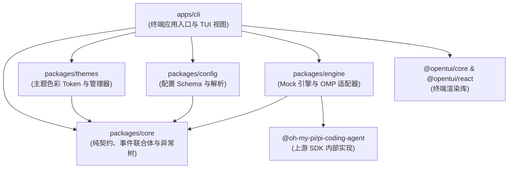
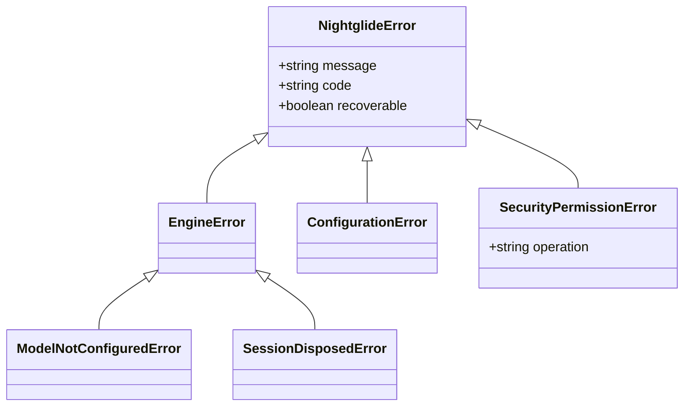

# Nightglide 工程开发与质量标准规范 (ENGINEERING STANDARDS)

> **"Build beyond the horizon." / "漫翔苍穹，构筑所想。"**  
> *标准级别: 核心工程铁律 | 适用范围: 全代码仓库、所有贡献者与自动化 CI 门禁*

---

## 1. Monorepo 架构与包依赖拓扑

Nightglide 采用基于 [Bun](https://bun.sh) Workspaces 的现代 Monorepo 架构，以保证高效的包管理、原子提交与跨模块类型联动。

### 1.1 包目录与职责定义

```
nightglide/
├── apps/
│   └── cli/                 # 应用入口层: 命令行路由、OpenTUI React 界面视图
├── packages/
│   ├── core/                # 契约核心: 纯接口、判别联合事件、标准异常体系
│   ├── themes/              # 苍穹设计系统: 语义色彩 Token、预设主题与主题管理器
│   ├── config/              # 配置与持久化: XDG 规范路径、JSON Schema 校验与凭据解析
│   └── engine/              # 引擎实现: 确定性 Mock 引擎与上游 OMP SDK 隔离适配器
└── tests/                   # 自动化测试套件: 引擎测试、配置测试、主题测试与端到端集成测试
```

### 1.2 严格单向无环依赖拓扑 (Dependency DAG)

为了彻底杜绝循环依赖与模块职责混淆，代码库各模块必须严格遵守以下单向依赖流向：



#### 模块边界绝对禁令
1. **严禁逆向与跨层穿透:** `packages/core` 为纯基础抽象层，**绝对禁止依赖任何同级包或外部第三方框架**。
2. **严禁上游泄漏至表现层:** `apps/cli` 内的任何组件或文件，**绝对禁止直接 `import` 来自 `@oh-my-pi/pi-coding-agent` 的任何类、类型或函数**。所有的上游交互必须经由 `packages/engine` 封装为 `packages/core` 契约后暴露。
3. **严禁循环引用:** 模块间禁止存在间接或直接的循环引用（使用 TypeScript 编译器结合构建工具检测循环依赖）。

---

## 2. 严格 TypeScript 规范 (TypeScript Strict Rules)

Nightglide 贯彻企业级严苛类型安全，将编译期类型检查作为首道防线。

### 2.1 编译选项强制要求 (`tsconfig.json`)
- `strict: true`（必须开启全局严格模式）
- `noImplicitAny: true`（禁止隐式 any）
- `strictNullChecks: true`（严格空值检查）
- `noUnusedLocals: true`（禁止未使用的局部变量）
- `noUnusedParameters: true`（禁止未使用的函数形参）
- `exactOptionalPropertyTypes: true`（精确可选属性判定）

### 2.2 绝对禁止使用 `any` 类型 (Zero Any Policy)
- **铁律:** 全仓库源代码中禁止出现裸写 `any`。违者无法通过 CI 自动化门禁。
- **替代方案:**
  - 未知数据结构使用 `unknown`，并在使用前通过类型守卫（Type Guard）或 Zod 实施安全收窄（Narrowing）。
  - 通用抽象必须使用泛型（Generics）结合 `extends` 约束。
  - 数据变体必须使用带标签的判别联合类型（Discriminated Union）。

### 2.3 判别联合与穷尽性类型检查 (Exhaustive Checks)
在处理 `AgentEvent` 或状态机分发时，必须在 `switch` 语句中实现穷尽性保障：

```typescript
function handleAgentEvent(event: AgentEvent): void {
  switch (event.type) {
    case "text_delta":
      // 处理流式文本
      break;
    case "tool_start":
      // 处理工具启动
      break;
    case "tool_end":
      // 处理工具结束
      break;
    case "status":
      // 处理状态流转
      break;
    case "error":
      // 处理错误
      break;
    case "done":
      // 处理结束
      break;
    default: {
      // 穷尽性保障: 若未来新增事件未处理，编译期直接报错
      const _exhaustiveCheck: never = event;
      throw new Error(`Unhandled event type: ${JSON.stringify(_exhaustiveCheck)}`);
    }
  }
}
```

### 2.4 ESM 模块与后缀规范
- 项目完全采用原生 ECMAScript Modules (`"type": "module"`）。
- 内部相对路径引用必须明确标注 `.js` 扩展名（例如 `import { AgentEngine } from "./contracts.js";`），以符合 Node.js 与 Bun 的原生 ESM 规范。

---

## 3. 统一错误处理体系 (Error Hierarchy)

全工程统一基于 `NightglideError` 派生结构化异常，严禁向外部抛出未经封装的裸字符串或未标记属性的原始错误。

### 3.1 错误类继承拓扑与属性规范



- **基类核心字段:**
  - `code: string`: 稳定唯一的机器可读错误码（例如 `MODEL_NOT_CONFIGURED`、`SESSION_DISPOSED`）。
  - `recoverable: boolean`: 标识该异常是否具备用户在界面端重试或自愈的可能性。
- **UI 捕获响应原则:**
  - 若 `recoverable === true`：UI 展示建议修复卡片，并保持输入处于可用状态。
  - 若 `recoverable === false`：UI 展示阻断性红色警示，记录错误日志，并提供安全的重置重载按钮。

---

## 4. 自动化测试与质量保障策略 (Testing Strategy)

Nightglide 的测试策略高度强调**确定性、离线化与极速反馈**。

```
                    +------------------------------------+
                    |       端到端集成测试 (Integration)    |  ~10% (CLI 启动、生命周期)
                    +------------------------------------+
                    |        组件与状态机测试 (Stateful)     |  ~30% (TUI 渲染、主题对比度)
                    +------------------------------------+
                    |      单元测试与契约测试 (Unit & Contract) |  ~60% (Engine, Config, Core)
                    +------------------------------------+
```

### 4.1 测试铁律 (Testing Rules)
1. **零外部网络依赖 (Zero Network Calls):**
   - 单元测试与 CI 流水线严禁向公网发起真实的 HTTP/HTTPS 请求。
   - 所有的模型流式测试必须基于 `MockAgentEngine` 完成。
2. **AAA 测试模式 (Arrange, Act, Assert):**
   - 每个测试用例必须具有清晰的准备（Arrange）、执行（Act）与断言（Assert）结构。
3. **主题无障碍对比度自动化验证:**
   - 主题测试套件必须自动计算所有预设主题中 `textPrimary` 对 `background` 的对比度，低于 4.5:1 则直接测试失败。
4. **资源清理保证:**
   - 任何涉及会话、文件或临时目录的测试，必须在 `afterEach` 或 `try...finally` 中显式调用 `dispose()` 或删除临时路径。

---

## 5. Git 工作流与版本发布纪律 (Git & Release Discipline)

### 5.1 分支管理模型
- `main`: 主保护分支。任何代码合入必须通过 Pull Request 并保证所有自动化检查绿灯通过。
- `feat/*`: 新功能特性开发分支。
- `fix/*`: 缺陷修复分支。
- `docs/*`: 文档与规范更新分支。

### 5.2 Conventional Commits 提交消息标准
提交信息必须遵循如下标准化结构：
`<type>(<scope>): <subject>`

- **常用类型 (Type):**
  - `feat`: 新增产品特性
  - `fix`: 缺陷修复
  - `docs`: 文档变更
  - `style`: 格式调整（不影响代码逻辑）
  - `refactor`: 重构优化（既不新增功能也不修复缺陷）
  - `test`: 新增或修改测试
  - `chore`: 杂务与构建配置变更
- **示例:**  
  `feat(engine): integrate isolated omp session manager`  
  `docs(standards): author engineering standards specification`

### 5.3 严格发布前准出检查清单 (Pre-Release Checklist)
在每次打 Tag 或发布前，必须依次按序通过如下流水线：
```bash
# 1. 严格 TypeScript 编译检查
bun run typecheck

# 2. 全量单元测试与集成测试
bun test

# 3. 环境与上游 SDK 探针体检
bun run doctor

# 4. 客户端 JS Bundle 打包验证 (Dependent Bundle)
# (注: 当前生成依赖 Bun 运行时与原生依赖的 dist/nightglide.js; 单一独立可执行二进制计划于 M4 发布)
bun run build
```

---
*(本文档为 Nightglide 团队核心开发规范，所有代码审查与自动化 PR 校验均以此为基准)*
