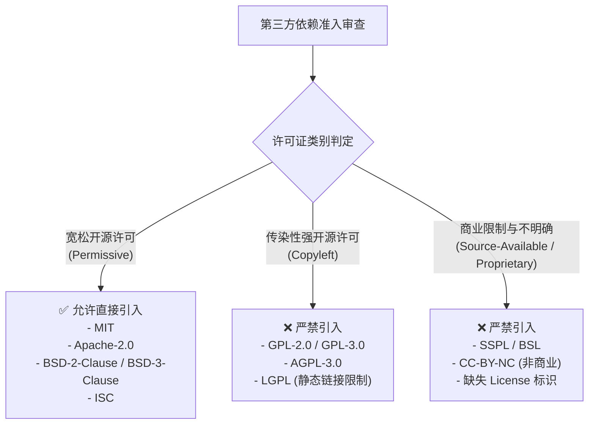

# Nightglide 开源许可、上游致谢与知识产权合规政策 (LICENSE & IP POLICY)


> **状态说明（2026-11-18）：**许可政策（MIT）与致谢原则仍然有效；但本文的依赖清单基于旧原型（OpenTUI 组件已退役）。新主线依赖以 `vendor/omp` 子模块及其第三方许可文件为准，发布前需按 Stage 4 重新校验第三方通知。
> **"Build beyond the horizon." / "漫翔苍穹，构筑所想。"**  
> *法律与合规基准: 官方知识产权与开源合规规范 | 生效日期: 2026-11-15*

---

## 1. Nightglide 核心许可协议 (The MIT License)

Nightglide 整体项目在 **MIT 许可证 (The MIT License)** 下公开发布。我们坚信开放、自由与协作是驱动现代软件工程创新的核心力量。

### 1.1 权利授予与法律边界
- **商业使用自由 (Commercial Use):** 允许个人与企业将 Nightglide 免费用于商业项目开发、代码生成与商业环境部署。
- **修改与派生自由 (Modification):** 允许自由修改源代码、扩展新适配器、开发衍生工具。
- **分发与集成自由 (Distribution):** 允许在开源或闭源商业产品中嵌入或分发 Nightglide。
- **唯一法定条件 (Condition):** 在任何形式的源代码分发或编译制品二进制分发中，**必须完整保留原始版权声明与 MIT 许可协议全文**。
- **免责声明 (Disclaimer of Warranty & Liability):** 本软件按“原样（AS IS）”提供，不提供任何明示或暗示的担保；作者与版权持有者不对因使用本软件造成的任何直接或间接损失承担责任。

---

## 2. 核心上游致谢与归属声明 (Upstream Attributions)

Nightglide 站在巨人的肩膀上。我们由衷感谢上游开源社区的卓越贡献，并在本项目中严格履行以下归属与致谢义务：

```
+-----------------------------------------------------------------------------------------+
|                                核心上游组件归属与致谢清单                                  |
+--------------------------+-----------------+------------+-------------------------------+
| 上游依赖包名             | 对应核心仓库    | 许可证类型 | 原始版权声明与贡献者致谢       |
+--------------------------+-----------------+------------+-------------------------------+
| @oh-my-pi/               | can1357/        | MIT        | Copyright (c) Mario Zechner,  |
| pi-coding-agent          | oh-my-pi        |            | Can Bölük, Stencil Labs       |
+--------------------------+-----------------+------------+-------------------------------+
| @opentui/core            | anomalyco/      | MIT        | Copyright (c) opentui         |
|                          | opentui         |            |                               |
+--------------------------+-----------------+------------+-------------------------------+
| @opentui/react           | anomalyco/      | MIT        | Copyright (c) opentui         |
|                          | opentui         |            |                               |
+--------------------------+-----------------+------------+-------------------------------+
| react                    | facebook/       | MIT        | Copyright (c) Meta Platforms, |
|                          | react           |            | Inc. and affiliates.          |
+--------------------------+-----------------+------------+-------------------------------+
```

### 2.1 制品归属交付规范
在 M4 阶段分发的独立单可执行二进制文件（Binary Distribution）中，必须内置 `nightglide credits` 命令或在安装包中附带 `THIRD_PARTY_LICENSES.txt`，确保上游所有版权声明与协议文本对最终用户完全公开透明。

---

## 3. 依赖项许可证准入与自动化审计规则 (Dependency Audit Rules)

为确保 Nightglide 的供应链合规与商业友好性，所有直接或传递引入的第三方 npm/Bun 依赖必须经过严格的许可证准入审计。



### 3.1 准入白名单 (Approved Whitelist)
- **MIT License**
- **Apache License 2.0**
- **BSD 2-Clause / BSD 3-Clause License**
- **ISC License**

### 3.2 绝对禁止黑名单 (Banned Blacklist)
- **GPL / AGPL 系列:** 杜绝任何强传染性协议（Copyleft），防止因依赖污染导致 Nightglide 自身架构被强制要求开源全部商业衍生组件。
- **SSPL / BSL 等限制性源码可用协议:** 杜绝带有云服务限制条款的组件。
- **非商业限制许可 (Non-Commercial):** 严禁引入带有 `-NC` 标识的库，确保企业用户无合规风险。

### 3.3 CI 自动化准入审计
在 GitHub Actions / 自动化构建流水线中，强制运行许可证扫描检查脚本。一旦检测到黑名单或未知许可证，流水线自动阻断。

---

## 4. 字体与终端资产使用规范 (Font Licensing Guidelines)

### 4.1 终端字体的宿主渲染边界
- Nightglide 是一款终端 CLI 应用，界面的排版文字、ASCII 艺术字标以及 Nerd Fonts 图标**均交由宿主操作系统的终端模拟器（如 iTerm2、Ghostty、Alacritty）及其安装的等宽字体渲染**。
- Nightglide 本身**不将商用字体文件打包进二进制文件**，因而避免了字体版权重分发的法律风险。

### 4.2 推荐开源字体合规说明
我们在文档与指引中向用户推荐的终端字体均为合法开源字体：
- **JetBrains Mono:** 遵循 Apache 2.0 许可协议。
- **Fira Code:** 遵循 SIL Open Font License (OFL) 1.1。
- **Source Han Sans (思源黑体) / Noto Sans CJK:** 遵循 SIL Open Font License 1.1。
- **Nerd Fonts 补丁图标:** 遵循各上游开源协议及 SIL OFL 1.1。

---

## 5. 商标与品牌使用边界 (Trademark Guidelines)

### 5.1 "Nightglide" 品牌商标使用守则
- “Nightglide” 名称、苍穹飞行艺术字标（Wordmark）以及官方主题标识代表 Nightglide 官方项目的质量与声誉。
- **允许的使用场景:**
  - 诚实指称本产品（如“用于配合 Nightglide 的插件”）。
  - 开源分享包含 Nightglide 终端界面的录屏、截图与教程。
- **禁止的使用场景:**
  - 未经授权使用 “Nightglide 官方” 或 “Nightglide Team” 名义发布未经审计的商业发行版。
  - 将下游派生分支或二次包装产品命名为可能引起用户混淆的名称。

### 5.2 上游商标的合理指称使用 (Nominative Fair Use)
- 本项目在文档与界面中提及 “Oh My Pi”, “OMP”, “OpenTUI” 仅用于客观技术描述和指称技术兼容性，不代表上游商标持有者对本项目的直接商业背书。

---
*(本文档为 Nightglide 知识产权与法律事务指南，保障开源社区与商业生态的健康长期发展)*
