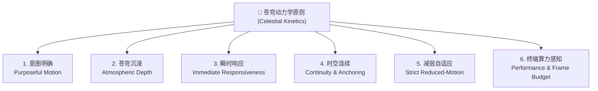

# Nightglide 苍穹动效系统规范 (MOTION SYSTEM)


> **历史原型记录。** 本文描述已退役的 OpenTUI 原型架构，其中的技术方案、完成度与结论不适用于 OMP 原生新主线；现状以 [新路线图](ROADMAP.md) 与 [验收记录](STAGE_2_3_VERIFICATION.md) 为准。本文仅作设计思想与历史参考。
> **"Build beyond the horizon." / "漫翔苍穹，构筑所想。"**  
> *动效系统代号: Celestial Kinetics (苍穹动力学) | 终端渲染基座: OpenTUI React (v0.9.0)*  
> *文档版本: v1.0.0 (基准官方规范) | 适用范围: 终端 UI 动画、微交互与过渡管线*

---

## 1. 动效设计核心哲学与六大铁律 (Motion Philosophy & Core Principles)

在终端字符网格中，动效既是强大的认知放大器，也是极易引发灾难的危险源。滥用动画会导致终端重绘管线拥塞、CPU 占用飙升、界面撕裂，甚至引发使用者的视觉疲劳与眩晕。

Nightglide 将动效确立为**一等公民产品需求**，并建立在以下六大核心原则之上：



### 六大核心原则
1. **意图明确 (Purposeful Motion):**  
   每一个动效必须明确表达状态变更、层级流转或因果关系。坚决拒绝为“炫技”而存在的无意义悬停动画。
2. **苍穹沉浸 (Atmospheric Depth):**  
   动效应当如夜航中机翼划破薄云般静谧从容。采用正弦呼吸、微光掠过与单线渐进，避免刺眼的高频狂闪与突兀跳跃。
3. **瞬时响应 (Immediate Responsiveness):**  
   动效绝不可增加软件的感知延迟。用户击键或发起操作的瞬间必须在 **50ms** 内呈现初始反馈，动画绝不阻塞任务推进。
4. **时空连续 (Continuity & Anchoring):**  
   状态切换时维持视觉锚点。例如子智能体派发时，父智能体的任务摘要平滑演变为连线起点，使用户视线自然跟随。
5. **减弱自适应 (Strict Reduced-Motion):**  
   支持全局一键减弱动效配置（`motion: "off"` 或 `--no-motion`）。关闭后所有过渡耗时强制清零，文本与状态瞬时就绪。
6. **终端算力感知与抗抖动 (Performance & Zero Jitter):**  
   终端字符网格没有次像素渲染。所有动画元素尺寸必须预先分配固定字符槽位（定宽定高），严禁因字符长度变化导致下方内容颠簸。

---

## 2. 动效时间体系与终端物理预算 (Timing Curves & Frame Budget)

### 2.1 终端离散时间阶梯 (Discrete Timing Tiers)

在终端字符环境中，过于细微的连续曲线（如 CSS `cubic-bezier(0.25, 0.1, 0.25, 1.0)`）会被离散的刷新率打碎。Nightglide 制定了 4 级离散时间标准：

```
+-----------------------------------------------------------------------------+
|                          NIGHTGLIDE 动效时间阶梯表                           |
+-------------------+-------------+-------------------+-----------------------+
| 动效阶梯级别      | 持续时间    | 帧数预算 (15 FPS) | 适用场景              |
+-------------------+-------------+-------------------+-----------------------+
| T0: Instant (瞬时)| 0 ms        | 0 帧              | 文本输入、错误阻断    |
| T1: Micro (微交互)| 80 - 120 ms | 1 - 2 帧          | 按钮按下、Tab 切换    |
| T2: Transition    | 150 - 250 ms| 2 - 4 帧          | 卡片展开、面板收起    |
| T3: Ambient (呼吸)| 800 - 1200ms| 12 - 18 帧 (循环) | 思考等待、状态呼吸灯  |
+-------------------+-------------+-------------------+-----------------------+
```

### 2.2 终端帧率预算与抗抖动铁律 (FPS Budget & Anti-Jitter Rules)

- **帧率上限:** 动画刷新率严格限制在 **10 FPS 至 15 FPS**（每 66ms 至 100ms 刷新一帧）。绝对禁止在终端中追求 60 FPS，防止 SSH 远程网络与低功耗设备 CPU 满载。
- **定宽槽位占位原则 (Slot Reservation):**
  - 旋转指示符必须严格固定为 1 字符宽（如 `⠋`），后跟 1 个不间断空格。
  - 进度指示条总长度必须预先计算字符列数（如固定 20 列），内部字符变化仅做实心与空心字元替换（如 `[=====>    ]`），禁止动态增减两端括号外的字符。
- **即时销毁机制 (Instant Teardown):**
  - 当状态流转至 `done` 或 `error`，或用户按下 `Esc` / `Ctrl+C` 时，必须立即调用定时器清理句柄，清除 `useAnimationTick` 订阅，不得遗留孤儿定时器。

---

## 3. 核心动效全量规范矩阵 (Animation Specifications)

每一个动效均由统一的架构规范定义：

---

### 分类 A: 启动与欢迎体验 (Startup Experience)

#### `ANIM-START-001`: 微光地平线展开 (Horizon Reveal)
- **触发源:** 应用程序初次冷启动或会话挂载完成。
- **初始状态:** 终端中央仅呈现极弱单线中点 `───✦───`（颜色 `textMuted`）。
- **目标状态:** 向两侧平滑延伸至完整卡片宽度（80-100 列），中点微光淡出为标准分界线。
- **可观测视觉行为:**
  - 第 0ms: 显示中央 7 字符 `───✦───`；
  - 第 66ms: 左右各延展 15 字符 `──────────✦──────────`；
  - 第 133ms: 延展至全宽，`✦` 变为单线制表符 `─`，整体切换为 `border` 颜色。
- **持续时间:** 150 ms。
- **打断行为:** 用户键入任意按键或传入管道流时，瞬间跳至最终目标状态并让出输入焦点。
- **减弱动效回退:** 耗时 0ms，首帧即直接展示完整全宽边框。
- **OpenTUI 实现可行性:** 基于 `@opentui/react` 的 `useAnimationTick(66)` 计算步长字符数，现存 OpenTUI 即可行。
- **性能预期:** CPU 占用率峰值 <0.5%，耗费 3 次微渲染。
- **验收标准:** 终端无闪烁，中文字符终端下宽度不溢出。

#### `ANIM-START-002`: 苍穹字标平滑显现 (Wordmark Glide)
- **触发源:** `ANIM-START-001` 边框展开完成。
- **初始状态:** ASCII 艺术字标前景色为 `textMuted`。
- **目标状态:** 5 行 ASCII 艺术字由弱化色逐行渐变为 `theme.colors.accent`（深色下为淡紫蓝）。
- **可观测视觉行为:** 顶部行至底行以 30ms 级联延迟改变文本前景 ANSI 颜色代码，形成垂直拂过感。
- **持续时间:** 150 ms。
- **打断行为:** 敲击任意键立即完成着色。
- **减弱动效回退:** 直接以 `accent` 静态高亮呈现。
- **OpenTUI 实现可行性:** 通过状态机计数器映射行样式，现存可行。
- **验收标准:** 5 行 ASCII 字符在全部终端下无换行位移。

#### `ANIM-START-003`: 老用户极速跳过启航 (Returning Quick Launch)
- **触发源:** 本地已存在有效 `config.json` 且未指定 `--splash`。
- **初始/目标状态:** 跳过一切过场动画，直接挂载主工作台。
- **持续时间:** 0 ms。

---

### 分类 B: 思考与推演指示 (Thinking & Processing)

#### `ANIM-THINK-001`: 苍穹星点微光呼吸 (Celestial Pulse)
- **触发源:** 客户端向模型发出请求，等待首字 Token 阶段。
- **初始状态:** 状态指示灯为幽蓝暗色 `○`（颜色 `textMuted`）。
- **目标状态:** 演变为发光星核 `✦`（颜色 `accent`），随后回落为 `●`。
- **可观测视觉行为:**
  - 循环帧序列 (10 FPS, 每帧 100ms):
    `Frame 0: ⠋ 正在思考...` -> `Frame 1: ⠙ 正在思考...` -> `Frame 2: ⠹ 正在思考...` ->
    `Frame 3: ⠸ 正在思考...` -> `Frame 4: ⠼ 正在思考...` -> `Frame 5: ⠴ 正在思考...`
  - 前景颜色跟随帧在 `textMuted` 与 `accent` 之间微正弦变换。
- **持续时间:** 持续循环直到首个 `text_delta` 到达。
- **打断行为:** 首字到达时立即定格并销毁定时器，平滑淡入主文本流。
- **减弱动效回退:** 静态展示 `✦ 思考中...`，无旋转与颜色跳动。
- **OpenTUI 实现可行性:** 利用 `useAnimationTick(100)` 驱动数组下标轮换，完全成熟稳定。
- **性能预期:** 单核 CPU 占用 <0.2%，定时器精确触发。
- **验收标准:** 思考文字与指示符定宽，整行无横向抖动。

#### `ANIM-THINK-002`: 子智能体推演状态切换 (Agent State Shifting)
- **触发源:** 子智能体从 `waiting` 进入 `running`，或从 `running` 进入 `completed`。
- **可观测视觉行为:** 状态卡片状态徽标文字由 `[WAITING]` 翻转为 `[RUNNING]`，背景由 `surface` 变为 `surfaceElevated`，边框高亮 100ms 后恢复常态。
- **持续时间:** 100 ms。
- **打断行为:** 支持状态重入与覆盖。
- **减弱动效回退:** 瞬间更新文字与颜色，无边框高亮闪烁。

#### `ANIM-THINK-003`: 失败重试渐退倒计时 (Retry Backoff Pulse)
- **触发源:** 网络或限流触发自动重试退避（如等待 3 秒）。
- **可观测视觉行为:** 显示 `⚠ 服务繁忙，正在进行第 1/3 次重试 (3s) [•••]`，点号每秒减少一个。
- **持续时间:** 依据重试退避间隔精确度量。

---

### 分类 C: 流式文本生成 (Streaming Responses)

#### `ANIM-STREAM-001`: 文本平滑追加与行锁定 (Character Stream Flow)
- **触发源:** 引擎分发 `text_delta` 事件。
- **初始状态:** 当前消息气泡末尾。
- **目标状态:** 新增字符稳定追加到终端缓冲区末端。
- **可观测视觉行为:**
  - 文本按 Token 块连续流入；
  - 遇到完整段落时立即触发 Markdown 语法高亮局部重配；
  - 绝对禁止清屏重刷，仅向底层 Virtual DOM 节点执行追加更新。
- **持续时间:** 实时流式（10-100+ tokens/s）。
- **打断行为:** 用户按 `Esc` / `Ctrl+C` 立即停止追加。
- **性能预期:** 即使在 100+ tokens/s 极端吞吐下，界面依然维持稳定 50ms 击键交互响应。

#### `ANIM-STREAM-002`: 瞬态发光游标跳跃 (Terminal Cursor Shimmer)
- **触发源:** 流式吐字期间活跃状态。
- **可观测视觉行为:** 在最后输出的字符右侧紧随一个发光方块 `█`（颜色为当前主题 `accent`），以 500ms 周期明暗交替，生成结束（`done`）瞬间自动隐去。
- **持续时间:** 与流式生命周期同步。
- **减弱动效回退:** 不呈现闪烁方块，生成结束后静默留空。

#### `ANIM-STREAM-003`: 智能视口锁定与防滚屏撕裂 (Auto-Scroll Anchoring)
- **触发源:** 流式内容超出当前时间轴可视窗口高度。
- **可观测视觉行为:**
  - 若用户未手动按方向键向上翻查，视口保持“贴底自动滚动 (Scroll Lock to Bottom)”；
  - 若用户向上滚动查看历史，视口立即解除锁定，新内容在视口外静默追加，严禁强行将用户的滚动位置拉回底部。
- **打断行为:** 用户按方向键或鼠标滚轮滚动即时解除锁定；按下 `G` 或回到底部时重新恢复锁定。

---

### 分类 D: 多智能体协同与接力 (Multi-Agent Collaboration)

#### `ANIM-AGENT-001`: 星图协同任务委派 (Delegation Spark)
- **触发源:** 主智能体向原生 Subagent（如 Planner 或 Scout）派发新任务。
- **初始状态:** 主对话流输出一条委派意向。
- **目标状态:** `AgentMonitor` 中滑入新 Subagent 任务胶囊，伴随微弱连线。
- **可观测视觉行为:**
  - 委派发出瞬间，屏幕右侧或顶部划过一条细字符导线：`──✦──>`；
  - 新增 Agent 卡片以 `surfaceElevated` 背景亮起，文字由 `[INITIALIZING]` 平滑变为 `[SCOUTING]`。
- **持续时间:** 150 ms。
- **打断行为:** 允许并发派发，连线各自行进不发生冲突。
- **减弱动效回退:** 新卡片直接在列表中呈现，无连线动画。
- **OpenTUI 实现可行性:** 基于状态数组条件渲染与 CSS 字符阶梯，完全可行。

#### `ANIM-AGENT-002`: 跨模型成果接力汇聚 (Constellation Handoff)
- **触发源:** 本地 Explorer 完成扫描，将摘要移交至云端 Planner。
- **可观测视觉行为:** Explorer 卡片显示 `✔ COMPLETED` 并降级为 `textMuted`；同时 Planner 卡片由暗态瞬间激活，顶部提示 `✦ 骨架摘要已安全同步至云端架构师`。
- **持续时间:** 120 ms。
- **减弱动效回退:** 状态直接切换。

#### `ANIM-AGENT-003`: 结果聚合与最终收敛 (Aggregation Wave)
- **触发源:** 所有子智能体任务执行完毕，Director 汇总方案生成最终回复。
- **可观测视觉行为:** `AgentMonitor` 中各子卡片状态统一转化为浅绿色对勾 `✔`，随后监视面板平滑折叠为单行精简摘要。
- **持续时间:** 200 ms。

---

### 分类 E: 工具执行与原生审批 (Tool Execution & Approval)

#### `ANIM-TOOL-001`: 工具调用微脉冲 (Tool Invocation Pulse)
- **触发源:** 引擎接收到底层 `tool_start` 事件。
- **初始状态:** 时间轴出现定宽卡片边框。
- **目标状态:** 卡片顶部标题高亮 `⚡ TOOL: read (executing...)`。
- **持续时间:** 80 ms。

#### `ANIM-TOOL-002`: 破坏性操作审批高亮 (Approval Gate Pulse)
- **触发源:** 触发 `edit` / `write` / `bash` 操作，进入人机审批等待阶段。
- **可观测视觉行为:** 卡片外框呈现 `warning` 警示色（深色下为明亮金黄 `#FBBF24`），底部按键提示 `[y/n]` 以 800ms 周期进行温和呼吸。
- **持续时间:** 持续至用户做出按键决策。
- **减弱动效回退:** 边框常亮不闪烁。

#### `ANIM-TOOL-003`: 成功落盘确认微闪 (Tool Success Flash)
- **触发源:** 用户敲击 `y` 批准操作且底层写入成功（`tool_end`）。
- **可观测视觉行为:** 卡片边框短暂呈现 `success` 浅绿（#4ADE80）持续 150ms，随后平滑过渡为静默完成态，打出 `✔ Updated (+12 lines)`。
- **持续时间:** 150 ms。

---

### 分类 F: 模型动态切换与回退 (Model Switching)

#### `ANIM-MODEL-001`: 活跃模型徽章滑动翻转 (Active Model Pill Glide)
- **触发源:** 用户在模型矩阵中切换活跃模型，或路由引擎基于任务自动分派新模型。
- **可观测视觉行为:** 导航顶栏的 `Model: [qwen2.5 (LOCAL)]` 徽标在 100ms 内重排为 `Model: [gpt-4o (CLOUD)]`，背景色做一次 100ms 的强调微亮。
- **持续时间:** 100 ms。

#### `ANIM-MODEL-002`: 隐私敏感回退通知提示 (Privacy Fallback Toast)
- **触发源:** 首选模型超时触发本地回退链。
- **可观测视觉行为:** 时间轴上方浮现单行微弱通知框 `⚡ 触发 LOCAL 模式回退: omlx -> ollama`，展示 3 秒后平滑隐去。
- **持续时间:** 3000 ms (静止展示) + 150 ms (淡出)。

---

### 分类 G: 苍穹主题平滑热重载 (Theme Switching)

#### `ANIM-THEME-001`: 全局调色盘无缝重配 (Palette Sweep)
- **触发源:** 用户敲击快捷键 `t` 选定新主题。
- **可观测视觉行为:**
  - 绝不销毁 DOM 树或执行终端全屏重刷；
  - OpenTUI React 上下文向下广播新主题对象；
  - 所有组件在下一次事件循环微任务中直接以新颜色 Token 重绘；
  - 全过程耗时小于 **15ms**，肉眼无任何白屏或闪烁撕裂感。
- **验收标准:** 终端行光标不发生跳动，控制台无重绘异常。

---

### 分类 H: 通知与异常容灾 (Notifications & Errors)

#### `ANIM-NOTIF-001`: 阻断性异常微颤 (Error Border Shake)
- **触发源:** 用户输入非法参数或发生未配置模型错误。
- **可观测视觉行为:**
  - 卡片边框变红（`error` 色）；
  - 边框第一行在 100ms 内微移一个字符槽位并复位（`┌─` -> ` ┌─` -> `┌─`）；
  - 随后静态显示错误诊断建议与一键修复按键。
- **持续时间:** 100 ms。
- **减弱动效回退:** 边框直接变红，无物理位移微颤。

---

## 4. 动效测试验收标准与量化基准 (Acceptance & Benchmarks)

| 测试指标 | 工业级达标门限 | 严格测量方法 |
| :--- | :--- | :--- |
| **最大帧率限制** | $\le 15\text{ FPS}$ | 在动画持续期间统计虚拟 DOM 重绘回调频率，严禁超频。 |
| **非阻塞击键保障** | 击键延迟 $< 50\text{ ms}$ | 运行后台复杂动画的同时模拟输入测试，按键必须立即捕获。 |
| **屏幕抖动率 (Jitter)** | $0\text{ 次}$ | 在 80x24、100x30 终端下走查所有动效，边框与下方文本位移为 0。 |
| **减弱动效响应** | $100\%$ 生效 | 配置 `motion: "off"` 时，所有定时器与呼吸逻辑彻底禁用。 |
| **终端还原率** | $100\%$ 复原 | 运行任意动画时强制按下 `Ctrl+C`，光标与交替屏必须 100% 完整复原。 |

---
*(本文档为 Nightglide 动效设计与工程实现的官方技术基准，UI 研发中严禁引入未经本规范定义的任意动画)*
