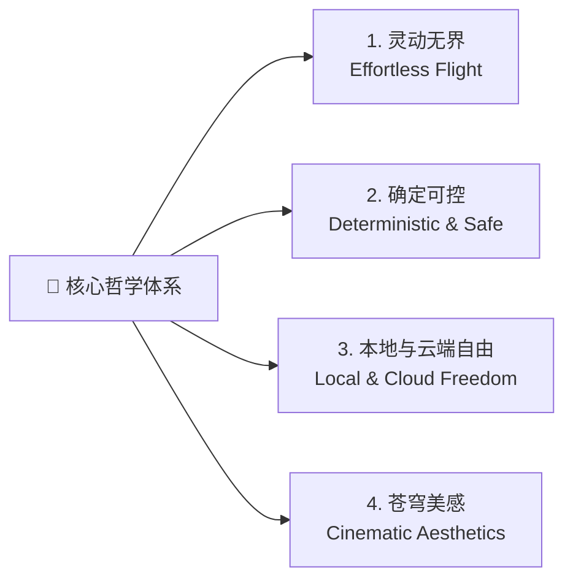
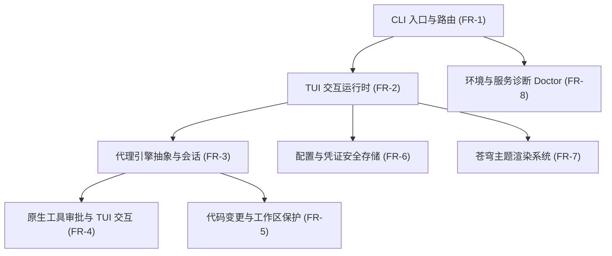
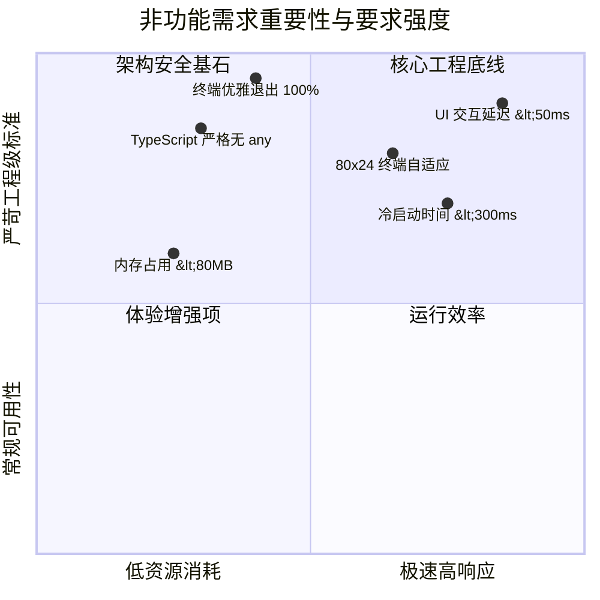

# Nightglide 产品详细规范 (PRODUCT SPECIFICATION)

> **"Build beyond the horizon." / "漫翔苍穹，构筑所想。"**  
> *文档版本: v1.0.0 | 状态: 官方技术基准规范 | 适用范围: 全平台客户端与引擎*

---

## 1. 产品愿景与设计哲学

### 1.1 背景与立项初衷
在现代软件开发范式中，AI 辅助编程正从单纯的“代码自动补全”向拥有自主执行能力的“智能体（Agent）”演进。然而，当前主流的终端 AI 工具普遍存在两极分化：要么是需要记忆复杂参数、交互生硬、缺乏视觉温度的黑盒 CLI；要么是重度依赖云端专有模型、代码与私钥存在外泄隐患的商业闭源插件。

**Nightglide** 应运而生。它是一款面向现代工程师与创作者的独立终端 AI 编程助手（AI Coding CLI）。Nightglide 建立在经过工程验证的 **Oh My Pi (OMP) SDK** 之上，采用 **OpenTUI** 革命性的终端渲染技术，创造出如苍穹夜航般优雅、深邃、流畅的交互体验。我们希望让每一位开发者——无论是初次接触终端的学生，还是要求严苛的资深系统架构师——都能在安全、可控且极具美感的环境中，自由构筑属于自己的软件世界。

---

### 1.2 四大核心产品哲学



1. **灵动无界 (Effortless Flight):**
   - 拒绝“参数地狱”与强迫记忆。无论是初始化项目、修改代码还是排查 Bug，用户只需以自然语言表达意图，系统提供智能向导与实时感知。
   - 兼顾新手友好的引导模式（Guided Mode）与高阶工程师热爱的极速专家模式（Expert Mode）。
2. **确定可控与安全沙箱 (Deterministic & Safe):**
   - 坚决杜绝 AI “脱缰”带来的破坏性后果。底层依托原生 OMP SDK 的原生工具审批与执行沙箱机制，所有文件修改与 Shell 执行均需严格经过原生审批流程。
   - Nightglide 表现层提供优雅清晰的确认与 Diff 对比展示，绝不绕过原生安全防护，亦无需构建脆弱的多余自定义拦截层。
3. **本地优先与模型自由 (Local & Cloud Freedom):**
   - 深度拥抱端侧算力与隐私计算，无缝支持 Apple Silicon 优化的 oMLX、Ollama 及任意兼容 OpenAI 接口标准的本地推理集群。
   - 用户拥有绝对数据主权：私钥安全存取，敏感代码零外发。
4. **苍穹美感与沉浸体验 (Cinematic Aesthetics):**
   - 打破终端非黑即白的沉闷刻板印象。引入以深空、极光、破晓为意象的“苍穹飞行（Celestial Flight）”语义主题系统。
   - 依托 OpenTUI 声明式组件与抗抖动终端渲染管线，消除闪烁与花屏，打造经得起数小时长程编码考验的视觉舒适感。

---

## 2. 目标用户画像 (Personas)

为了确保产品功能与交互流程具备扎实的针对性，Nightglide 深入定义了四个典型用户画像：

### Persona 1: 终端与 AI 编程初学者 (First-time CLI User)
- **代表人物:** 小林（大二软件工程专业学生 / 初学编程的自学者）
- **技能特征:**
  - 了解基础终端命令（`cd`, `ls`, `git clone`），但不熟悉复杂的管道重定向与环境变量配置。
  - 对“AI 可能会删掉我的代码”充满恐惧，渴望每一步操作都有清晰提示和“后悔药（撤回机制）”。
- **痛点与诉求:**
  - 看到满屏报错无从下手；很多 CLI 工具初次启动时由于缺少 API Key 直接崩溃退出。
  - 需要友好的入门向导（Guided Onboarding）、无门槛的试用演示（Demo Mode）以及可视化的操作前确认。
- **Nightglide 赋能:**
  - 首次启动自动进入向导模式，展示苍穹欢迎页。
  - 提供无需配置 API Key 的内置确定性演示模式（`bun run demo`），通过模拟流式对话建立用户信任。
  - 破坏性操作前提供彩色语义 Diff 预览与一键回滚。

### Persona 2: 独立开发者与敏捷创作者 (Student & Hobbyist)
- **代表人物:** Alex（独立独立全栈开发者 / 开源爱好者）
- **技能特征:**
  - 熟练使用 React, Node.js, Python, Rust 等多语言技术栈。
  - 追求极致的交付速度与从 0 到 1 的敏捷落地，常在夜晚和碎片化时间高效编码。
- **痛点与诉求:**
  - 搭建脚手架和编写样板代码占用大量精力。
  - 商业闭源工具费用昂贵且经常遭遇网络限流；需要轻便、免侵入、可随身携带的单文件工具。
- **Nightglide 赋能:**
  - 智能项目脚手架与意图分解，快速生成干净的代码骨架。
  - 极速启动（<300ms）与小巧的资源占用，随时在任意项目根目录键入 `nightglide` 即可开启伴随式开发。
  - 优美沉静的 Midnight Flight 主题，陪伴深夜编码时光。

### Persona 3: 资深系统工程师与架构师 (Senior Engineer)
- **代表人物:** 张工（大厂资深后端开发 / 分布式系统架构师）
- **技能特征:**
  - 极其熟悉 Linux 内核、Git 工作流、CI/CD 与微服务架构。
  - 键盘流（Vim / Tmux）重度用户，对打断输入焦点的多余弹窗零容忍。
- **痛点与诉求:**
  - 极度反感“黑盒魔法”。要求清楚知道 AI 究竟查看了哪些文件、执行了什么命令、改动了哪几行。
  - 需要高密度的信息展示、键盘快捷键支持、以及将 AI 输出无缝衔接至系统管道的能力。
- **Nightglide 赋能:**
  - 专家模式（Expert Mode）与极简状态栏，最大化代码展示视野。
  - 细粒度的工具执行生命周期展示（`tool_start`, `tool_end`，输入输出参数完全透明）。
  - 严格的 Git 工作树保护机制，每次改动均生成隔离分支或原子变更。

### Persona 4: 本地 AI 极客与隐私狂热者 (Local AI Enthusiast)
- **代表人物:** Ethan（AI 安全研究员 / 拥有 M1/M2/M3 Max 设备的本地推理极客）
- **技能特征:**
  - 拥有 64GB+ 统一内存设备，日常运行 oMLX、Ollama、vLLM、Llama.cpp 本地端侧模型。
  - 对数据隐私有极端严苛的要求，严禁企业私有代码或个人隐私外泄至任何第三方公有云 API。
- **痛点与诉求:**
  - 市面上绝大多数 Copilot 类工具对非标准本地服务支持极差，配置繁琐，经常因接口微小差异报错。
  - 希望工具完全离线可用，在飞机、高铁或断网环境中依然能利用本地显卡/神经引擎高效辅助编程。
- **Nightglide 赋能:**
  - 内置 `nightglide doctor` 智能检测本地端侧推理端口（如 oMLX 8000、Ollama 11434）。
  - 原生适配 OpenAI 兼容规范与端侧量化模型流式传输。
  - 提供绝对的数据不出机承诺与开源透明代码审计。

---

## 3. 核心痛点与行业解决方案对比

| 痛点维度 | 传统 CLI / 脚本工具 | 主流闭源 IDE 插件 | **Nightglide 终极解法** |
| :--- | :--- | :--- | :--- |
| **交互界面与视觉体验** | 纯 ANSI 单色文本，日志滚屏极快，无法回看与聚焦，界面生硬冰冷。 | 嵌在复杂 IDE 边栏中，割裂终端专注流，占用高额 GUI 内存。 | **OpenTUI 声明式终端渲染**，苍穹语义主题系统，极具电影感的美学与微动效。 |
| **安全与权限边界** | 往往给予无限制的 Bash 执行权限，一不小心可能执行 `rm -rf`。 | 权限逻辑封装在云端，无法对特定本地操作实施离线拦截。 | **原生 OMP 工具审批与 TUI 人机确认**，原生工具权限白名单与二次确认交互。 |
| **模型自由度与隐私** | 强绑定特定供应商（如 OpenAI 或 Claude），无法切换端侧私有引擎。 | 必须登录专属账号，代码片段需上传至供应商服务器进行上下文分析。 | **本地模型优先架构**，原生支持 oMLX/Ollama，配置文件与密钥严格本地受控。 |
| **跨技能层级友好度** | 参数繁琐晦涩（如 `--flags` 堆叠），仅适合少数专家用户。 | 适合日常但缺乏定制性，无法按需灵活介入底层执行链。 | **双模态无缝切换**（小白向导引导 vs 专家极速透传），适应全阶段开发者。 |
| **确定性与测试能力** | 依赖真实网络与付费 Token，测试困难且结果具备不确定性。 | 无法离线单测，CI/CD 集成成本高。 | 内置 **Deterministic MockAgentEngine**，零成本驱动完整 UI 测试与离线演示。 |

---

## 4. 核心功能需求 (Functional Requirements)

Nightglide 按照模块化架构划分以下 8 大核心功能集合：



### FR-1: 命令行入口与智能路由
- **描述:** 提供统一可执行文件 `nightglide`，支持常规交互模式启动与子命令直接路由。
- **子命令矩阵:**
  - `nightglide` (无参数): 检查环境配置，进入默认 TUI 交互界面。
  - `nightglide dev`: 启动开发与调试模式，开启详细日志通道。
  - `nightglide demo`: 启动免 Key 确定性流式演示模式（基于 `MockAgentEngine`）。
  - `nightglide doctor`: 执行环境、依赖、网络与本地推理服务探针检测。
  - `nightglide config`: 查看或安全编辑用户全局与项目级配置。

### FR-2: 交互式 OpenTUI 终端应用
- **描述:** 基于 OpenTUI React 渲染器构建的沉浸式终端界面。
- **关键交互组件:**
  - **Header / Navigation Bar:** 展示 Nightglide 苍穹艺术字标（ASCII Wordmark）、当前工作区路径、活跃模型与当前模式。
  - **Message Timeline:** 结构化渲染用户输入、助手流式回复（Streaming Delta）、思考中状态（Thinking Indicator）与工具调用卡片。
  - **Composer:** 支持多行编辑、历史命令上下键翻查、快捷键提交（`Enter` 发送，`Shift+Enter` 换行，`Ctrl+C` 取消）。
  - **Status Bar:** 实时显示终端尺寸（如 `100x30`）、主题名称、网络/模型连通性指示器与快捷键提示（如 `Tab` 模式切换、`?` 帮助）。

### FR-3: 统一代理引擎抽象与会话管理
- **描述:** 表现层与执行层彻底解耦，通过 `AgentEngine` 与 `AgentSession` 契约通信。
- **功能特性:**
  - 统一事件模型 `AgentEvent`：严格区分 `text_delta`、`tool_start`、`tool_end`、`status`、`error` 与 `done`。
  - 确定性模拟引擎 `MockAgentEngine`：内置典型代码编写场景模拟，输出逐字流式文本与工具调用，无需任何外部网络。
  - 隔离上游适配器 `OmpAgentEngine`：基于 `@oh-my-pi/pi-coding-agent`，实施隔离设置、内存会话与环境脱钩。

### FR-4: 原生工具执行与人机审批交互
- **描述:** 依托 OMP 原生工具执行引擎与审批机制，在终端 TUI 提供清晰的可视化审批确认。
- **工具分类与审批交互:**
  - **只读操作 (Read-only):** `read`, `find`, `grep` —— 原生只读分析工具，向用户呈现执行概要与定位结果。
  - **写入与修改操作 (Write & Edit):** `edit`, `write` —— 原生编码修改工具，执行前触发工具审批，TUI 呈现待修改内容与确认状态。
  - **命令执行 (Command Execution):** `bash` —— 原生 Shell 执行工具，触发原生工具审批，TUI 呈现命令全貌与工作目录，经用户敲击确认后方可执行。

### FR-5: 代码变更对比与工作区保护
- **描述:** 防范模型幻觉导致的毁灭性代码覆盖。
- **功能特性:**
  - 语法着色 Diff 视图：红绿两色对比新增与删除行，支持分块（Chunk）浏览。
  - 变更放弃（Revert）与采纳（Apply）机制：支持逐文件或全量接受修改。
  - 自动备份与状态快照：写入前在临时元数据区创建回滚检查点。

### FR-6: 跨平台配置体系与凭证安全
- **描述:** 统一多操作系统配置规范。
- **路径标准:**
  - macOS/Linux: `~/.config/nightglide/config.json`
  - Windows: `%APPDATA%\nightglide\config.json`
- **安全红线:**
  - 严禁在本地明文 JSON 文件中直接持久化 API Key。
  - 优先从系统环境变量（如 `OPENAI_API_KEY`, `NIGHTGLIDE_API_KEY`）或安全密钥链读取。

### FR-7: 苍穹语义主题系统 (Celestial Themes)
- **描述:** 内置 4 套满足 WCAG AA 终端对比度标准的高品质色彩预设：
  - **Midnight Flight (深空夜翔):** 默认深色主题，深蓝黑夜空背景，淡紫蓝高亮。
  - **Aurora (极光变奏):** 充满活力与艺术气息的极光紫与青绿。
  - **Cloudlight (云隙轻光):** 明亮清爽的浅白与蓝灰配色。
  - **Daybreak (破晓之光):** 温暖温润的晨曦暖色调浅色主题。
- **动态热重载:** 支持在交互界面中通过快捷键瞬间切换，无闪烁平滑重绘。

### FR-8: 综合系统诊断工具 (`doctor`)
- **描述:** 为开发者提供一键自检与故障排查报告。
- **探测矩阵:**
  - 核心运行时（Bun 版本，Node.js 版本，Git 配置）。
  - 上游核心包（OMP SDK 导出完整性，OpenTUI 渲染器可用性，原生 Task 委派就绪状态）。
  - 本地与云端推理服务连通性（检测本地 8000、11434 端口状态与鉴权要求）。
  - 多提供商注册表与工作负载路由器状态检查。

### FR-9: 多提供商管理与端点诊断 (`providers` & `models`)
- **描述:** 支持多 Provider 并存配置与模型限定符引用。
- **功能特性:**
  - `nightglide providers`: 列出已配置的本地与云端端点，严格基于回环 IP 判定物理 Locality (`[LOCAL]` vs `[CLOUD]`)，探测连通性。
  - `nightglide models`: 展示已注册模型的能力徽标、限定符 ID（如 `omlx/qwen2.5-coder`、`openai/gpt-4o`）与当前各智能体角色的分配关系。

### FR-10: 工作负载感知模型智能路由 (`WorkloadModelRouter`)
- **描述:** 依据任务意图、复杂度和严格的隐私合规要求，智能调度最适模型。
- **4 类运行模式:**
  - **`LOCAL`:** 纯离线隐私保护模式。仅使用本地回环端点模型，路由层从源头保证仅分派物理本地模型，且回退候选链绝不包含云端端点，确保数据不出机。
  - **`BALANCED`:** 默认推荐模式。常规轻量检索/解释在本地端侧运行；高复杂度规划与评审任务在用户显式开启云端授权时协同云端强模型。
  - **`PERFORMANCE`:** 性能优先模式。首选具备最高推理能力的模型，且必须严格在用户授权预算内运行。
  - **`MANUAL`:** 手动模式。严格执行用户针对 `MAIN`、`EXPLORE`、`PLAN`、`IMPLEMENT`、`REVIEW` 各角色显式指定的模型，严禁任何未授权静默替换。

### FR-11: 本地与云端多智能体协同流水线 (Local + Cloud Agent Collaboration)
- **描述:** 多 Agent 分工接力解决复杂开发任务。
- **核心协同范式:**
  - **Local Explore, Cloud Plan:** 本地 Explorer 扫描只读代码并提炼符号骨架；云端 Planner 仅接收必要摘要并产出架构蓝图。代码资产零全量上传。
  - **Cloud Plan, Local Code, Cloud Review:** 云端编制蓝图后，本地编码模型修改文件，独立 Reviewer 模型执行安全质量审查。

### FR-12: 实时多智能体监视器与模型矩阵视图 (`AgentMonitor` & `ModelAssignmentView`)
- **描述:** 在终端 TUI 中消除 AI 协作的黑盒感。
- **交互组件:**
  - **Agent Monitor:** 对话界面可随时展开/收起参与当前任务的各 Agent 角色卡片、模型、LOCAL/CLOUD 标签、状态与 Token。
  - **Routing Explanation:** 任务指派前展示直观的路由解释卡片与预估成本。
  - **Model Matrix (`[5]` 快捷导航):** 交互式角色分配矩阵，无需手动编辑 YAML 即可直观查看与调整模型分配，一键切换路由模式与云端开关。

---

## 5. 非功能需求 (Non-Functional Requirements)



### 5.1 性能与响应延迟 (Performance)
- **冷启动耗时:** 从用户在终端按下回车键到首屏完整渲染，总耗时不超过 **300ms**（在 M1+ Apple Silicon 或主流 x86_64 设备上）。
- **界面交互响应:** 键盘击键、输入框滚动、状态栏切换的本地 UI 响应延迟小于 **50ms**。
- **流式渲染吞吐:** 支持每秒渲染 100+ tokens 的高速模型流式输出，终端不产生排队丢帧与界面撕裂。
- **基础内存占用:** 常驻内存（RSS）基线控制在 **80MB** 以内。

### 5.2 终端环境兼容性与鲁棒性 (Robustness & Compatibility)
- **尺寸自适应范围:**
  - 最低基线: 严格支持经典的 **80x24** 终端尺寸（保证边界不溢出、布局不崩塌）。
  - 标准推荐: 适配 **100x30** 及以上标准终端。
  - 宽屏优化: 针对 **120x36+** 宽屏终端提供分栏与宽屏高密度信息展示。
- **信号处理与现场恢复:**
  - 捕获 `SIGINT` (Ctrl+C)、`SIGTERM` 以及未捕获异常，确保 100% 调用终端恢复序列（恢复显示光标、退出 Raw 模式、清理交替屏幕缓冲区 Alternate Screen），彻底杜绝退出后终端花屏、光标消失。
- **色彩降级策略:**
  - 自动检测终端色彩支持度（TrueColor 24-bit -> ANSI 256 色 -> 基本 16 色），并平滑映射主题 Token。
  - 严格支持 `NO_COLOR` 环境变量标准规范。

### 5.3 代码健壮性与类型安全 (Type Safety & Code Quality)
- **TypeScript 严格标准:**
  - 开启 `strict: true`, `noImplicitAny: true`, `strictNullChecks: true`。
  - 整个代码库内**绝对禁止使用 `any` 类型**（必须使用泛型、`unknown` 或具体接口定义）。
- **测试覆盖率与自动化防护:**
  - 核心契约与配置校验测试覆盖率达到 90% 以上。
  - CI 测试中 100% 使用 Mock 隔离，零外网真实请求依赖，保证单测稳定度与闪电速度。

---

## 6. 成功度量指标 (Success Metrics)

```
+-----------------------------------------------------------------------------+
|                          NIGHTGLIDE 核心成功指标体系                           |
+-----------------------------------------------------------------------------+
| 指标维度             | 目标值                | 衡量定义与采集方式             |
+---------------------+----------------------+--------------------------------+
| Time to First       | < 5 秒               | 用户从执行命令到看到欢迎向导并能  |
| Interaction (TTFI)  |                      | 成功发起首次对话/演示的时长      |
+---------------------+----------------------+--------------------------------+
| Onboarding          | > 85%                | 首次启动用户无障碍完成模型配置   |
| Completion Rate     |                      | 或进入确定性演示模式的比率       |
+---------------------+----------------------+--------------------------------+
| Destructive Action  | 0 起                 | 未经用户显式确认导致本地代码丢失 |
| Incident Rate       |                      | 或未备份覆盖的安全事故率         |
+---------------------+----------------------+--------------------------------+
| Credential Leakage  | 0 起                 | 日志、错误堆栈或向导中明文输出  |
| Incident Rate       |                      | 用户私有密钥的安全事故率         |
+---------------------+----------------------+--------------------------------+
| Terminal Panic /    | < 0.01%              | 异常退出导致终端状态未复原的     |
| Garbled Screen Rate |                      | 偶发比例（零容忍）             |
+---------------------+----------------------+--------------------------------+
```

---

## 7. MVP 范围界定与里程碑演进

### 7.1 M0 阶段核心交付范围 (已落地与正在落地)
- [x] Monorepo 规范结构与 Bun 1.4.4+ 自动化集成工程。
- [x] `packages/core`：统一契约、`AgentEvent` 判别联合类型与异常继承树。
- [x] `packages/themes`：4 套苍穹主题、色彩语义 Token 与运行时管理器。
- [x] `packages/config`：跨平台路径规范、Schema 校验与默认配置生成器。
- [x] `packages/engine`：确定性 `MockAgentEngine`，实现无依赖零成本全链路测试。
- [x] `packages/engine`：隔离的 `OmpAgentEngine` 适配器（严格限制只读工具白名单）。
- [x] `apps/cli`：OpenTUI 驱动的终端向导、免 Key 演示模式与 `doctor` 诊断工具。

### 7.2 里程碑演进路线规范 (Milestone Evolution)
- **M0 (Engineering Foundation & UX):** 架构基石、Monorepo 搭建、OMP 上游隔离封装、苍穹设计系统与 OpenTUI 终端交互、免 Key 演示模式与诊断工具（已完成）。
- **M1 (Multi-Provider Intelligence & Agent Collaboration):** 多提供商注册表、工作负载感知智能模型路由（LOCAL / BALANCED / PERFORMANCE / MANUAL）、本地与云端多 Agent 协同流水线、Agent Monitor 与 Model Assignment 矩阵（已完成）。
- **M1.1 (Audit Remediation & Real Capability Verification):** 独立安全审计整改、0.0.0.0 与网络 Locality 严密判定、MANUAL 模式零静默替换与强类型异常、WCAG AA 终端对比度全量合规、真实终端多尺寸验证与文档一致性矫正（已完成）。
- **M1.2 (Native OMP Restoration & Architecture Simplification):** 架构简化与原生 OMP 能力回归。彻底移除多余的自定义 4 层 Below-the-Prompt 工具拦截器、强制 `tools.approval: deny` 注入以及人为禁用 Reviewer/Task/Sonic 等脆弱机制；确立 Nightglide 作为轻量 SDK 适配器、TUI 呈现与多提供商路由器的职责边界，原生工具执行、原生审批与子智能体执行完全由 OMP 原生接管（当前基线）。
- **M2 (Safe File Editing & Sandbox Workflows):** 受控代码修改工具（`edit`, `write`）、语法着色 Diff 审查与终端人机审批、Git Worktree 临时工作区沙箱与原子写盘。
- **M3 (Advanced Developer Experience & Self-Healing):** 项目代码库全局上下文索引、智能 Git 提交与 PR 描述生成、编译/单测报错自愈修正循环。
- **M4 (Public Distribution & Ecosystem):** 跨平台独立二进制打包分发、Homebrew/npm 一键安装、第三方能力与插件生态。

---

## 8. 明确排除范围 (Out-of-Scope Boundaries)

为了集中资源打造极致的终端编码助手，Nightglide 明确界定以下能力**不属于**本产品的设计边界：

1. **不作为传统重量级 IDE (如 VS Code / IntelliJ) 的替代品:**
   - Nightglide 专注于终端会话交互与 AI 智能体协同，不内置全套语法高亮编辑器、窗口拖拽布局系统或复杂的图形化插件市场。
2. **不提供中心化云端托管 SaaS 服务:**
   - Nightglide 是去中心化、本地优先的客户端软件，不在云端存储用户的代码、项目历史、敏感提示词或模型交互日志。
3. **不承担远程分布式模型训练集群调度任务:**
   - Nightglide 是编程推理与代码操作的辅助工具，不负责大规模 LLM 预训练、微调分布式算力编排或 GPU 集群物理管理。
4. **不充当绕过系统宿主安全隔离的越权通道:**
   - Nightglide 严格遵守宿主操作系统的用户权限与文件访问控制，绝不提供任何旨在绕过权限检查、越权提升特权或隐蔽通信的功能。

---
*(本文档为 Nightglide 产品设计的顶层指导纲领，后续所有功能开发与交互设计均需严格对齐本规范)*
