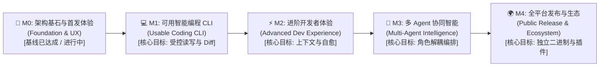

# Nightglide 演进里程碑路线图 (ROADMAP)

> **"Build beyond the horizon." / "漫翔苍穹，构筑所想。"**  
> *发布版本规划: M0 至 M4 | 制定日期: 2026-11-15 | 维护团队: Nightglide Architecture Group*

---

## 1. 总体演进概览与时间线

Nightglide 遵循精细化、高可靠性的阶段式演进策略。从底层隔离与美学基石（M0）出发，逐步进化为具备受控文件读写能力的实用 CLI（M1）、拥有高级审查与 Git 上下文的开发者利器（M2）、具备多角色协作编排的智能体系统（M3），直至面向全网跨平台独立分发的成熟开源产品（M4）。

---

## 2. 里程碑阶段详细规范

---

### 里程碑 M0: 基础架构与首发体验 (Foundation & Initial Experience)
- **核心定位:** 搭建高鲁棒性 Monorepo，完成上游 SDK 隔离封装，确立苍穹设计美学与 OpenTUI 终端交互基准，提供确定性离线演示。
- **当前状态:** **基线已达成 (Baselines Done / In Progress)**

#### 交付清单 (Deliverables)
1. **Monorepo 与构建工程:**
   - 基于 Bun 1.4.4 构建的工作区结构（`packages/core`, `packages/themes`, `packages/config`, `packages/engine`, `apps/cli`）。
   - 统一 TypeScript 严格类型检查规则与单测编排。
2. **核心抽象契约 (`packages/core`):**
   - 定义 `AgentEngine`, `AgentSession`, `SessionState`。
   - 统一判别联合事件流 `AgentEvent`（6 大核心事件）。
   - 结构化异常体系（`NightglideError`, `EngineError`, `SecurityPermissionError`）。
3. **苍穹设计系统 (`packages/themes`):**
   - 实现 4 套官方主题：Midnight Flight, Aurora, Cloudlight, Daybreak。
   - 导出语义色彩 Token 与运行时 `ThemeManager`（支持热重载与订阅）。
4. **跨平台配置管理 (`packages/config`):**
   - 规范跨平台配置存储路径（XDG / AppData）。
   - 编写严苛的 JSON Schema 校验器与默认模板自生成逻辑。
5. **执行引擎实现 (`packages/engine`):**
   - **确定性模拟引擎 (`MockAgentEngine`):** 毫秒级稳定模拟逐字吐字、工具调用与完成态，实现 0 网络依赖的 UI 体验与 CI 测试。
   - **隔离上游适配器 (`OmpAgentEngine`):** 基于 `@oh-my-pi/pi-coding-agent` 18.20.2，实施内存会话隔离、设置隔离与只读工具白名单。
6. **终端表现层 (`apps/cli`):**
   - 基于 OpenTUI React 渲染器构建交互式终端。
   - 实现 Header（艺术字标）、Timeline（流式气泡）、Composer（输入框）、StatusBar（环境指标）组件。
   - 提供 `nightglide demo`（免 Key 确定性演示）与 `nightglide doctor`（系统环境综合体检）。

#### 准出验收标准 (Exit Criteria)
- [x] `bun run typecheck` 严格通过，全工程 0 any，0 编译错误。
- [x] `bun test` 单元测试与集成测试 100% 通过（离线无外部网络请求）。
- [x] `bun run demo` 能够正常拉起 OpenTUI 界面，平滑渲染流式打字效果与工具卡片。
- [x] `bun run doctor` 能如实诊断出宿主 Bun、Git、OMP SDK 以及本地 oMLX 8000 端口状态。
- [x] 在终端狂按 `Ctrl+C` 退出后，终端光标正常恢复，无乱码或花屏残留。

#### 技术风险与缓解策略 (Risks & Mitigations)
- **风险 1: 上游 OMP SDK 默认配置隐式读取宿主全局状态。**  
  *缓解:* 在适配器初始化中强制传入 `Settings.isolated()` 与 `disableExtensionDiscovery: true`。
- **风险 2: 终端在小窗口尺寸（如 80x24）下内容折叠错乱。**  
  *缓解:* 在组件树中集成 `useTerminalDimensions()`，当宽度不足 90 列时自动折叠次要标签与边框。

---

### 里程碑 M1: 可用智能编程 CLI (Usable Coding CLI)
- **核心定位:** 实现真正的端到端受控代码修改，从只读阶段跨越到可写入、可审查、可撤销的日常生产力工具。
- **当前状态:** **Planned (下一里程碑)**

#### 交付清单 (Deliverables)
1. **受控写入与文件编辑工具链:**
   - 开放受控文件修改工具（`edit`, `write`），支持基于文本锚点的行级替换与安全写入。
   - 在将修改落盘之前，强制生成文件修改 Diff 暂存快照。
2. **终端语法着色 Diff 审查弹窗:**
   - 在 OpenTUI 中实现轻量级 Diff 审查组件，红绿高亮展示增删行。
   - 提供直观的键盘审批流（`[y] 采纳变更` / `[n] 拒绝修改` / `[d] 展开详细上下文`）。
3. **本地模型一键配对向导:**
   - 自动探测本地运行的 Ollama (`11434`) 与 oMLX (`8000`) 端口，向导式拉取可用模型列表。
   - 针对无鉴权或鉴权失败场景，给出精确的命令级修复提示（如 API Key 注入指引）。
4. **云端标准供应商原生支持:**
   - 提供对 Claude 3.5 Sonnet、GPT-4o、DeepSeek-V3/R1 等主流云端接口的无缝对接。
   - 支持从环境变量安全读取凭据，彻底杜绝明文配置文件存 Key。
5. **单可执行文件打包发布通道:**
   - 配置 Bun 二进制编译流水线，生成单文件可执行产物 `dist/nightglide`。

#### 准出验收标准 (Exit Criteria)
- 用户向 Nightglide 提出自然语言修改需求，系统能够定位文件、生成 Diff、在终端弹窗等待确认，确认后正确写入目标文件。
- 用户拒绝修改时，工作区文件保持 100% 原始状态，无临时垃圾文件残留。
- 支持在离线状态下连接本地 Ollama / oMLX 顺畅完成一轮包含 3 个文件的代码重构。
- 编译生成的独立二进制文件可在未安装 Bun/Node 的干净系统上正常启动并完成演示。

#### 技术风险与缓解策略 (Risks & Mitigations)
- **风险 1: 模型生成的代码替换锚点在原始文件中未匹配，导致写操作失败。**  
  *缓解:* 引入两阶段模糊锚点定位算法；匹配失败时自动触发只读重读与自纠正事件。
- **风险 2: 终端 Diff 渲染在大文件或超长行时超出缓冲区导致排版错乱。**  
  *缓解:* 实现基于块（Chunk）的分页折叠渲染，单次只展示变更区域前后 3 行上下文。

---

### 里程碑 M2: 进阶开发者体验 (Advanced Developer Experience)
- **核心定位:** 增强代码库上下文感知、自动化代码审查、自愈重试与 Git 工作树协作保护。
- **当前状态:** **Planned**

#### 交付清单 (Deliverables)
1. **工作空间知识库与语义检索 (Workspace Indexing):**
   - 轻量级代码库符号索引（AST 语法树提取函数、类与导出的语义符号）。
   - 智能相关文件检索，大幅削减发送给模型的冗余上下文，节省 Token。
2. **测试驱动自愈回路 (Self-Healing Loop):**
   - 允许智能体在修改代码后自动运行项目的测试套件（如 `bun test`）。
   - 若测试报错，自动捕获错误堆栈进行自我反思与修复（设置最大重试上限 3 次）。
3. **Git Worktree 隔离开发支持:**
   - 支持将高风险重构任务派发至隔离的临时 Git Worktree 中执行。
   - 验证通过并由用户验收后，再将变更应用合并至用户当前工作区分支。
4. **智能 Git Commit 提炼工具:**
   - 分析当前暂存区 Diff，按照 Conventional Commits 规范自动生成高质量提交说明。
5. **Token 消耗实时计量与超限预警:**
   - 状态栏精准显示会话累计消耗 Token 数、预计推理费用或端侧生成速度（tokens/s）。

#### 准出验收标准 (Exit Criteria)
- 在千级文件规模的中型项目中，智能体能够在 3 秒内准确定位关联文件并构建上下文。
- 自动化自愈流程能够在单测报错时自主完成至少 1 次修复并使单测绿灯通过。
- Git Worktree 操作安全可靠，主工作区在测试过程中保持完全干净不受污染。

---

### 里程碑 M3: 多 Agent 协同智能 (Multi-Agent Intelligence)
- **核心定位:** 从单 Agent 线性对话升级为分布式职责解耦的多智能体编排网络。
- **当前状态:** **Planned**

#### 交付清单 (Deliverables)
1. **多角色智能体解耦体系:**
   - **Main Agent (总控编排):** 接收用户顶级需求，分解子任务并维护全局状态。
   - **Explore Agent (只读探索):** 纯只读探测，负责全库搜索、调用链路梳理。
   - **Planner Agent (架构规划):** 产出逐步执行方案、依赖拓扑与风险评估。
   - **Coding Agent (沙箱编码):** 专注行级代码编写与重构。
   - **Review Agent (质量与安全审查):** 模拟资深工程师对改动进行安全与规范审计。
2. **多 Agent 状态总线与时间轴视图:**
   - 在 TUI 中提供并列或折叠的多智能体活动时间轴，用户可清晰观测各智能体的思考与交接过程。
3. **断点持久化与长程任务续接 (Task Checkpointing):**
   - 将复杂的多阶段重构任务序列化为本地状态机快照，支持终端重启后继续推进。

#### 准出验收标准 (Exit Criteria)
- 多智能体间具备明确的权限边界：Explore Agent 无法修改文件，Coding Agent 无法绕过 Review Agent 直接提交。
- 面对“重构用户鉴权模块”等跨 5+ 文件的复合任务，各 Agent 分工明确，产出符合规范的代码变更集。

---

### 里程碑 M4: 全平台公开发布与生态 (Public Release & Ecosystem)
- **核心定位:** 开源生态推广、全平台包管理器分发、插件扩展协议规范与国际化全量支持。
- **当前状态:** **Planned**

#### 交付清单 (Deliverables)
1. **全平台包管理器分发渠道:**
   - Homebrew Tap (`brew install nightglide/tap/nightglide`)。
   - npm 全局包 (`npm install -g nightglide` / `bun add -g nightglide`)。
   - Linux 发行版二进制（x86_64 与 aarch64）及 Windows winget 支持。
2. **社区插件与扩展协议 (Nightglide Extension Protocol):**
   - 规范沙箱化受控插件扩展接口，支持社区贡献自定义主题、特定语言 LSP 适配器与新模型连接器。
3. **多语言国际化 (i18n):**
   - 完善英文（en-US）与简体中文（zh-CN）全界面文案自适应切换。
4. **官方文档站与社区治理:**
   - 发布基于 Astro/Starlight 的精美文档站点，公布完整贡献者指南与社区行为准则。

#### 准出验收标准 (Exit Criteria)
- 在 macOS、Ubuntu 22.04+ 以及 Windows 11 环境下一键安装无报错。
- 开源协议合规审计 100% 达标，许可证声明完整无瑕疵。
- 建立稳定的 GitHub Actions CI/CD 发布流，打 tag 自动构建发布跨平台 Release 制品。

---

## 3. 里程碑交付特性对照矩阵

| 能力维度 | M0: 架构基石与首发体验 | M1: 可用智能编程 CLI | M2: 进阶开发者体验 | M3: 多 Agent 协同智能 | M4: 全平台公开发布与生态 |
| :--- | :--- | :--- | :--- | :--- | :--- |
| **执行引擎** | Mock 引擎 + OMP 只读隔离 | OMP 读写受控适配器 | 本地/云端智能路由器 | 分布式多 Agent 编排器 | 插件化引擎扩展协议 |
| **文件操作** | 纯只读探测 (`read`/`grep`) | 原子编辑 (`edit`/`write`) | Git Worktree 隔离修改 | 多智能体并行修改合并 | 远程/容器内工作区透传 |
| **交互界面** | OpenTUI 基础对话/状态栏 | 终端 Diff 审批弹窗 | 符号面板与自愈进度条 | 多 Agent 协作泳道视图 | 完整主题/多语言无缝切换 |
| **模型支持** | Mock + oMLX 探测 | 本地 Ollama + 云端大模型 | 动态模型切换 + Token 预警 | 异构模型角色分配 | 动态权重与社区网关 |
| **安全机制** | 强制内存隔离与只读白名单 | 二次按键确认门禁 | Git 快照可撤销撤销回滚 | 角色特权严格最小化 | 插件沙箱沙盒强隔离 |
| **分发方式** | Monorepo 源码构建 | 单二进制产物打包 | 预发布 Release 测试包 | 灰度邀请公测 | Homebrew / npm / winget |

---

## 4. 语义化版本控制策略 (Semantic Versioning)

Nightglide 严格遵循 [SemVer 2.0.0](https://semver.org/lang/zh-CN/) 规范：
- `v0.1.0` (对标 M0): 基础架构验证版，交付核心类型、主题与离线演示能力。
- `v0.5.0` (对标 M1): 首个可用于生产代码修改的 Beta 版本，提供受控写入与 Diff 审批。
- `v0.8.0` (对标 M2): 开发者体验增强版，提供索引搜索、自愈回路与 Git 工作树支持。
- `v0.9.0` (对标 M3): 多 Agent 协同候选发布版（RC）。
- `v1.0.0` (对标 M4): 首个正式生产级公开版本（General Availability），提供稳定的 API 契约与全平台安装包。

---
*(路线图将随项目研发推进在每个里程碑准出会议后进行动态复盘与修订)*
