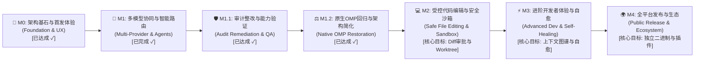

# Nightglide 演进里程碑路线图 (ROADMAP)

> **"Build beyond the horizon." / "漫翔苍穹，构筑所想。"**  
> *发布版本规划: M0 至 M4 | 制定日期: 2026-11-15 | 维护团队: Nightglide Architecture Group*

---

## 1. 总体演进概览与时间线

Nightglide 遵循精细化、高可靠性的阶段式演进策略。从底层隔离与美学基石（M0）出发，在 M1 全面升级为具备多模型注册、工作负载感知路由与本地/云端协同（Local + Cloud Collaboration）能力的真正多智能体编码助手，后续进一步深化受控安全沙箱编辑（M2）、高级项目与 Git 上下文深度自愈（M3），直至面向全网跨平台的独立开源产品（M4）。

---

## 2. 里程碑阶段详细规范

---

### 里程碑 M0: 基础架构与首发体验 (Foundation & Initial Experience)
- **核心定位:** 搭建高鲁棒性 Monorepo，完成上游 SDK 隔离封装，确立苍穹设计美学与 OpenTUI 终端交互基准，提供确定性离线演示。
- **当前状态:** **已达成 (Completed ✓)**

#### 交付清单回顾
1. **Monorepo 与构建工程:** 基于 Bun 1.4.4，TypeScript 5.8+，`packages/core`, `packages/themes`, `packages/config`, `packages/engine`, `apps/cli`。
2. **核心契约:** `AgentEngine`, `AgentSession`, `AgentEvent`, `NightglideError` 异常树。
3. **苍穹设计系统:** 4 套主题（Midnight Flight, Aurora, Cloudlight, Daybreak）与 `ThemeManager`。
4. **引擎适配:** `MockAgentEngine` 与初始 `OmpAgentEngine` 只读白名单封装。
5. **终端表现层:** OpenTUI React 终端挂载，`nightglide demo` 与 `nightglide doctor`。

---

### 里程碑 M1: 多模型协同与工作负载智能路由 (Multi-Provider Intelligence & Agent Collaboration)
- **核心定位:** 接入 OMP 原生规划、评审与 Subagent 任务派发能力，构建多 Provider 注册表与工作负载感知模型路由（LOCAL / BALANCED / PERFORMANCE / MANUAL），实现本地端侧模型与云端强模型的无缝接力协作。
- **当前状态:** **已完成 (Completed ✓)**

#### 交付清单 (Deliverables)
1. **OMP 原生能力深度审计 (`docs/OMP_CAPABILITY_AUDIT.md`):**
   - 审计 `@oh-my-pi/pi-coding-agent` 18.20.2 源码。
   - 确认并集成原生 Plan 角色切换、Reviewer 嵌入式 Agent、原生 `task` 工具与 `subagentEventBus`。
2. **多提供商注册表 (`@nightglide/providers`):**
   - 支持多 Provider 同时注册并存（oMLX, Ollama, OpenAI, Anthropic, 自建网关）。
   - 物理网络位置绝对判定（`resolveEndpointLocality` 区分 loopback 本地与外部云端）。
   - 提供商健康探测与凭据脱敏管理。
   - 提供 `nightglide providers` 命令行工具。
3. **工作负载感知模型路由 (`@nightglide/routing`):**
   - 8 类结构化任务意图分类 (`explore`, `explain`, `plan`, `implement`, `debug`, `review`, `test`, `summarize`)。
   - 4 种路由模式：`LOCAL` (绝对禁止云端外发)、`BALANCED` (轻量本地，复杂授权云端)、`PERFORMANCE` (最高能力优先)、`MANUAL` (角色绑定)。
   - 产出不可变强类型 `RoutingDecision`，含任务类型、分配角色、模型 ID、决策理由与预估成本。
   - 提供 `nightglide models` 查看模型清单与角色分配。
4. **引擎升级与多智能体协作 (`@nightglide/engine`):**
   - `OmpAgentEngine`: 接入原生 `task` 工具，注入 `Settings.isolated()` 角色覆盖，监听 `subagentEventBus` 并广播标准化事件，由路由层实现隐私感知模型分派。
   - `MockAgentEngine`: 增强多智能体协同仿真（本地 Explorer 扫描代码库 + 云端 Planner 编制规划 + 最终汇聚）。
5. **TUI 界面升级 (`apps/cli/src/ui`):**
   - **Agent Monitor:** 多智能体协同监视卡片，实时呈现参与 Agent 角色、模型、LOCAL/CLOUD 标签、执行状态与 Token。
   - **Routing Explanation:** 任务路由透明解释卡片，通俗展现模型决策原因与成本。
   - **Model Assignment View:** 交互式角色分配矩阵，通过 Tab `[5]` 直观调整分配并一键切换路由模式与云端授权。

#### 准出验收标准 (Exit Criteria)
- [x] OMP 原生能力审计报告完成，无未验证 API 捏造。
- [x] 多 Provider 注册表稳定运行，模型标识全局限定 (`provider/model`)。
- [x] 物理网络 Locality 判定绝对依据 IP/域名，绝不依赖 Display Name。
- [x] LOCAL 模式绝对禁止云端请求，路由层确保仅分派物理本地模型。
- [x] BALANCED 模式下本地 Explorer 与云端 Planner 协同接力流转顺利完成。
- [x] TUI Agent Monitor 正常展示活跃子智能体状态与标签。
- [x] 全套测试通过（75 个单元与集成测试用例，涵盖 Provider、Routing、Engine、UI、CLI）。
- [x] 编译期类型检查 `tsc --noEmit` 0 报错通过。

---

### 里程碑 M1.1: 审计整改与真实能力验证 (Audit Remediation & Real Capability Verification)
- **核心定位:** 全面整改 M1 遗留的端点 Locality 判定、0.0.0.0 规范化、MANUAL 模式零静默替换、WCAG 2.1 AA 终端对比度全量合规及真实终端尺寸响应。
- **当前状态:** **已达成 (Completed ✓)**

#### 交付清单与整改成果 (Deliverables)
1. **网络位置与 0.0.0.0 规范化 (`@nightglide/providers`):**
   - 严格区分服务端监听绑定 (`0.0.0.0`) 与客户端目标地址。
   - 保留开发者本地端点 `0.0.0.0` 兼容性，客户端发起请求时安全规范化为 `127.0.0.1`。
   - 严密防御 SSRF、私有内网 (RFC 1918)、链路本地、16进制/8进制/Dword 畸形 IP 与域名欺骗。
   - `checkConnection` 实现手动重定向校验，严禁本地端点重定向至外部公网。
2. **子智能体只读权限探索与整改 (`@nightglide/engine`):**
   - 分析原生 OMP subagent 权限链与工具继承机制（为 M1.2 全面回归原生架构奠定分析基础）。
3. **工作负载智能路由确定性加固 (`@nightglide/routing`):**
   - 根除 MANUAL 模式下的静默替换逻辑，未分配或模型不可用时抛出机器可读强类型异常。
   - 完善中英文双语及混合 Prompt 分类，明确标记为规则型策略路由（Policy-Based Routing）。
4. **终端无障碍与响应式升级 (`apps/cli/src/ui`, `@nightglide/themes`):**
   - 4 款苍穹主题（Midnight Flight, Aurora, Cloudlight, Daybreak）文本对比度全量达到 WCAG 2.1 AA（$\ge 4.5:1$）。
   - 输入框焦点隔离，彻底杜绝打字输入时意外触发单字符导航快捷键。
   - 自适应终端尺寸分级（80x24 / 100x30 / 120x36+）与错误边界捕获。
5. **全面质量保证与独立 QA:**
   - 117 项自动化测试全量通过（0 失败，782 断言）。
   - 独立 QA 子智能体全维度交叉审计通过。

---

### 里程碑 M1.2: 原生 OMP 能力回归与架构简化 (Native OMP Restoration & Architecture Simplification)
- **核心定位:** 彻底移除自定义 4 层 Below-the-Prompt 工具拦截器、强制 `tools.approval: deny` 注入、`task.disabledAgents` 人工禁用与会话硬熔断；恢复原生 OMP 完整代理能力（Reviewer、Task、Sonic、原生编码工具链），确立 Nightglide 作为轻量 SDK 适配器、TUI 呈现与多提供商路由器的清晰职责分界。
- **当前状态:** **已达成 (Completed ✓)**

#### 交付清单与重构成效 (Deliverables)
1. **移除脆弱的自定义拦截器与人工屏蔽:**
   - 彻底移除自定义 `createModelDispatchGuard`/`assertDispatchModel` 网络门禁。
   - 移除父会话强制注入 `tools.approval: { write: "deny", edit: "deny", bash: "deny" }`。
   - 解除对原生 `task`、`reviewer`、`sonic` 智能体的人为 `task.disabledAgents` 禁用。
   - 移除 `tool_execution_start` 突发写操作会话硬熔断逻辑。
2. **全面回归 OMP 原生能力与执行驱动:**
   - 原生 Reviewer 智能体 (`reviewer`)、原生 Task 智能体 (`task`)、原生只读与编码工具链完全由 OMP 原生接管与驱动。
   - 原生工具审批机制 (Native Tool Approval) 由 OMP SDK 自行解析与流转，Nightglide 专注在 TUI 呈现清晰的人机审批卡片。
3. **架构职责与清晰模块分界:**
   - **OMP SDK 拥有:** 工具执行与沙箱、工具可用性、原生工具审批、Agent 定义与执行、任务委派、编码工具链、Reviewer/Plan 执行、会话底层取消。
   - **Nightglide 拥有:** TUI 与终端视口呈现、苍穹主题系统、多提供商注册表、任务分类、模型角色分配、4 大路由模式、多智能体可视化、系统体检与诊断。
4. **全量文档体系深度校准:**
   - 更新 ARCHITECTURE、PRODUCT_SPEC、FEATURE_MATRIX、ROADMAP、SECURITY、OMP_CAPABILITY_AUDIT、M1_AGENT_ROUTING_SPEC 等全量文档，彻底消除过时的自定义拦截器描述。

---

### 里程碑 M2: 受控代码编辑与安全沙箱 (Safe File Editing & Sandbox)
- **核心定位:** 实现沙箱化文件编辑（`edit`, `write`）与受控 Shell 执行，提供语法着色 Diff 审查与 Git Worktree 隔离机制，并行交付核心工作台与基础动效体系。
- **当前状态:** **规划就绪，M1 验收后启动 (Planned)**

#### 交付清单 (Deliverables)
1. **核心工程与安全沙箱 (Core Engineering):**
   - 基于 Git Worktree 的任务工作区临时隔离与原子写盘。
   - 单元测试自愈闭环与命令拦截看门狗。
2. **并行 UI/UX 体验与基础动效交付 (Parallel Visual & UX Deliverables):**
   - **`FEAT-UI-007` 苍穹主工作台 (Flight Deck):** 黄金四层视觉重心落地，统一会话与工具执行视口。
   - **`FEAT-UI-008` 语法着色 Diff 审查与并排双栏预览:** 基于 `@opentui/core` `DiffRenderable` 原生驱动，内联与宽屏并排双栏审查。
   - **`FEAT-UI-009` 双模态无缝切换 (Guided vs. Expert):** 敲击 Tab 键瞬间切换新手向导与极速专家视图，不中断会话。
   - **`FEAT-MOT-002` 思考微光正弦呼吸 (`ANIM-THINK-001`):** 10-15 FPS 定宽占位呼吸，消除思考等待焦虑与屏幕抖动。
   - **`FEAT-MOT-003` 流式文本平滑追加与发光游标 (`ANIM-STREAM-001/002`):** 高吞吐 Token 稳定流入，末尾伴随瞬态微光游标。
   - **`FEAT-MOT-005` 工具审批警示与落盘微闪 (`ANIM-TOOL-002/003`):** 破坏性操作边框呼吸警示，确认后浅绿微闪 150ms。
   - **`FEAT-MOT-007` 苍穹主题无闪烁热重配 (`ANIM-THEME-001`):** 15ms 内全量重配语义 Token，零白屏闪烁。
   - **`FEAT-MOT-008` 减弱动效严格自适应:** 响应 `motion: "off"` 配置，所有过渡动画耗时清零，保证无障碍基准。
   - **`FEAT-EXP-001` 渐进式新手引导向导:** 首次运行 3 步初始化，免 Key 演示模式无缝直通。

---

### 里程碑 M3: 进阶项目上下文与自愈智能 (Advanced Dev Experience)
- **核心定位:** 增强大型项目全局符号索引与长任务分解，深度提炼多智能体协同可视化与专家交互流转。
- **当前状态:** **规划中 (Planned)**

#### 交付清单 (Deliverables)
1. **核心工程与智能上下文:**
   - 项目全局上下文图谱索引与符号定义跟踪。
   - 智能 Git 提交与 PR 描述生成、编译/单测报错深度自愈。
2. **高阶 UI/UX 与协同动效深度打磨:**
   - **`FEAT-UI-010` 多智能体星图连线可视化 (`ANIM-AGENT-001/002`):** 展现本地 Explorer 与云端 Planner 成果接力，强化本地隐私透明度。
   - **`FEAT-MOT-006` 活跃模型切换胶囊微滑与回退通知 (`ANIM-MODEL-001/002`):** 活跃模型平滑重排，回退发生时浮现非侵入式 Toast。
   - **`FEAT-EXP-003` 键盘优先极速流转与 Vim 键位映射:** 全面支持 `j/k`、`g/G`、`Ctrl+D/U` 等肌肉记忆快捷操控。
   - **`FEAT-MOT-009` 终端抗抖动与帧率极限评估管线 (Research Required):** 建立自动化重绘与 CPU 消耗监测。

---

### 里程碑 M4: 全平台分发与插件生态 (Public Release & Ecosystem)
- **核心定位:** 独立单一可执行二进制构建，发布跨平台分发包，开放第三方工具集成，提供完整的电影级苍穹启航仪式感。
- **当前状态:** **规划中 (Planned)**

#### 交付清单 (Deliverables)
1. **全平台打包分发:**
   - 跨平台独立二进制打包分发 (macOS x64/arm64, Linux, Windows)。
   - Homebrew / npm 一键分发。
2. **终极视觉体验与生态赋能:**
   - **`FEAT-MOT-001` 苍穹启航微光地平线与字标拂动 (`ANIM-START-001/002`):** 150ms 优雅启航仪式，击键瞬间跳过。
   - 全平台主流终端仿真器（Ghostty, WezTerm, iTerm2, Kitty, Alacritty）像素级排版与色彩校准。
   - 开放第三方主题与自定义语义配色插件协议。

---
*(本路线图每逢重大里程碑交付节点进行基线校准更新)*
