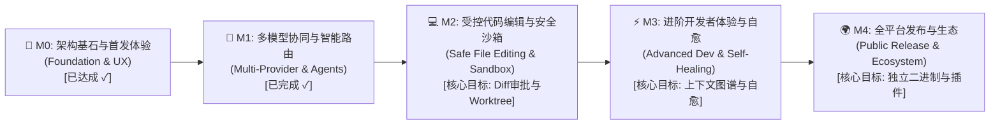

# Nightglide 演进里程碑路线图 (ROADMAP)

> **"Build beyond the horizon." / "漫翔苍穹，构筑所想。"**  
> *发布版本规划: M0 至 M4 | 制定日期: 2026-11-15 | 维护团队: Nightglide Architecture Group*

---

## 1. 总体演进概览与时间线

Nightglide 遵循精细化、高可靠性的阶段式演进策略。从底层隔离与美学基石（M0）出发，在 M1 全面升级为具备多模型注册、工作负载感知路由与本地/云端协同（Local + Cloud Collaboration）能力的真正多智能体编码助手，后续进一步深化受控安全沙箱编辑（M2）、高级项目与 Git 上下文深度自愈（M3），直至面向全网跨平台的独立开源产品（M4）。

---

## 2. 里程碑阶段详细规范

---

### 里程碑 M0: 基础架构与首发体验 (Foundation & Initial Experience)
- **核心定位:** 搭建高鲁棒性 Monorepo，完成上游 SDK 隔离封装，确立苍穹设计美学与 OpenTUI 终端交互基准，提供确定性离线演示。
- **当前状态:** **已达成 (Completed ✓)**

#### 交付清单回顾
1. **Monorepo 与构建工程:** 基于 Bun 1.4.4，TypeScript 5.8+，`packages/core`, `packages/themes`, `packages/config`, `packages/engine`, `apps/cli`。
2. **核心契约:** `AgentEngine`, `AgentSession`, `AgentEvent`, `NightglideError` 异常树。
3. **苍穹设计系统:** 4 套主题（Midnight Flight, Aurora, Cloudlight, Daybreak）与 `ThemeManager`。
4. **引擎适配:** `MockAgentEngine` 与初始 `OmpAgentEngine` 只读白名单封装。
5. **终端表现层:** OpenTUI React 终端挂载，`nightglide demo` 与 `nightglide doctor`。

---

### 里程碑 M1: 多模型协同与工作负载智能路由 (Multi-Provider Intelligence & Agent Collaboration)
- **核心定位:** 接入 OMP 原生规划、评审与 Subagent 任务派发能力，构建多 Provider 注册表与工作负载感知模型路由（LOCAL / BALANCED / PERFORMANCE / MANUAL），实现本地端侧模型与云端强模型的无缝接力协作。
- **当前状态:** **已完成 (Completed ✓)**

#### 交付清单 (Deliverables)
1. **OMP 原生能力深度审计 (`docs/OMP_CAPABILITY_AUDIT.md`):**
   - 审计 `@oh-my-pi/pi-coding-agent` 18.20.2 源码。
   - 确认并集成原生 Plan 角色切换、Reviewer 嵌入式 Agent、原生 `task` 工具与 `subagentEventBus`。
2. **多提供商注册表 (`@nightglide/providers`):**
   - 支持多 Provider 同时注册并存（oMLX, Ollama, OpenAI, Anthropic, 自建网关）。
   - 物理网络位置绝对判定（`resolveEndpointLocality` 区分 loopback 本地与外部云端）。
   - 提供商健康探测与凭据脱敏管理。
   - 提供 `nightglide providers` 命令行工具。
3. **工作负载感知模型路由 (`@nightglide/routing`):**
   - 8 类结构化任务意图分类 (`explore`, `explain`, `plan`, `implement`, `debug`, `review`, `test`, `summarize`)。
   - 4 种路由模式：`LOCAL` (绝对禁止云端外发)、`BALANCED` (轻量本地，复杂授权云端)、`PERFORMANCE` (最高能力优先)、`MANUAL` (角色绑定)。
   - 产出不可变强类型 `RoutingDecision`，含任务类型、分配角色、模型 ID、决策理由与预估成本。
   - 提供 `nightglide models` 查看模型清单与角色分配。
4. **引擎升级与多智能体协作 (`@nightglide/engine`):**
   - `OmpAgentEngine`: 接入原生 `task` 工具，注入 `Settings.isolated()` 角色覆盖，监听 `subagentEventBus` 并广播标准化事件，增加底层 `assertDispatchModel` 硬件级隐私守卫。
   - `MockAgentEngine`: 增强多智能体协同仿真（本地 Explorer 扫描代码库 + 云端 Planner 编制规划 + 最终汇聚）。
5. **TUI 界面升级 (`apps/cli/src/ui`):**
   - **Agent Monitor:** 多智能体协同监视卡片，实时呈现参与 Agent 角色、模型、LOCAL/CLOUD 标签、执行状态与 Token。
   - **Routing Explanation:** 任务路由透明解释卡片，通俗展现模型决策原因与成本。
   - **Model Assignment View:** 交互式角色分配矩阵，通过 Tab `[5]` 直观调整分配并一键切换路由模式与云端授权。

#### 准出验收标准 (Exit Criteria)
- [x] OMP 原生能力审计报告完成，无未验证 API 捏造。
- [x] 多 Provider 注册表稳定运行，模型标识全局限定 (`provider/model`)。
- [x] 物理网络 Locality 判定绝对依据 IP/域名，绝不依赖 Display Name。
- [x] LOCAL 模式绝对禁止云端请求，违规外发时被底层硬拦截。
- [x] BALANCED 模式下本地 Explorer 与云端 Planner 协同接力流转顺利完成。
- [x] TUI Agent Monitor 正常展示活跃子智能体状态与标签。
- [x] 全套测试通过（75 个单元与集成测试用例，涵盖 Provider、Routing、Engine、UI、CLI）。
- [x] 编译期类型检查 `tsc --noEmit` 0 报错通过。

---

### 里程碑 M2: 受控代码编辑与安全沙箱 (Safe File Editing & Sandbox)
- **核心定位:** 实现沙箱化文件编辑（`edit`, `write`）与受控 Shell 执行，提供语法着色 Diff 审查与 Git Worktree 隔离机制。
- **当前状态:** **规划就绪，M1 验收后启动 (Planned)**

#### 核心关注点
1. 基于 Git Worktree 的任务工作区隔离（非 OS 级容器，严格注明属性）。
2. TUI 内置 Diff 对比审查弹窗，强制用户按确认键后方可落盘。
3. 单元测试自愈闭环。

---

### 里程碑 M3: 进阶项目上下文与自愈智能 (Advanced Dev Experience)
- **核心定位:** 增强大型项目全局符号索引与长任务分解，完善测试报错自愈。
- **当前状态:** **规划中 (Planned)**

---

### 里程碑 M4: 全平台分发与插件生态 (Public Release & Ecosystem)
- **核心定位:** 独立单一可执行二进制构建，发布跨平台分发包，开放第三方工具集成。
- **当前状态:** **规划中 (Planned)**

---
*(本路线图每逢重大里程碑交付节点进行基线校准更新)*
