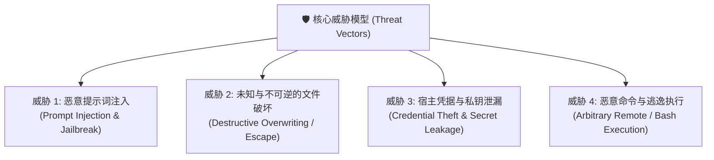
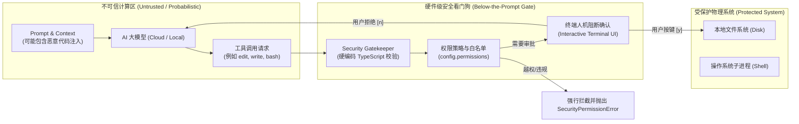

# Nightglide 安全模型与权限防护规范 (SECURITY & ISOLATION POLICY)

> **"Build beyond the horizon." / "漫翔苍穹，构筑所想。"**  
> *安全评级: 最高安全防护规范 | 适用范围: 全平台客户端、上游适配器与模型交互层*

---

## 1. 威胁建模与安全目标 (Threat Model)

在 AI 智能体直接拥有读写本地磁盘、执行终端命令等系统特权的场景下，安全边界的设计直接决定了用户的资产安全。Nightglide 的安全架构首要防范以下四大现实威胁：

### 核心安全目标
1. **指令与执行物理隔离:** 大模型的推理与文本生成仅仅产生“意图请求”，绝对不拥有物理执行能力。
2. **底层防篡改权限门禁:** 权限决策必须硬编码在代码层与执行层（Below-the-Prompt），绝不依赖大模型的“自觉”。
3. **数据主权与零隐私外泄:** 用户代码与敏感私钥默认不出机，严禁隐式遥测上传。

---

## 2. 提示词注入防御与执行边界 (Prompt Injection Defense)

### 2.1 传统“提示词安全”的失效陷阱
许多传统 AI Agent 试图通过在 System Prompt 中写入“请不要删除用户文件”、“请不要执行危险命令”来保证安全。这种设计在面对恶意构建的代码注释（间接提示词注入，Indirect Prompt Injection）或越狱模板时极其脆弱。一旦大模型被攻击者绕过，便会发出危险的工具调用指令。

### 2.2 Nightglide “提示词之下”硬门禁架构 (Below-the-Prompt Enforcement)

- **绝对隔离原则:**
  - `Gatekeeper` 运行于 Node/Bun 原生进程内，纯通过不可被文本篡改的代码逻辑执行拦截。
  - 即使大模型被完全越狱并坚称“用户已授权执行 `rm -rf /`”，`Gatekeeper` 检测到未获得当前物理按键签名，将立即硬性驳回。

---

## 3. 工作空间沙箱与 Git 边界明确声明 (Workspace Protection)

### 3.1 关键事实阐明: Git Worktree 绝非操作系统级沙箱
- > [!WARNING] 
  > **必须明确界定:** Git 工作树（Git Worktree）或本地副本只是一种**代码版本层面的差异隔离机制**，**绝对不是 Linux Namespace、cgroups、Docker 容器或 macOS App Sandbox 级别的操作系统内核隔离！**
  > 在 Git Worktree 中执行的任意恶意脚本，依然拥有与当前用户完全相同的系统访问权限。

### 3.2 路径越界逃逸防护 (Path Traversal Protection)
为防止模型试图读取工作区之外的敏感文件（如 `/etc/passwd`, `~/.ssh/id_rsa`）：
1. **工作区根锚定 (Root Pinning):**
   - 每次会话启动时，`workspacePath` 经过 `path.resolve()` 规范化为绝对路径。
2. **规范化前缀校验:**
   - 任何工具传入的文件路径，必须经过解析并检验 `resolvedTarget.startsWith(workspacePath)`。
   - 若检测到 `../` 逃逸行为，拦截器立即阻断，不发起任何物理 I/O，并向会话返回标准权限错误。

### 3.3 工具分级授权与白名单边界
- **第一级: 只读探测 (Read-Only) - 默认受控放行**
  - 工具: `read`, `find`, `grep`
  - 限制: 仅限在工作区目录树内搜索与读取，单次读取设置最大字节上限，防止读取 GB 级别的大文件拖垮内存。
- **第二级: 代码修改 (Write-Back) - 强制 Diff 暂存与审批**
  - 工具: `edit`, `write`
  - 限制: 生成原子修改 Diff 并在终端渲染，只有用户物理按下 `y` 键后才执行写磁盘操作。
- **第三级: Shell 执行 (Command Execution) - 默认硬性禁用**
  - 工具: `bash`
  - 限制: M0 阶段全局禁用；未来版本开启时必须明确展示命令全貌，要求输入二次确认。

---

## 4. 凭证安全与无明文存储 (Credential Safety)

API Key 和模型凭据是开发者的核心资产，Nightglide 实施最高级别的凭据防护规范：

### 4.1 严禁明文持久化
- `~/.config/nightglide/config.json` 的标准 JSON Schema 中**严格不包含任何用于明文存储 API Key 的字段**。
- 严禁将 API Key 直接持久化在磁盘上的未加密 JSON 配置文件中。

### 4.2 凭证解析推荐优先级
1. **环境变量优先:**  
   从当前 Shell 环境读取（`OPENAI_API_KEY`, `ANTHROPIC_API_KEY`, `NIGHTGLIDE_API_KEY`）。
2. **系统级加密凭据链 (Keychains):**  
   在支持的操作系统上使用系统原生安全存储（macOS Keychain / Linux Secret Service / Windows Credential Manager）。

### 4.3 内存与日志脱敏 (Secret Masking)
- 在所有对外输出的日志、终端 UI 渲染组件、错误堆栈以及 `AgentEvent` 事件流中，实施正则敏感词脱敏清洗。
- 自动检测形如 `sk-...` 等常见 API Key 格式，自动替换为前缀+掩码+后缀（如 `sk-ant••••••••abcd`），杜绝录屏与截屏导致泄露。

---

## 5. 遥测策略与本地隐私 (Telemetry & Privacy)

Nightglide 践行纯粹的开源与隐私理念：

1. **零默认遥测 (Zero Telemetry by Default):**
   - Nightglide **不内置任何后台埋点、行为追踪或匿名数据收集 SDK**。
   - 不向任何中心化服务器上传用户的工作空间路径、文件名称、Git 提交记录或提问内容。
2. **端侧推理零外泄保证 (Local-First Guarantee):**
   - 当配置为本地推理引擎（oMLX, Ollama）时，所有的 Prompt、代码上下文与推理数据仅在 `localhost` 本地回路（Loopback Network）内流转。
   - 用户可断开公网连接验证：Nightglide 在纯离线模式下功能依然完整稳定。

---
*(本文档为 Nightglide 最高安全合规基准，任何破坏上述安全防护特性的代码变更均将被直接否决)*
