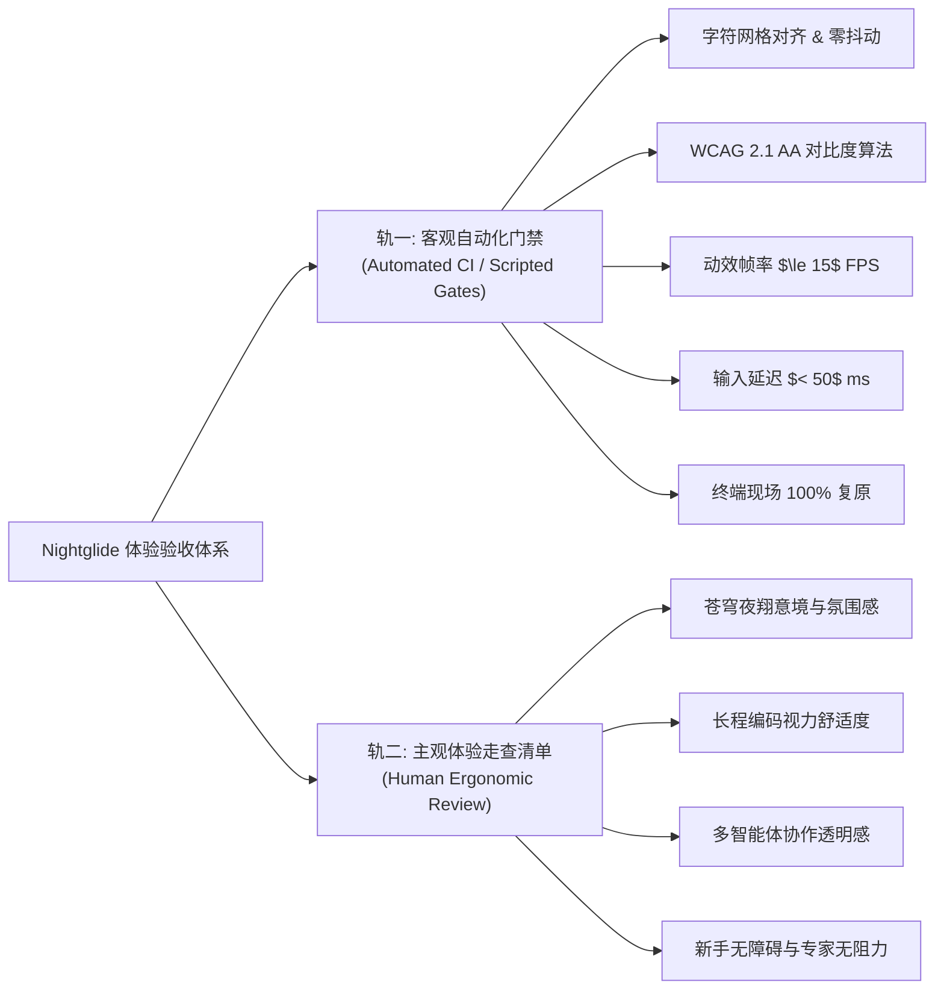

# Nightglide 体验与视觉验收准则 (UX ACCEPTANCE CRITERIA)

> **"Build beyond the horizon." / "漫翔苍穹，构筑所想。"**  
> *文档定位: UI/UX 体验交付、微交互与动效实现的验收门禁规范*  
> *适用阶段: M2 及后续所有界面实现的自动化测试与设计走查 (Design QA)*

---

## 1. 验收体系架构与双轨评估模型 (Dual-Track Evaluation Model)

为确保未来 UI/UX 实现既具备严格的工程级确定性，又具备经得起长程专注考验的人文温度与视觉美感，Nightglide 确立**客观自动化检验 (Automated Objective Checks)** 与 **主观体验走查 (Subjective Visual Review)** 双轨验收模型：

---

## 2. 客观自动化验收门禁 (Automated Objective Verification Gates)

所有进入主干或发布候选（RC）的代码必须 100% 自动通过以下脚本化门禁：

### 2.1 终端字符网格尺寸与响应式断点 (Dimensions & Layout Grid)
- **GATE-DIM-001 (80x24 紧凑基准):**
  - 在虚拟终端 `cols = 80, rows = 24` 下挂载所有核心屏幕（Welcome, Flight Deck, Setup, Models, Diff Preview）；
  - 断言：容器不得抛出溢出换行异常，右边框 `│` 距右边界偏移量为 0，ASCII 艺术字标自动折叠为单行紧凑标。
- **GATE-DIM-002 (100x30 标准平衡):**
  - 在 `cols = 100, rows = 30` 下挂载；
  - 断言：完整呈现 ASCII 艺术字标，状态栏全量指示器可见，边距 `paddingX = 2`。
- **GATE-DIM-003 (120x36+ 宽屏分栏):**
  - 在 `cols = 120, rows = 36` 下挂载；
  - 断言：Diff 审查视图自动激活并排双栏对比（Side-by-side），消息正文最大宽度约束在 90 列以内。
- **GATE-DIM-004 (全角 CJK 字符对齐测算):**
  - 模拟包含中文、中文全角标点与中英混排的回复内容；
  - 断言：右侧边框闭合字符必须严格依据 `string-width` 列数对齐，无因中文字符导致的凸出破框（边框抖动量 = 0 列）。

### 2.2 色彩对比度与无障碍规范 (Contrast & Accessibility)
- **GATE-A11Y-001 (WCAG 2.1 AA 文本对比度):**
  - 使用相对亮度算法遍历计算四大主题（Midnight Flight, Aurora, Cloudlight, Daybreak）的所有前景色与背景色对；
  - 断言：`textPrimary` 与 `surface` / `background` 对比度 $\ge 10.0:1$；`textSecondary` 对比度 $\ge 6.0:1$；`textMuted` 对比度 $\ge 4.5:1$；大字标与关键图标对比度 $\ge 3.0:1$。
- **GATE-A11Y-002 (NO_COLOR 纯文本降级):**
  - 设置环境变量 `NO_COLOR=1` 启动应用；
  - 断言：终端输出中 100% 不包含任何 ANSI 24-bit（`\x1b[38;2;...m`）或 256 色转义序列；所有状态必须包含文字或符号标识（如 `[OK] ✔`, `[ERROR] ✖`）。

### 2.3 动效预算与性能监控 (Motion Budgets & Performance)
- **GATE-MOT-001 (最大帧率天花板):**
  - 在运行 `ANIM-THINK-001`、`ANIM-STREAM-002` 等高频微动效期间记录虚拟 DOM 渲染 Tick；
  - 断言：更新频率严格 $\le 15\text{ FPS}$（单帧间隔 $\ge 66\text{ ms}$），严禁超频重绘。
- **GATE-MOT-002 (减弱动效一键清零):**
  - 配置 `motion: "off"` 或传入 `--no-motion` 启动应用；
  - 断言：活跃动画定时器数量为 0，启动序列耗时 = 0ms，流式发光游标呼吸 = 0ms。
- **GATE-MOT-003 (屏幕位移绝对零抖动 Zero Jitter):**
  - 运行思考指示灯与进度条动画 50 帧；
  - 断言：动画元素下方所有行、右侧所有字符的物理行号与列号坐标保持恒定（位移 = 0）。

### 2.4 交互响应与输入优先权 (Responsiveness & Input Priority)
- **GATE-PERF-001 (非阻塞击键延迟):**
  - 在后台执行高吞吐模型流式渲染（100 tokens/s）或多智能体推演的同时向输入框注入键盘事件；
  - 断言：击键事件响应并回显到输入框的时间延迟 $< 50\text{ ms}$。
- **GATE-PERF-002 (瞬时打断与取消响应):**
  - 在流式生成中发送 `SIGINT` (Ctrl+C) 或 `Esc`；
  - 断言：在 $100\text{ ms}$ 内停止流式追加，100% 调用底层 `session.cancel()`，输入框焦点立即可写。

### 2.5 终端现场保护与复原 (Terminal Restoration)
- **GATE-TEARDOWN-001 (100% 终端环境优雅复原):**
  - 模拟正常退出（`q`）、用户打断（`Ctrl+C`）、未捕获运行时错误三种退出路径；
  - 断言：标准输出流必须写入终端清理转义序列（`\x1b[?25h` 显示光标、`\x1b[?1049l` 退出交替屏幕缓冲区、恢复终端 Raw 模式），退出后宿主终端无光标消失与花屏残存。

---

## 3. 主观体验与人机工效走查清单 (Subjective Ergonomic Review)

在正式版本发布前，必须由设计团队（Design Reviewers）在真实终端（Ghostty, iTerm2, macOS Terminal）中完成人工走查：

### 3.1 苍穹夜翔意境与视觉呼吸感 (Atmosphere & Breathing Room)
- [ ] **视觉舒适度:** 在昏暗光线下连续使用 Midnight Flight 主题 2 小时，眼部无明显刺痛感与眩光疲劳。
- [ ] **留白与秩序感:** 界面元素不显局促拥挤，边框细腻克制，符合“夜航仪表盘”沉静、高精度的质感。
- [ ] **克制无噪音:** 无大尺寸、高彩度无关 Emoji，微动效如同星光般微弱自然，不抢夺代码正文注意力。

### 3.2 动态流转自然度 (Motion Feel)
- [ ] **思考节奏:** 思考指示微光的明暗变换宛如正弦呼吸，自然舒缓，有效化解等待焦虑。
- [ ] **流式生成:** 字符平滑流入，瞬态游标紧随其后，无卡顿聚批爆发导致的视觉卡死感。
- [ ] **主题热重载:** 敲击快捷键切换主题时，色彩如光影掠过般瞬间呈现，无肉眼可察觉的刷新闪白。

### 3.3 多智能体透明协作感知 (Multi-Agent Transparency)
- [ ] **黑盒消除:** 看到 `AgentMonitor` 时，能在 2 秒内看清当前有哪几个 Agent 参与、各自使用的模型、以及 LOCAL/CLOUD 属性。
- [ ] **隐私踏实感:** 当本地 Explorer 扫描完成移交给云端 Planner 时，星图连线能明确传达“仅骨架摘要上传，源码未离机”的安全感。

### 3.4 双模态可用性走查 (Dual-Persona Ergonomics)
- [ ] **新手体验 (Guided):** 初学者在零外部文档指导下，能在 1 分钟内完成首次交互，且任何破坏性改动均有明确解释与后悔机制。
- [ ] **专家体验 (Expert):** Vim 键盘流用户在纯键盘模式下，无需触碰鼠标即可流畅完成代码审查、审批与测试流转，无多余弹窗打断击键心流。

---

## 4. 核心端到端场景验收测试用例 (End-to-End Scenarios)

| 场景编号 | 场景名称 | 操作步骤 | 预期人机交互结果 | 验收判定 |
| :--- | :--- | :--- | :--- | :---: |
| **TC-UX-001** | 冷启动启航流程 | 执行 `nightglide` 进入冷启动 | 150ms 微光地平线拂过，ASCII 字标点亮，击键瞬时跳过进入工作台。 | 自动 + 人工 |
| **TC-UX-002** | 首次配置向导 | 删除本地 config.json 后启动 | 优雅展示 3 步向导，无报错崩溃，支持直通免 Key 演示模式。 | 自动 + 人工 |
| **TC-UX-003** | 破坏性代码修改审批 | Agent 生成代码并调用 `edit` | 弹出彩色 Diff 审查视图，按 `y` 确认落盘并浅绿微闪，按 `n` 安全回滚。 | 自动化 |
| **TC-UX-004** | 敏感 Shell 执行拦截 | Agent 调用 `bash` 尝试执行命令 | 醒目弹出黄色警示边框与命令全貌，严格等待用户按 `y` 授权。 | 自动化 |
| **TC-UX-005** | 本地推理服务断连容灾 | 关闭 8000 端口并向本地模型提问 | 捕获 `EngineError`，原位呈现诊断建议卡片，提供一键切换 Mock 演示。 | 自动化 |
| **TC-UX-006** | 快捷动态切换主题 | 在工作台敲击 `t` 键并按 `2` | 15ms 内全量切换为 Aurora 极光主题，无白屏闪烁，输入框保留原草稿。 | 自动 + 人工 |
| **TC-UX-007** | 双模态无缝切换 | 在工作台敲击 `Tab` 键 | 布局无缝在 Guided 与 Expert 间切换，状态栏即时反映，会话不中断。 | 自动化 |
| **TC-UX-008** | 多智能体接力协同 | 触发重构意图派发子任务 | AgentMonitor 展现本地 Explorer 扫描后将摘要移交云端 Planner。 | 自动化 |
| **TC-UX-009** | 任务强制打断复原 | 在模型流式输出中按 `Ctrl+C` | 立即停止字符追加，100ms 内释放资源，输入框重新立即可写。 | 自动化 |
| **TC-UX-010** | 极小终端尺寸自适应 | 将终端窗口缩小至 80x24 | 界面自动重排为紧凑布局，字标折叠为单行，无换行撕裂破损。 | 自动化 |

---
*(本文档为 Nightglide UI/UX 质量验收的最高法典，未来所有界面功能合入前必须满足上述准则)*
