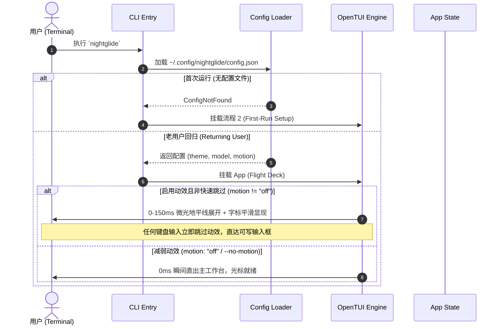
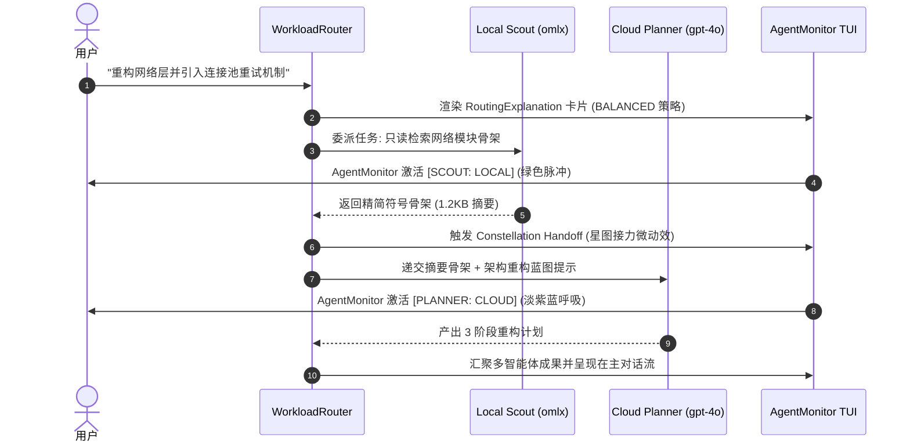

# Nightglide 交互与用户旅程规范 (UX FLOWS)


> **历史原型记录。** 本文描述已退役的 OpenTUI 原型架构，其中的技术方案、完成度与结论不适用于 OMP 原生新主线；现状以 [新路线图](ROADMAP.md) 与 [验收记录](STAGE_2_3_VERIFICATION.md) 为准。本文仅作设计思想与历史参考。
> **"Build beyond the horizon." / "漫翔苍穹，构筑所想。"**  
> *文档定位: 核心人机交互、状态机流转与终端视口线框全量规范 (12 大核心场景)*  
> *基准版本: v2.0.0 (M1.2 Native OMP 基准) | 终端渲染基座: OpenTUI React*

---

## 目录索引

1. [流程 1: 启动与苍穹启航体验 (Startup: Cold Start, Returning, Skip, Reduced-Motion)](#流程-1-启动与苍穹启航体验-startup)
2. [流程 2: 首次运行向导与模型就绪 (First-Run Guided Onboarding & Demo)](#流程-2-首次运行向导与模型就绪-first-run-guided-onboarding)
3. [流程 3: 模型选择与角色矩阵管理 (Model Selection & Matrix View)](#流程-3-模型选择与角色矩阵管理-model-selection--matrix)
4. [流程 4: 日常编程主对话与流式交互 (Main Coding Chat & Streaming Flow)](#流程-4-日常编程主对话与流式交互-main-coding-chat)
5. [流程 5: 智能体任务委派与跨模型接力 (Agent Delegation & Cross-Model Handoff)](#流程-5-智能体任务委派与跨模型接力-agent-delegation)
6. [流程 6: 多智能体并行协作与结果汇聚 (Parallel Multi-Agent Collaboration)](#流程-6-多智能体并行协作与结果汇聚-parallel-multi-agent)
7. [流程 7: 工具执行与原生审批拦截 (Tool Execution & Native Approval Gate)](#流程-7-工具执行与原生审批拦截-tool-execution--approval)
8. [流程 8: 模型动态切换与隐私敏感回退 (Model Switching & Privacy Fallback)](#流程-8-模型动态切换与隐私敏感回退-model-switching--fallback)
9. [流程 9: 提供商故障与优雅容灾恢复 (Provider Failure & Error Recovery)](#流程-9-提供商故障与优雅容灾恢复-provider-failure--recovery)
10. [流程 10: 任务打断与现场安全复原 (Task Cancellation & Safe Cleanup)](#流程-10-任务打断与现场安全复原-task-cancellation--cleanup)
11. [流程 11: 苍穹主题动态平滑热切换 (Dynamic Theme Switching & Hot-Swap)](#流程-11-苍穹主题动态平滑热切换-dynamic-theme-switching)
12. [流程 12: 双模态体验切换 (Guided vs. Expert Mode Flow)](#流程-12-双模态体验切换-guided-vs-expert-mode-flow)

---

### 流程 1: 启动与苍穹启航体验 (Startup)

#### 1.1 场景与目标
用户在终端执行 `nightglide`。无论冷启动还是日常使用，启动过程必须在 **300ms** 内呈现首屏，且提供优雅而克制的启航仪式感。任何动画绝不阻塞用户击键。

#### 1.2 状态流转时序 (Mermaid)



#### 1.3 终端界面原型示意 (ASCII Mockup)

```
┌─ ✈ NIGHTGLIDE ────────────────────────────────────────── 100x30 ─┐
│                                                                  │
│                 ~ ~ ~ ~ ~ ✦ ~ ~ ~ ~ ~                            │
│  ─────────────────────────────────────────────────────────────   │
│    _  _ _       _   _     _ _     _                              │
│   | \| (_)__ _ | |_| |_  | (_) __| |___                          │
│   | .` | / _` || ' \  _| | | |/ _` / -_)                         │
│   |_|\_|_\__, ||_||_\__| |_|_|\__,_\___|                         │
│          |___/  Build beyond the horizon.                        │
│  ─────────────────────────────────────────────────────────────   │
│   Workspace: ~/projects/nightglide-cli  [Git: main*]             │
│   Active Model: omlx/qwen2.5-coder-7b (LOCAL)                    │
│                                                                  │
│   [ Press any key or start typing to glide into workspace... ]   │
└──────────────────────────────────────────────────────────────────┘
```

---

### 流程 2: 首次运行向导与模型就绪 (First-Run Guided Onboarding)

#### 2.1 场景与目标
初次使用者启动应用，系统探测环境并以引导向导（WelcomeScreen）呈现。核心目标：不因缺失 API Key 报错闪退，指导完成本地/云端配置，或一键进入确定性免 Key 演示模式。

#### 2.2 终端界面原型示意 (ASCII Mockup)

```
┌─ ✈ NIGHTGLIDE · 首次登机向导 (ONBOARDING) ──────────────── 100x30 ─┐
│                                                                  │
│   欢迎来到 Nightglide。苍穹编码助手将为您提供安全、流畅的编码体验。        │
│                                                                  │
│   [ 步骤 1/3: 选择默认交互模式 ]                                    │
│   (●) 1. 引导模式 (Guided)   - 丰富操作指引、安全二次确认与渐进解释       │
│   ( ) 2. 专家模式 (Expert)   - 高信息密度、单行摘要与键盘极速流转         │
│                                                                  │
│   [ 步骤 2/3: 选择首选视觉主题 ]                                    │
│   [●] 1. Midnight Flight (深空夜翔 · 默认深色)                     │
│   [ ] 2. Aurora (极光变奏 · 创意深色)                              │
│   [ ] 3. Cloudlight (云隙轻光 · 清爽浅色)                          │
│   [ ] 4. Daybreak (破晓之光 · 暖调浅色)                            │
│                                                                  │
│   [ 步骤 3/3: 模型连接配置 ]                                       │
│   [1] 探测本地模型 (已探测到 oMLX 8000 端口可用 ✔)                   │
│   [2] 配置云端模型 (OpenAI / Anthropic / DeepSeek)               │
│   [3] 立即体验免 Key 确定性演示 (Demo Mode)                        │
│                                                                  │
│  ─────────────────────────────────────────────────────────────   │
│   [Enter] 确认选择    [d] 体验演示    [?] 帮助    [q] 退出           │
└──────────────────────────────────────────────────────────────────┘
```

---

### 流程 3: 模型选择与角色矩阵管理 (Model Selection & Matrix)

#### 3.1 场景与目标
用户敲击导航标签 `[3]` 或快捷键 `m`，进入交互式模型矩阵屏幕（`ModelAssignmentView`）。用户无需手动修改 JSON/YAML 配置文件，即可直观配置各角色（`MAIN`、`EXPLORE`、`PLAN`、`IMPLEMENT`、`REVIEW`）所使用的模型、切换路由工作模式并开关云端授权。

#### 3.2 终端界面原型示意 (ASCII Mockup)

```
┌─ ✈ NIGHTGLIDE · 模型角色矩阵与路由策略 (MODEL MATRIX) ──── 100x30 ─┐
│                                                                  │
│  当前全局路由模式: [ BALANCED (平衡模式) ]   (按 [Space] 轮换模式)     │
│  云端模型外发授权: [ AUTHORIZED (已授权) ]   (按 [c] 切换云端开关)     │
│                                                                  │
│  角色分配表 (Role Assignment Table):                              │
│  ┌────────────┬─────────────────────────────┬──────────┬───────┐  │
│  │ 角色 (Role)│ 分配模型 (Model Identifier) │ 位置属性 │ 状态  │  │
│  ├────────────┼─────────────────────────────┼──────────┼───────┤  │
│  │ > MAIN     │ omlx/qwen2.5-coder-7b       │ [LOCAL]  │ ACTIVE│  │
│  │   EXPLORE  │ omlx/qwen2.5-coder-7b       │ [LOCAL]  │ READY │  │
│  │   PLAN     │ openai/gpt-4o               │ [CLOUD]  │ READY │  │
│  │   IMPLEMENT│ omlx/qwen2.5-coder-7b       │ [LOCAL]  │ READY │  │
│  │   REVIEW   │ anthropic/claude-3-5-sonnet │ [CLOUD]  │ READY │  │
│  └────────────┴─────────────────────────────┴──────────┴───────┘  │
│                                                                  │
│  模式说明: BALANCED 模式下，常规轻量检索与修改在本地端侧运行；        │
│           高复杂度架构规划与安全审查经由云端强模型协同接力。          │
│                                                                  │
│  ─────────────────────────────────────────────────────────────   │
│  [↑/↓] 选择角色  [Enter] 变更模型  [c] 云端开关  [Esc] 返回对话       │
└──────────────────────────────────────────────────────────────────┘
```

---

### 流程 4: 日常编程主对话与流式交互 (Main Coding Chat)

#### 4.1 场景与目标
日常核心编程交互流：用户键入任务 -> 意图与工作负载自动分类 -> 状态栏提示思考脉冲 -> 模型首字输出 -> 稳定流式追加（附带瞬态光标呼吸） -> Markdown 代码块语法着色与渲染。

#### 4.2 终端界面原型示意 (ASCII Mockup)

```
┌─ ✈ NIGHTGLIDE · FLIGHT DECK ──────────────────────────── 100x30 ─┐
│ [1] Flight Deck  [2] Setup  [3] Models  [4] Themes  [5] Doctor    │
│ Workspace: ~/projects/nightglide  [Branch: main*]  Model: qwen2.5 │
├──────────────────────────────────────────────────────────────────┤
│ ❯ User:                                                          │
│   请为 packages/core/src/errors.ts 增加一个 TimeoutError 错误类。  │
│                                                                  │
│ ✦ Nightglide:                                                    │
│   已为您分析现有错误继承链。现在创建 TimeoutError 类，继承自       │
│   EngineError，具有可恢复标记 (recoverable = true)：             │
│                                                                  │
│   ┌─ TypeScript: packages/core/src/errors.ts ────────────────┐   │
│   │ export class TimeoutError extends EngineError {          │   │
│   │   readonly timeoutMs: number;                            │   │
│   │   constructor(timeoutMs: number, message?: string) {     │   │
│   │     super(message || `Timeout after ${timeoutMs}ms`,     │   │
│   │           "TIMEOUT_ERROR", true);                        │   │
│   │     this.name = "TimeoutError";                          │   │
│   │     this.timeoutMs = timeoutMs;                          │   │
│   │   }                                                      │   │
│   │ }█                                                       │   │
│   └──────────────────────────────────────────────────────────┘   │
├──────────────────────────────────────────────────────────────────┤
│ ❯ Ask Nightglide to write code, review architecture...           │
├──────────────────────────────────────────────────────────────────┤
│ [100x30] [Mode: Guided] [Theme: Midnight Flight]  [?] Help       │
└──────────────────────────────────────────────────────────────────┘
```

---

### 流程 5: 智能体任务委派与跨模型接力 (Agent Delegation)

#### 5.1 场景与目标
用户提出复杂跨文件架构重构意图时，Nightglide 触发典型的 **"Local Explore, Cloud Plan"** 跨模型协同接力工作流：
1. 本地 Explorer 扫描本地代码库目录结构与关键定义。
2. 提炼出架构摘要骨架（无敏感代码全量外传）。
3. 成果通过微光星图连线移交至云端 Planner 制定架构方案。
4. 云端方案交付给本地 Implementer 执行文件原子写入。

#### 5.2 状态流转时序 (Mermaid)



#### 5.3 终端界面原型示意 (ASCII Mockup)

```
┌─ ✦ MULTI-AGENT COLLABORATION MONITOR (Active Task: Refactor Network) ─┐
│                                                                       │
│  [1] 🔭 SCOUT (LOCAL)        [omlx/qwen2.5]   ✔ COMPLETED (142 tokens) │
│      └─ 扫描: packages/providers/src/locality.ts (提取 4 处符号定义)    │
│                                                                       │
│  ───✦ 星图接力: 本地骨架摘要递交至云端架构师 (0 敏感源码泄露) ───────>│
│                                                                       │
│  [2] 📋 PLANNER (CLOUD)      [openai/gpt-4o]  ● STREAMING (310 tokens)│
│      └─ 规划: 编制 3 阶段原子重构计划与回滚保护检查点...                 │
│                                                                       │
│  [Ctrl+M] 收起展开监视面板    [d] 查看完整子智能体日志                 │
└───────────────────────────────────────────────────────────────────────┘
```

---

### 流程 6: 多智能体并行协作与结果汇聚 (Parallel Multi-Agent)

#### 6.1 场景与目标
复杂任务触发多个子智能体并发执行（如同时并行执行单元测试、代码风格审查和文档更新）。系统必须在同一屏中稳定呈现并发进度，并在全部完成后执行结果原子聚合，无交错乱序。

#### 6.2 终端界面原型示意 (ASCII Mockup)

```
┌─ ✦ PARALLEL SUBAGENTS WORKING ───────────────────────────── 100x30 ─┐
│                                                                      │
│  [Task Group: Pull Request Readiness Check]                          │
│                                                                      │
│  Agent A: ⚙ UNIT-TEST (LOCAL)    [Progress: ⠸ 14/18 tests passed]    │
│  Agent B: 🛡 REVIEWER (CLOUD)    [Progress: ● Analyzing AST safety]  │
│  Agent C: 📝 DOC-GEN (LOCAL)     [Progress: ✔ Generated JSDoc]       │
│                                                                      │
│  ─────────────────────────────────────────────────────────────────   │
│  地平线聚合流: [=====>                         ] 60% 完成             │
│  [Ctrl+C] 中止所有并行任务    [Tab] 切换聚焦子智能体                 │
└──────────────────────────────────────────────────────────────────────┘
```

---

### 流程 7: 工具执行与原生审批拦截 (Tool Execution & Approval)

#### 7.1 场景与目标
严格依据 M1.2 架构规范，所有破坏性操作（`edit`, `write`, `bash`）必须经由 OMP 原生审批体系管控。表现层提供高保真彩色 Diff 对比与审批选择，绝不越权静默落盘。

#### 7.2 终端界面原型示意 (ASCII Mockup)

```
┌─ 🔍 DIFF PREVIEW & NATIVE TOOL APPROVAL ──────────────────── 100x30 ─┐
│ Target File: packages/core/src/errors.ts                             │
│ Operation:   edit (+12 lines, -0 lines)                              │
├──────────────────────────────────────────────────────────────────────┤
│ @@ -42,6 +42,18 @@ export class EngineError extends NightglideError  │
│    }                                                                 │
│  }                                                                   │
│                                                                      │
│+ export class TimeoutError extends EngineError {                     │
│+   readonly timeoutMs: number;                                       │
│+   constructor(timeoutMs: number, message?: string) {                │
│+     super(message || `Timeout after ${timeoutMs}ms`,                │
│+           "TIMEOUT_ERROR", true);                                   │
│+     this.name = "TimeoutError";                                     │
│+     this.timeoutMs = timeoutMs;                                     │
│+   }                                                                 │
│+ }                                                                   │
│                                                                      │
│  export class SecurityError extends NightglideError {                │
├──────────────────────────────────────────────────────────────────────┤
│ [y] 批准写入 (Approve)    [n] 拒绝 (Deny)    [e] 外部编辑    [Esc] 取消│
└──────────────────────────────────────────────────────────────────────┘
```

---

### 流程 8: 模型动态切换与隐私敏感回退 (Model Switching & Fallback)

#### 8.1 场景与目标
当首选模型遇到服务过载或网络中断时，系统触发回退策略链。**隐私底线:** 在 `LOCAL` 模式下，回退链仅包含本地候选模型，绝对禁止自动回退到云端。回退发生时，通过非侵入式 Toast 清楚告知用户原因。

#### 8.2 终端界面原型示意 (ASCII Mockup)

```
┌─ ✈ NIGHTGLIDE · FLIGHT DECK ──────────────────────────── 100x30 ─┐
│                                                                  │
│  ╭─ ⚡ MODEL FALLBACK TRIGGERED ─────────────────────────────╮    │
│  │ 首选模型 [omlx/qwen2.5-coder-32b] 响应超时 (>15s)。      │    │
│  │ 已按照 LOCAL 隐私策略安全回退至本地候选:                   │    │
│  │ ➜ [ollama/qwen2.5-coder:7b] (100% 数据不出机)             │    │
│  ╰───────────────────────────────────────────────────────────╯    │
│                                                                  │
│  ✦ Nightglide (via ollama/qwen2.5-coder:7b):                     │
│    我已接替继续为您编写函数实现...                               │
│                                                                  │
└──────────────────────────────────────────────────────────────────┘
```

---

### 流程 9: 提供商故障与优雅容灾恢复 (Provider Failure & Recovery)

#### 9.1 场景与目标
当遭遇网络彻底断开、API 401 凭证过期或本地端点未启动时，系统捕获 `EngineError`，严禁终端崩溃退出，在界面原位呈现诊断建议卡片，支持一键运行 `doctor` 或转入免 Key 演示模式。

#### 9.2 终端界面原型示意 (ASCII Mockup)

```
┌─ ✖ PROVIDER CONNECTION FAILED ────────────────────────────── 100x30 ─┐
│                                                                      │
│  无法连接至本地推理端点: http://127.0.0.1:8000/v1 (Connection Refused) │
│                                                                      │
│  可能原因:                                                           │
│  1. 本地 oMLX 服务尚未启动；                                         │
│  2. 本地服务监听端口非默认 8000。                                     │
│                                                                      │
│  建议恢复操作:                                                       │
│  [d] 运行系统诊断探针 (nightglide doctor)                             │
│  [s] 进入 Setup 设置界面重新配置端点                                  │
│  [m] 一键切换为免 Key 确定性演示模式 (MockAgentEngine)                │
│  [r] 重新探测连通性                                                  │
│                                                                      │
│  ─────────────────────────────────────────────────────────────────   │
│  按对应快捷键立即修复，或按 [Esc] 返回上一屏                           │
└──────────────────────────────────────────────────────────────────────┘
```

---

### 流程 10: 任务打断与现场安全复原 (Task Cancellation & Cleanup)

#### 10.1 场景与目标
用户在模型流式吐字、工具执行或并行子智能体推演过程中敲击 `Ctrl+C` 或 `Esc`。系统必须：
1. 立即停止向终端发送新字符；
2. 通知底层 OMP `session.cancel()` 释放子进程；
3. 保留未保存代码的原子撤回；
4. 100ms 内恢复输入框焦点，用户可立即开始下一轮打字；
5. 退出应用时保证 100% 恢复光标与交替屏幕，零花屏遗留。

#### 10.2 终端界面原型示意 (ASCII Mockup)

```
│  ✦ Nightglide:                                                    │
│    正在为您重构核心类...                                          │
│    [■ Task cancelled by user via Ctrl+C / Esc]                   │
│                                                                  │
├──────────────────────────────────────────────────────────────────┤
│ ❯ [Ready for your next instruction...]                           │
└──────────────────────────────────────────────────────────────────┘
```

---

### 流程 11: 苍穹主题动态平滑热切换 (Dynamic Theme Switching)

#### 11.1 场景与目标
用户在白天工作与深夜编码交替时，希望瞬间切换视觉环境。无需重启应用。敲击快捷键 `t` 弹出底端轻量切换浮层，敲击数字键瞬间完成热重载。

#### 11.2 终端界面原型示意 (ASCII Mockup)

```
┌─ ✈ NIGHTGLIDE · FLIGHT DECK ──────────────────────────── 100x30 ─┐
│                                                                  │
│  (主聊天工作区正常显示，内容不被清空)                               │
│                                                                  │
├──────────────────────────────────────────────────────────────────┤
│ ❯ Select Theme:                                                  │
│   (●) [1] Midnight Flight (深空夜翔)    ( ) [2] Aurora (极光变奏) │
│   ( ) [3] Cloudlight (云隙轻光)         ( ) [4] Daybreak (破晓之光)│
│   [Toast: Theme switched to Aurora in 8ms ✔]                     │
└──────────────────────────────────────────────────────────────────┘
```

---

### 流程 12: 双模态体验切换 (Guided vs. Expert Mode Flow)

#### 12.1 场景与目标
通过敲击 `Tab` 键在 Guided Mode（新手引导）与 Expert Mode（专家极速）之间瞬时无缝切换。

#### 12.2 双模式视口对比 (ASCII Mockups)

```
[模式 A: 引导向导模式 Guided Mode]
┌─ ✈ FLIGHT DECK [GUIDED] ─────────────────────────────────────────┐
│ ✦ Nightglide:                                                    │
│   我已分析完成。请检查以下准备执行的修改：                           │
│   ┌─ 💡 Action Required ──────────────────────────────────────┐  │
│   │ 准备更新 packages/core/src/errors.ts 文件。                │  │
│   │ [Enter] 查看详细语法对比    [y] 快速采纳    [n] 拒绝修改    │  │
│   └───────────────────────────────────────────────────────────┘  │
└──────────────────────────────────────────────────────────────────┘

[模式 B: 极速专家模式 Expert Mode]
┌─ ✈ FLIGHT DECK [EXPERT] ─────────────────────────────────────────┐
│ ✦ qwen2.5: updated errors.ts (+12/-0)                            │
│ ✔ edit: packages/core/src/errors.ts [y/n/d]                      │
└──────────────────────────────────────────────────────────────────┘
```

---
*(本文档为 Nightglide 人机交互体验规范，所有 UI 组件行为与按键映射必须严格按照本规范执行)*
