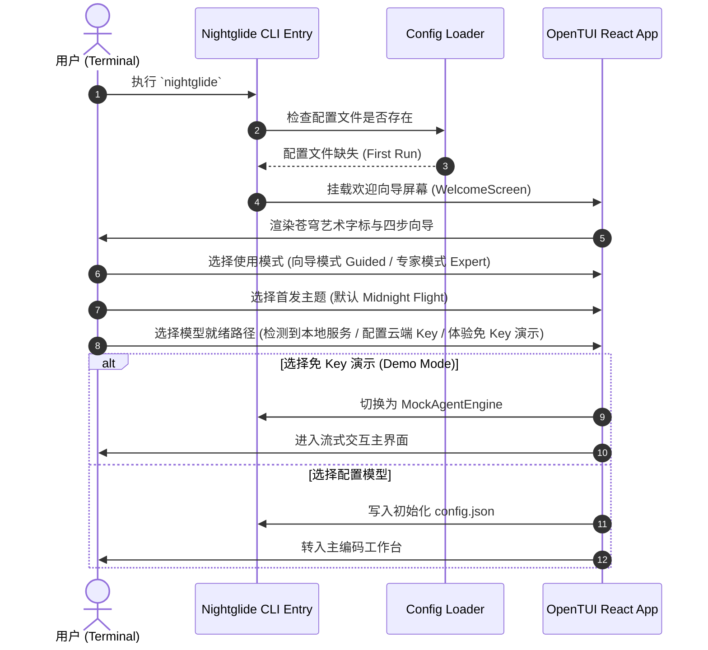
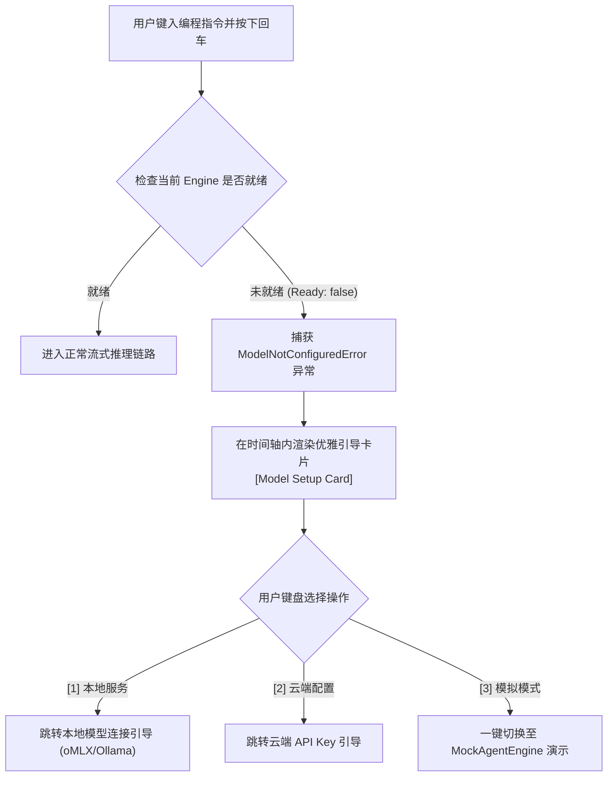
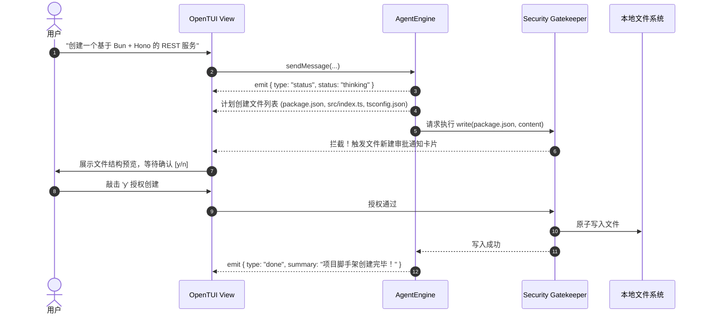

# Nightglide 交互与用户旅程规范 (UX FLOWS)

> **"Build beyond the horizon." / "漫翔苍穹，构筑所想。"**  
> *文档定位: 端到端人机交互与状态流转基准 | 包含 12 组核心交互流程*

---

## 目录索引

1. [流程 1: 首次启动向导 (First Launch Onboarding)](#流程-1-首次启动向导-first-launch-onboarding)
2. [流程 2: 未配置模型引导与优雅降级 (No Model Configured)](#流程-2-未配置模型引导与优雅降级-no-model-configured)
3. [流程 3: 本地推理模型快速配置 (Local Model Setup: oMLX / Ollama)](#流程-3-本地推理模型快速配置-local-model-setup)
4. [流程 4: 云端模型供应商配置 (Cloud Provider Setup)](#流程-4-云端模型供应商配置-cloud-provider-setup)
5. [流程 5: 打开已有项目代码库 (Open Project Inspection)](#流程-5-打开已有项目代码库-open-project-inspection)
6. [流程 6: 智能创建新项目 (New Project Scaffolding)](#流程-6-智能创建新项目-new-project-scaffolding)
7. [流程 7: 智能编程与流式生成任务 (Daily Coding Task Flow)](#流程-7-智能编程与流式生成任务-daily-coding-task-flow)
8. [流程 8: 代码变更对比审查 (Diff Preview & Approval)](#流程-8-代码变更对比审查-diff-preview--approval)
9. [流程 9: 敏感工具拦截与二次审批 (Permission Confirmation Gate)](#流程-9-敏感工具拦截与二次审批-permission-confirmation-gate)
10. [流程 10: 异常阻断与优雅恢复 (Error Recovery & Graceful Degradation)](#流程-10-异常阻断与优雅恢复-error-recovery--graceful-degradation)
11. [流程 11: 苍穹主题动态切换 (Dynamic Theme Switching)](#流程-11-苍穹主题动态切换-dynamic-theme-switching)
12. [流程 12: 双模态体验切换 (Guided vs. Expert Mode Flow)](#流程-12-双模态体验切换-guided-vs-expert-mode-flow)

---

### 流程 1: 首次启动向导 (First Launch Onboarding)

#### 1.1 场景与目标
用户在全局终端中首次键入 `nightglide`，此时本地尚未初始化配置文件 `~/.config/nightglide/config.json`。系统必须以极高的视觉美感吸引用户，完成基础个性化偏好设定，且绝不因为没有 API Key 而直接闪退报错。

#### 1.2 状态流转图 (Mermaid)



#### 1.3 终端界面原型示意 (ASCII Mockup)

```
┌─ ✈ NIGHTGLIDE ────────────────────────────────────────── 100x30 ─┐
│                                                                  │
│    _  _ _       _   _     _ _     _                              │
│   | \| (_)__ _ | |_| |_  | (_) __| |___                          │
│   | .` | / _` || ' \  _| | | |/ _` / -_)                         │
│   |_|\_|_\__, ||_||_\__| |_|_|\__,_\___|                         │
│          |___/  Build beyond the horizon.                        │
│                                                                  │
│   欢迎登机，开始您的苍穹编程之旅。                                    │
│   系统已为您准备好安全的沙箱环境。请选择您的首选使用偏好：                   │
│                                                                  │
│   [●] 1. 引导向导模式 (Guided)   - 详细指引、每步操作均有确认与解释        │
│   [ ] 2. 极速专家模式 (Expert)   - 紧凑布局、极简状态栏、高密度信息       │
│                                                                  │
│   初始主题选择:                                                   │
│   (●) Midnight Flight [深空]   ( ) Aurora [极光]                 │
│   ( ) Cloudlight [云光]        ( ) Daybreak [破晓]               │
│                                                                  │
│   ────────────────────────────────────────────────────────────   │
│   [ Enter 确认并继续 ]          [ d 立即体验免 Key 演示 ]   [ q 退出 ]   │
└──────────────────────────────────────────────────────────────────┘
```

---

### 流程 2: 未配置模型引导与优雅降级 (No Model Configured)

#### 2.1 场景与目标
当用户在既未设置环境变量、也未在配置文件中填入可用模型的情况下，直接尝试向 Nightglide 发起编程任务。传统 CLI 工具往往抛出刺眼的 `Error: 401 Unauthorized` 或未捕获异常并直接崩溃。Nightglide 必须捕获 `ModelNotConfiguredError`，并以卡片形式提供友好的配置解决路径。

#### 2.2 状态流转图 (Mermaid)



---

### 流程 3: 本地推理模型快速配置 (Local Model Setup)

#### 3.1 场景与目标
支持开发者一键连接机器本地端侧大模型（如 macOS oMLX 8000 端口，或通用 Ollama 11434 端口），保证数据 100% 不出机。

#### 3.2 交互步骤
1. 用户在设置页或通过指令输入 `/setup local`。
2. 系统后台异步发起两项轻量级 HTTP 探针请求：
   - 探针 A: `GET http://127.0.0.1:8000/v1/models` (oMLX 默认端口)
   - 探针 B: `GET http://127.0.0.1:11434/api/tags` (Ollama 默认端口)
3. 探测结果分析：
   - 若探针 A 连通但返回 401，界面提示：“检测到本地 oMLX 正在运行，但需要提供访问鉴权 Token。请输入鉴权值（支持免按键直接按回车跳过）：”
   - 若探针 B 连通且正常返回模型列表，界面以单选列表展示已有模型（如 `qwen2.5-coder:7b`, `deepseek-coder-v2`），用户按方向键选择。
4. 确认后，配置自动写入用户配置层 `config.json`，并立即触发健康自检。

---

### 流程 4: 云端模型供应商配置 (Cloud Provider Setup)

#### 4.1 场景与目标
指导用户安全配置主流公有云商模型（Anthropic Claude 3.5 Sonnet, OpenAI GPT-4o, DeepSeek 等）。

#### 4.2 安全保护准则
- 绝不在终端以明文回显用户正在输入的 API Key（采用字符掩码 `••••••••••••`）。
- 优先建议用户将其写入系统环境变量（如 `.zshrc` / `.bashrc` 中的 `export ANTHROPIC_API_KEY=...`）。
- 若用户选择由 Nightglide 本地持久化，则存储于系统密钥链或进行受限文件权限管理（`chmod 600`），并在配置中仅保留环境变量引用名。

---

### 流程 5: 打开已有项目代码库 (Open Project Inspection)

#### 5.1 场景与目标
用户在已有项目的目录中启动 Nightglide：`cd my-project && nightglide`。系统需在 200ms 内完成项目基本面盘点，且不执行任何破坏性写入。

#### 5.2 流程说明
1. **工作区根定位:** 向上递归查找 `.git`、`package.json`、`Cargo.toml` 或 `go.mod`，锁定项目根目录。
2. **只读元数据盘点:**
   - 提取当前 Git 分支名与变更状态（干净 / 有未暂存变更）。
   - 语言环境推断（TypeScript / Rust / Python 等）。
3. **安全边界限定:** 将智能体操作的虚拟根路径（`workspacePath`）强制绑定在当前项目目录下，任何试图逃逸到父级目录（如 `../../etc/passwd`）的工具调用将被底层沙箱硬性拦截。
4. **Header 状态刷新:** 导航头清晰显示：`Workspace: ~/my-project (branch: main*)`。

---

### 流程 6: 智能创建新项目 (New Project Scaffolding)

#### 6.1 场景与目标
在空目录中根据用户自然语言意图（例如：“帮我创建一个基于 Bun 和 Hono 的轻量级 REST API 项目”），生成完整的项目脚手架。

#### 6.2 交互时序 (Sequence Diagram)



---

### 流程 7: 智能编程与流式生成任务 (Daily Coding Task Flow)

#### 7.1 场景与目标
用户日常与 Nightglide 互动编码的主核心流程：提出问题、AI 检索分析、调用只读工具、流式生成代码及解释。

#### 7.2 交互界面多阶段视图

```
[阶段一: 用户提问]
User: "请帮我重构 packages/core/src/errors.ts，增加一个超时错误 TimeoutError"

[阶段二: 工具感知中 (只读工具卡片)]
┌─ ⚡ TOOL: read (只读探测) ──────────────────────────────────────────────┐
│  Target: packages/core/src/errors.ts                                  │
│  Status: Completed (耗时: 12ms) - 发现已有 5 个错误类继承体系               │
└───────────────────────────────────────────────────────────────────────┘

[阶段三: 流式输出代码变更]
Assistant: 我已读取 errors.ts。现在基于现有的 NightglideError 基础异常类，
为您新增一个 TimeoutError。它具有标准错误码 `TIMEOUT_ERROR`，并标记为可恢复：

```typescript
export class TimeoutError extends EngineError {
  readonly timeoutMs: number;
  constructor(timeoutMs: number, message = `Operation timed out after ${timeoutMs}ms`) {
    super(message, "TIMEOUT_ERROR", true);
    this.name = "TimeoutError";
    this.timeoutMs = timeoutMs;
  }
}
```
```

---

### 流程 8: 代码变更对比审查 (Diff Preview & Approval)

#### 8.1 场景与目标
当智能体生成代码后准备应用至文件系统时，Nightglide 弹出全屏或分栏语法 Diff 审查弹窗，绝不擅自静默覆盖。

#### 8.2 审查终端视图与按键操作

```
┌─ 🔍 DIFF PREVIEW: packages/core/src/errors.ts ────────────────────────┐
│ @@ -45,6 +45,16 @@ export class ConfigurationError extends Nightglide... │
│    }                                                                  │
│  }                                                                    │
│                                                                       │
│+ export class TimeoutError extends EngineError {                      │
│+   readonly timeoutMs: number;                                        │
│+   constructor(timeoutMs: number, message = `Timed out`) {            │
│+     super(message, "TIMEOUT_ERROR", true);                           │
│+     this.name = "TimeoutError";                                      │
│+     this.timeoutMs = timeoutMs;                                      │
│+   }                                                                  │
│+ }                                                                    │
│                                                                       │
│  export class SecurityPermissionError extends NightglideError {       │
│───────────────────────────────────────────────────────────────────────│
│ [y] 采纳写入 (Apply)   [n] 放弃 (Discard)   [e] 手动编辑 (Edit)   [Esc] 取消 │
└───────────────────────────────────────────────────────────────────────┘
```

- **按键响应逻辑:**
  - `y` / `Enter`: 确认落盘，执行原子文件写入，并在时间轴提示 `✔ 已更新 packages/core/src/errors.ts (+10 lines)`。
  - `n` / `Esc`: 放弃变更，临时暂存区清除，原文件毫发无损。

---

### 流程 9: 敏感工具拦截与二次审批 (Permission Confirmation Gate)

#### 9.1 场景与目标
智能体在解决某些排错任务时，可能推断需要执行终端命令（如 `bash: rm -rf dist && bun test`）。此类操作具有高破坏性潜能，必须经由底层看门狗挂起，并在界面显式警示。

#### 9.2 警示阻断卡片规范

```
┌─ ⚠ 敏感操作阻断 (HIGH RISK ACTION DETECTED) ──────────────────────────┐
│                                                                       │
│  智能体申请在您的终端环境中执行以下 Shell 命令：                           │
│                                                                       │
│  $ rm -rf node_modules/.cache && bun test                             │
│                                                                       │
│  工作目录: /Users/aoody743/Documents/Nightglide CLI                     │
│  风险提示: 此命令将删除本地缓存目录并启动子进程。                          │
│                                                                       │
│  请确认是否允许执行？                                                    │
│  [ y: 仅允许本次执行 ]     [ a: 本次会话全局允许 ]     [ n / Esc: 拒绝 ]   │
└───────────────────────────────────────────────────────────────────────┘
```

- **安全底线:** 若用户选择拒绝（`n`），系统向引擎返回标准错误响应 `{ error: "User rejected shell execution" }`，智能体接收反馈并尝试使用替代手段解决问题。

---

### 流程 10: 异常阻断与优雅恢复 (Error Recovery)

#### 10.1 场景与目标
网络中断、API 额度耗尽、超时或本地服务崩溃时，保证终端界面不挂起、不花屏，并给予用户即时恢复方案。

#### 10.2 典型异常恢复矩阵

| 触发异常 | 终端表现 | 恢复选项与按键快捷键 |
| :--- | :--- | :--- |
| **API 超时 (Timeout)** | 提示 “模型响应超时 (>30s)”。 | `[r] 自动重试` / `[c] 放弃重置` |
| **网络断开 (ECONNREFUSED)** | 提示 “无法连接至推理服务器，请确认本地服务已启动”。 | `[d] 运行 doctor 诊断` / `[m] 切换至模拟演示` |
| **语法解析错误 (Syntax Error)** | 提示 “模型产出的代码块存在语法错误”。 | 自动触发自愈提示词给模型进行下一轮纠正。 |
| **用户主动打断 (Ctrl+C)** | 立即停止流式追加，输出 “已由用户终止”。 | 重新聚焦输入框，光标立即可写。 |

---

### 流程 11: 苍穹主题动态切换 (Dynamic Theme Switching)

#### 11.1 场景与目标
用户在白天工作与深夜编码交替时，希望瞬间切换视觉环境。无需重启应用。

#### 11.2 快捷键与视觉响应
1. 用户在任意非输入编辑状态敲击快捷键 `t`，或在输入框中键入 `/theme`。
2. 屏幕底部弹出半透明主题切换浮层：
   `[1] Midnight Flight (深空)  [2] Aurora (极光)  [3] Cloudlight (云光)  [4] Daybreak (破晓)`
3. 敲击数字键 `2` 或上下箭头选择后回车。
4. **即时渲染管线:**
   `ThemeManager.setTheme("aurora")` 被调用，所有基于 `useTheme()` 钩子的组件在下一次微任务渲染中瞬间应用新色彩 Token。
5. 耗时小于 **15ms**，全过程无白屏闪烁。

---

### 流程 12: 双模态体验切换 (Guided vs. Expert Mode Flow)

#### 12.1 模式对比

```
                向导模式 (Guided Mode)                    专家模式 (Expert Mode)
        +-----------------------------------+     +-----------------------------------+
        | - 适合新手与初次使用者            |     | - 适合资深工程师与键盘流          |
        | - 完整的操作步骤文本说明          |     | - 单行紧凑状态栏                  |
        | - 显式按钮与确认弹窗              |     | - 最小化界面开销，最大化代码视野   |
        | - 工具调用详细参数展开            |     | - 仅展示工具执行摘要行            |
        | - 每步提示当前快捷键含义          |     | - 默认信任安全操作，极速流式      |
        +-----------------------------------+     +-----------------------------------+
```

#### 12.2 切换方式
- 快捷键: 在任意主界面敲击 `Tab` 键在 Guided 与 Expert 之间循环切换。
- 命令切换: 在 Composer 中输入 `/mode expert` 或 `/mode guided`。
- 状态栏右侧指示器即时显示当前模式：`[Mode: Guided]` 变更为 `[Mode: Expert]`。

---
*(本文档为 Nightglide 人机交互体验规范，所有 UI 组件行为与按键映射必须严格按照本规范执行)*
